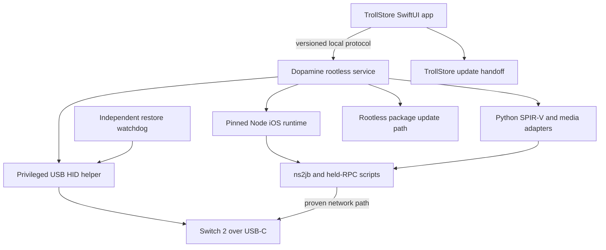
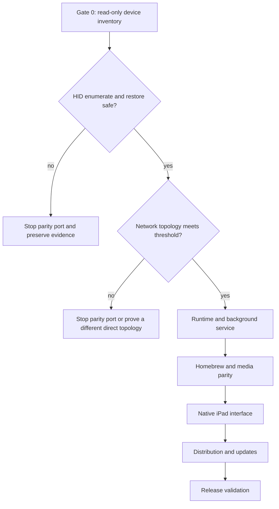
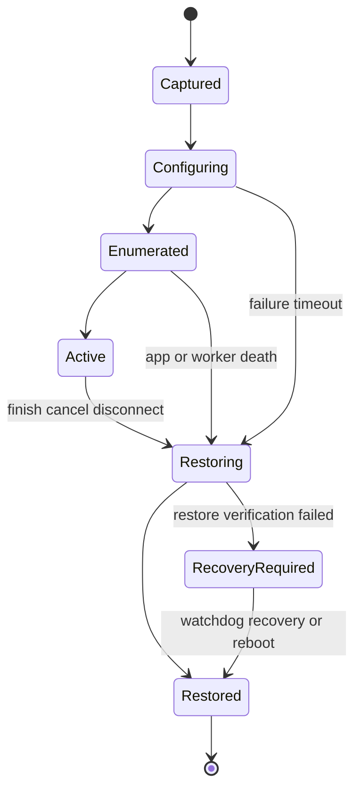

# M2 iPad Full Port Roadmap - Plan

> **Closed as a failed experiment, 2026-11-02.** Direct USB HID failed on the
> reference device through the tested userspace approach. No kernel candidate
> met the source eligibility requirements, so the remaining port work was not
> executed. This roadmap is retained for reference. See the
> [hardware verdict](../../ipad/hardware-matrix.md).

## Goal Capsule

- **Objective:** The jailbroken M2 iPad Pro 12.9-inch (6th generation), `iPad14,5` / `J620AP` / `T8112`, on iPadOS 17.0 can run the complete mac2jb workflow with no Mac present during normal use, including USB bootstrap entry, ns2jb hosting, held-RPC tools, every bundled homebrew app, recovery, updates, and diagnostics.
- **Means:** Deliver the port through six dependency-ordered child plans, beginning with destructive-risk hardware feasibility gates and ending with device-backed release qualification (KTD1–KTD8).
- **Authority:** Product Requirements and session-settled Key Decisions override technical choices; Key Technical Decisions govern implementation mechanisms; child plans refine only their assigned boundaries.
- **Execution profile:** Code implementation across iOS, jailbreak packaging, native helpers, JavaScript orchestration, SwiftUI, CI, and physical-device verification.
- **Stop conditions:** Do not begin the runtime/UI parity phases until the USB and network gates in R4–R7 pass. Stop the release path if direct USB HID, safe USB restoration, or a reliable Switch-to-iPad network topology cannot be demonstrated on the target hardware.
- **Ownership:** The implementing agent lands each child plan in dependency order, preserves the macOS build throughout, and ships only after the release-validation plan passes.

---

## Product Contract

### Summary

Port mac2jb from its current Apple-silicon Mac host model to the jailbroken M2 iPad Pro target (`iPad14,5` / `J620AP` / `T8112`) running iPadOS 17.0, Dopamine, and TrollStore. The result retains the current end-to-end user workflow while replacing macOS-only USB gadget, process, UI, runtime, updater, and packaging mechanisms with iPad-compatible equivalents.

### Problem Frame

The repository is an integrated macOS product rather than a portable command-line host. Its USB HID implementation depends on a macOS kext and `IOUSBDeviceFamily`; its app uses AppKit and `Foundation.Process`; its release embeds desktop Node, Python, SPIR-V Tools, and media executables. The M2 iPad has related Darwin and USB-device infrastructure, but private entitlement access and safe descriptor restoration must be proven on the exact iPadOS 17.0 target before the rest of the port is justified.

### Key Decisions

- **Direct iPad-to-Switch USB HID is a release requirement.** Host-only or manually typed bootstrap modes may support development but do not satisfy parity. Governs R4–R6. (session-settled: user-approved — chosen over a host-only port: the user confirmed the complete Mac-free workflow)
- **The port covers the entire shipped product.** GPUBrewLauncher, HBLauncher, IZLauncher, OunceCake, Stremio, developer tools, updates, recovery, and diagnostics are all in scope. Governs R11–R16. (session-settled: user-directed — chosen over an MVP subset: the user requested everything split into multiple plans)
- **Hardware uncertainty is handled with explicit gates.** Implementation proceeds in dependency order and stops when a release-defining target capability is disproved. Governs R4–R8. (session-settled: user-approved — chosen over building the full app before proving hardware: the target depends on private USB behavior)
- **The current macOS product remains supported.** The port introduces platform seams without redesigning or dropping the existing build. Governs R2, R17, R20. (session-settled: user-approved — chosen over an iPad-only rewrite: the fork already has a working Mac surface worth preserving)

### Requirements

**Target and compatibility**

- R1. The supported iPad target is the M2 iPad Pro 12.9-inch (6th generation), `iPad14,5` / `J620AP` / `T8112`, on iPadOS 17.0 with Dopamine and TrollStore installed.
- R2. The current Apple-silicon macOS build, release archive, and tested workflows must remain buildable and behaviorally compatible.
- R3. Normal iPad use must not require a Mac, remote host, SSH session, or developer computer after installation.

**Hardware and safety gates**

- R4. The iPad must enumerate to the Switch 2 as a USB HID keyboard and transmit neutralized boot-protocol reports through a direct USB-C cable.
- R5. USB configuration changes must preserve or transactionally restore the iPad's original USB functions after success, cancellation, process death, cable removal, daemon restart, and app crash.
- R6. The USB layer must discover the active controller and user-client classes at runtime instead of assuming the Mac controller list in `sender.c`.
- R7. The target must provide a repeatable IP path between the Switch and iPad with exploit success and latency comparable enough to the current wired workflow to pass the release metrics in the hardware plan.
- R8. Failure of R4, R5, or R7 on the target device blocks the parity release and records reproducible evidence rather than silently weakening the requirement.

**Runtime and background execution**

- R9. The iPad must run the pinned ns2jb host, profile selection, attachment, dump, held-session, keyboard, and command orchestration locally.
- R10. Session ownership, cleanup, crash recovery, and USB restoration must continue when the UI leaves the foreground or is terminated.
- R21. A root-service crash must fail closed: the independent watchdog restores USB, unverifiable child trees are terminated or quarantined, and the user restarts the Switch workflow unless the existing live-attachment proof succeeds.

**Feature parity**

- R11. First-time setup must type and save the full and demo bootstraps with the current timing controls, progress reporting, cancellation, and recovery guidance.
- R12. Standard jailbreak, host-only, RPC-already-held, held-RPC, live keyboard, controller selection, and timing workflows must have native iPad equivalents.
- R13. GPUBrewLauncher and HBLauncher must launch their bundled apps, including ftpd-sb, from an iPad-held session.
- R14. IZLauncher and File Exchange must run on iPadOS with their Python, Pillow, font, and SPIR-V validation dependencies replaced or ported.
- R15. OunceCake must preserve its current ownership, FTP, cleanup, and failure guarantees.
- R16. Stremio must support account/add-on selection and the current receiver/RPC protocol using iPad-compatible media probing, decode, frame, and audio paths.

**Distribution and quality**

- R17. The product must ship reproducible, integrity-checked iOS artifacts with pinned source/runtime provenance and retained third-party notices.
- R18. TrollStore installation and update must be supported for the app; Dopamine rootless installation and update must be supported for the background service package.
- R19. The UI must diagnose missing jailbreak state, missing service package, entitlement denial, controller failure, network mismatch, runtime corruption, and stale sessions without requiring shell access.
- R20. CI must retain current macOS checks and add cross-build, package-audit, simulator/host fixture, and physical-device acceptance coverage for the iPad target.

### Success Criteria

- On the target `iPad14,5` / iPadOS 17.0 device, 30 consecutive USB configure/enumerate/send/restore cycles complete without a stuck key, lost standard USB function after restoration, or reboot requirement.
- The selected network topology completes at least 20 full ns2jb attempts and meets the baseline-relative success threshold defined in the hardware plan.
- Each homebrew option completes one launch-and-cleanup acceptance run on both supported SmileBASIC editions where the upstream app supports that edition.
- A cold install using only published `.tipa` and rootless `.deb` artifacts reaches the first-time setup screen and passes self-diagnostics.
- The macOS release workflow remains green and its release audit reports no platform-regression omissions.

### Acceptance Examples

- AE1. **Covers R3, R4, R7, R9, R11.** Given a freshly jailbroken target iPad and a Switch 2 on the supported firmware, when the user follows first-time setup and jailbreak, then the iPad types the bootstrap, hosts ns2jb, and reaches 4/4 verification without a Mac.
- AE2. **Covers R5, R10, R19.** Given an active HID session, when the app is killed, then the daemon sends a neutral report, restores the captured USB configuration, records the recovery, and the relaunched app explains the outcome.
- AE3. **Covers R12, R14.** Given a verified held RPC session, when the user launches IZLauncher, then its shader validation and Python/Pillow pipeline run locally and File Exchange becomes available.
- AE4. **Covers R12, R16.** Given a Stremio account with a supported stream, when the user starts playback, then the iPad media pipeline supplies the existing Switch receiver while session controls remain responsive.
- AE5. **Covers R17, R18.** Given an installed prior release, when a compatible release is published, then the app verifies its manifest and hands the app update to TrollStore while the service package is updated through the rootless package path.
- AE6. **Covers R2, R20.** Given the port changes, when CI runs the existing macOS build and fixtures, then the current app, CLI helpers, archive, and release audit still pass.

### Scope Boundaries

**In scope**

- **Product goal (owner, 2026-10-31): every jailbroken or TrollStore-capable iPad and iPhone with USB-C.** Lightning devices are a stretch goal, contingent on HID function publication working over Lightning. The M2 iPad Pro 12.9-inch (6th generation), `iPad14,5` / `J620AP` / `T8112`, iPadOS 17.0, Dopamine rootless, TrollStore, is the **reference device**: every gate is proven there first. Other devices join through a per-device profile plus qualification (see the hardware plan's device-generalization unit). Also in scope: Switch 2 and the repository's currently supported SmileBASIC versions and host profiles.
- Native iPad UI and a local background service, with the current JavaScript orchestration reused behind platform adapters where practical.
- A physical-device lab procedure even when public CI cannot attach the target iPad and Switch.

**Non-goals considered and not built**

- Stock iPadOS support is excluded because R4, R9, and R10 require private entitlements, unsandboxed helpers, and a jailbreak service.
- Devices or iOS versions where no public jailbreak or TrollStore can grant `com.apple.private.usbdevice.setdescription` with `platform-application` to a root process are out of reach, not deferred. Each other in-reach USB-C device ships only after device-backed qualification on that model and iOS build.
- A remote-Mac fallback is excluded from the parity path because it would violate R3; it may remain a developer diagnostic outside the release workflow.
- App Store distribution is excluded because the required private entitlements and executable helper model are incompatible with that channel.

### Dependencies

- The dedicated `iPad14,5` target held on iPadOS 17.0 with working Dopamine and TrollStore.
- A Switch 2 and both supported SmileBASIC editions or access to representative full/demo test fixtures plus at least one physical edition for acceptance.
- A recoverable device backup and a safe reboot/re-jailbreak path before USB descriptor experiments.

---

## Planning Contract

### Key Technical Decisions

- KTD1. **Use a two-artifact iOS architecture.** A TrollStore `.tipa` contains only the SwiftUI app, UI-only frameworks/assets, protocol models, and release verification material. A Dopamine rootless `.deb` solely owns the service, independent watchdog, USB helper, Node/scripts/vendor trees, Python/Pillow, SPIR-V, media runtimes, and mutable service state. TrollStore preserves arbitrary entitlements but explicitly cannot spawn launch daemons, while Theos rootless packaging targets `/var/jb` and `iphoneos-arm64`.
- KTD2. **Keep privilege out of the UI process.** The app communicates with the service through a launchd-registered Mach service/XPC transport using only an exact service-name lookup entitlement; target-device tests must prove this sandbox crossing before protocol integration. Only the smallest USB/service executables receive `com.apple.private.usbdevice.setdescription`, IOKit user-client exceptions, no-sandbox/platform entitlements, or root execution rights.
- KTD3. **Reuse orchestration through a process boundary.** Preserve `scripts/gui-*.cjs`, `host-wrapper.cjs`, and the pinned vendor trees where device tests prove compatibility. Replace direct Swift `Process` ownership with a service protocol and isolate iOS-specific executable paths and platform identity.
- KTD4. **Run Node in interpreter mode first.** Pin a reproducible iOS arm64 Node build and start it with `--jitless`; TrollStore documents JIT-related entitlements as banned on A12+ without a PPL bypass, and a public Dopamine build demonstrates `child_process` with forkfix in this mode.
- KTD5. **Treat USB mutation as a single-writer transaction.** Discover a verified restore recipe for the current controller state, make the independently supervised watchdog/controller broker the sole writer, require a short mutation lease, add HID to a reconstructed clone when supported, and retain exclusive HID only for controlled experiments.
- KTD6. **Use gated phased delivery.** Child plan 1 proves the target hardware, plans 2–5 build on its recorded contracts, and plan 6 owns release qualification. A failed gate stops dependent work without redefining parity.
- KTD7. **Keep ordinary workloads unprivileged.** The service drops Node, ns2jb, Python, FFmpeg, and homebrew work to `mobile` with cleared groups, environment, and descriptors; only the minimal watchdog and USB helper keep root/private authority.
- KTD8. **Preserve the scripted build model with explicit source sets.** Separate shared, macOS, and iPad file lists and compile each against its SDK and target triple; add an Xcode project only if an implementation-time SDK/framework requirement cannot be met by the current script-first pattern.

### High-Level Technical Design

### Child Plan Sequence

Visual overview: `docs/plans/ipad-port/index.html`.

1. `docs/plans/ipad-port/01-hardware-feasibility.md` — prove USB HID, restoration, entitlements, power behavior, and network topology.
2. `docs/plans/ipad-port/02-runtime-services.md` — build the rootless service, protocol, process supervision, Node runtime, and shared platform seams.
3. `docs/plans/ipad-port/03-homebrew-parity.md` — define the runtime capability catalog, then port Python/Pillow, SPIR-V, launchers, OunceCake, and Stremio media dependencies.
4. `docs/plans/ipad-port/04-native-interface.md` — port AppKit/Process workflows to UIKit/SwiftUI and consume the stable runtime/homebrew/update contracts.
5. `docs/plans/ipad-port/05-distribution-updates.md` — build `.tipa`/`.deb` artifacts, signing, provenance, update handoffs, and release audit.
6. `docs/plans/ipad-port/06-release-validation.md` — add CI, hardware acceptance, regression coverage, runbooks, and release gates.

This is the normative whole-plan order. Runtime U2 owns the abstract update-status and compatibility protocol consumed by the UI; Distribution U1 later binds that protocol to concrete artifact identities and signed manifests. Homebrew therefore precedes Native, and Native has no dependency on an unfinished Distribution unit. Release-validation scaffolding may be prepared earlier, but the validation plan cannot complete or promote a release until plans 1–5 are done.

### Artifact Ownership

| Artifact | Owns | Behavior when counterpart is absent |
|---|---|---|
| TrollStore `.tipa` | SwiftUI app, UI-only frameworks/assets, protocol models, public release key/manifest | Diagnostics and installation guidance only |
| Dopamine rootless `.deb` | Service, watchdog/controller broker, USB helper, Node/scripts/vendor snapshots, Python/Pillow, SPIR-V, media runtimes, service state | No supported user workflow without the matching app |

The hardware plan first builds a disposable rootless probe package with the production watchdog/journal schema. The runtime and distribution plans adopt and migrate that implementation rather than creating a second controller writer.

### System-Wide Impact

- **Security boundary:** The port adds private entitlements, root execution, and a persistent daemon. Protocol authentication, filesystem ownership, and least-privilege splitting become release requirements.
- **Lifecycle:** Session and USB ownership move from the macOS UI process to a service that must reconcile app launches, jailbreak restarts, stale files, and device disconnects.
- **Build and release:** The repository gains iOS cross-compilation, dual install artifacts, new runtime pins, device-only gates, and platform-specific provenance while retaining macOS artifacts.
- **Performance:** Wi-Fi or another proven topology replaces the current two-device Ethernet assumption, and Stremio decoding must fit the iPad's thermal and memory envelope.

### Risks and Mitigations

| Risk | Consequence | Mitigation |
|---|---|---|
| The target USB controller denies descriptor configuration despite TrollStore entitlements | Direct HID parity is infeasible | Make the first implementation a read-only inventory and signed canary; stop before UI/runtime investment if the gate fails |
| A malformed or interrupted USB configuration removes standard device functions | USB access may remain broken until reboot | Snapshot first, use an independent watchdog, verify restoration, and require repeated fault-injection cycles |
| The single USB-C port prevents the current Ethernet topology | ns2jb becomes unreliable | Benchmark Wi-Fi against a wired baseline before committing; investigate a direct composite/network mode only if Wi-Fi misses the threshold |
| Node/fork behavior differs on the M2 iPadOS 17.0 target | Existing JS orchestration cannot launch children | Pin an iOS build, run a capability matrix early, and move incompatible subprocesses behind native service commands |
| Runtime dependencies inflate or fail to cross-build | IZLauncher/Stremio parity stalls | Prefer linked libraries and narrow native adapters over desktop CLI emulation where upstream iOS builds are library-only |
| Dual artifacts drift | App/service protocol mismatch or unsafe updates | Version the protocol, enforce a compatibility range, publish one signed manifest, and test mixed-version refusal/rollback |

### Sources and Research

- Repository baseline: `README.md`, `Makefile`, `sender.c`, `vendor/libusbd/src/plat/macos/impl.c`, `gui/SessionModel.swift`, `gui/Runtime.swift`, `scripts/build-gui.sh`, `.github/workflows/build.yml`, `upstream.lock`, and `packaging/homebrew-runtime.lock.json`.
- TrollStore support, entitlements, root helpers, limitations, and URL scheme: <https://github.com/opa334/TrollStore>.
- Dopamine rootless target and forkfix behavior: <https://github.com/opa334/Dopamine> and <https://github.com/opa334/Dopamine/blob/3.x/BaseBin/systemhook/src/main.c>.
- Rootless packaging paths and architecture: <https://theos.dev/docs/rootless> and <https://theos.dev/docs/packaging>.
- iOS USB-device configuration evidence: <https://www.synacktiv.com/publications/ios-a-journey-in-the-usb-networking-stack> and <https://github.com/apple-oss-distributions/IOKitUser/blob/main/usb_device.subproj/IOUSBDeviceControllerLib.h>.
- Existing Mac USB gadget safety warning: <https://github.com/shinyquagsire23/macos_usb_gadget_poc>.
- Jailbroken iOS Node precedent: <https://github.com/j0shua-SYSON/node-ios>.
- Python iOS embedding constraints: <https://docs.python.org/3.13/using/ios.html>.
- SPIR-V Tools iOS library-only behavior: <https://github.com/KhronosGroup/SPIRV-Tools/blob/main/CMakeLists.txt>.

---

## Implementation Units

### U1. Execute the hardware feasibility gate

- **Goal:** Establish whether the target device can safely satisfy the direct USB and network requirements.
- **Requirements:** R4–R8, R19
- **Dependencies:** None
- **Files:** `docs/plans/ipad-port/01-hardware-feasibility.md`, `ios/probes/`, `docs/ipad/hardware-matrix.md`
- **Approach:** Execute the hardware child plan in full, including its minimal rootless watchdog/probe package, and commit its machine-readable capability record and human-readable results before approving dependent units.
- **Execution note:** Start with read-only IOKit inventory; no descriptor mutation is allowed until the current configuration and recovery path are captured.
- **Status (2026-10-31):** Hardware child-plan U1 and U2 passed (automatic same-boot USB recovery; see `docs/ipad/hardware-matrix.md`). U3 (HID canary) is next, planned in `docs/plans/ipad-port/01-u3-hid-canary.md`.
- **Test scenarios:**
  - Covers AE1. Connect the target iPad directly to a USB descriptor host, configure HID, send a known text sequence, and verify exact reports plus restoration.
  - Covers AE2. Kill the app and worker at each USB lifecycle state and verify watchdog restoration or a clearly signaled recovery-required state.
  - Run the wired baseline and candidate iPad network topology across the prescribed exploit sample and compare success, jitter, and failure modes.
- **Verification:** The child plan's three release gates have signed device evidence and no unresolved restore failure.

### U2. Build the iOS runtime and background service

- **Goal:** Provide a durable local execution substrate for existing orchestration and privileged helpers.
- **Requirements:** R1–R3, R9, R10, R19
- **Dependencies:** U1
- **Files:** `docs/plans/ipad-port/02-runtime-services.md`, `ios/service/`, `ios/shared/`, `scripts/`
- **Approach:** Execute the runtime-services child plan, using KTD1–KTD4 and the hardware contracts emitted by U1.
- **Test scenarios:**
  - Start, cancel, crash, and reconnect host/HID processes through the local protocol while preserving JSON-line semantics.
  - Restart the UI during a held session and verify service-owned state is reconciled without duplicating the host.
  - Crash the root service and verify R21: children cannot retain privileged descriptors or orphan ports, USB restores, and only the existing verified-attachment path can reconnect.
  - Refuse an incompatible UI/service protocol version with actionable diagnostics and no privileged action.
- **Verification:** The service passes its capability matrix and can run a fixture ns2jb lifecycle without AppKit or `Foundation.Process`.

### U3. Restore all homebrew and media capabilities

- **Goal:** Make every bundled homebrew option function through the iOS runtime.
- **Requirements:** R13–R16, R17
- **Dependencies:** U2
- **Files:** `docs/plans/ipad-port/03-homebrew-parity.md`, `scripts/`, `stremio/`, `vendor/`, `packaging/`
- **Approach:** Execute the homebrew child plan, replacing desktop executable assumptions with pinned iOS libraries or service adapters while preserving launcher/session protocols.
- **Test scenarios:**
  - Covers AE3. Launch IZLauncher and exercise File Exchange with iOS Python/Pillow and SPIR-V validation.
  - Launch GPUBrewLauncher, HBLauncher, ftpd-sb, and OunceCake and verify cleanup/ownership boundaries.
  - Covers AE4. Run Stremio sample and account fixtures through the iOS media pipeline, then complete an on-device stream.
- **Verification:** The parity matrix has a passing fixture and physical-device result for every bundled app.

### U4. Deliver the native iPad workflow

- **Goal:** Give all existing setup, jailbreak, developer, keyboard, recovery, and diagnostic workflows a native iPad surface.
- **Requirements:** R11, R12, R19
- **Dependencies:** U2, U3
- **Files:** `docs/plans/ipad-port/04-native-interface.md`, `gui/`, `ios/app/`
- **Approach:** Execute the interface child plan against the stable runtime/homebrew contracts, sharing portable state models with macOS while using UIKit for platform-specific capture and pickers. Consume the abstract update contract from Runtime U2; do not depend on Distribution implementation details.
- **Test scenarios:**
  - Covers AE1. Complete first-time full and demo setup through the iPad UI, including cancellation and retry.
  - Exercise host-only, held RPC, attach, dump, and live keyboard modes with background/foreground transitions.
  - Present actionable states for every R19 diagnostic category.
- **Verification:** Every current user-visible macOS workflow has an iPad acceptance path and the macOS Swift fixtures remain green.

### U5. Package, sign, update, and audit both artifacts

- **Goal:** Produce installable, updatable, integrity-checked `.tipa` and rootless `.deb` releases.
- **Requirements:** R17–R19
- **Dependencies:** U2, U3, U4
- **Files:** `docs/plans/ipad-port/05-distribution-updates.md`, `packaging/`, `scripts/`, `.github/workflows/`
- **Approach:** Execute the distribution child plan with one compatibility manifest and separate channel-specific installers.
- **Test scenarios:**
  - Covers AE5. Verify a valid update, reject checksum/signature/version mismatches, and retain a usable installed version.
  - Install on a clean jailbreak root, reboot/re-jailbreak, and verify app/service discovery and ownership.
  - Audit every executable, entitlement, license, source pin, and runtime asset in both artifacts.
- **Verification:** Fresh install, upgrade, downgrade refusal, partial-update recovery, and uninstall tests all pass.

### U6. Qualify the release and preserve macOS

- **Goal:** Turn the port into a repeatable, documented release rather than a one-device proof of concept.
- **Requirements:** R2, R4–R8, R11–R21
- **Dependencies:** U1–U5
- **Files:** `docs/plans/ipad-port/06-release-validation.md`, `.github/workflows/`, `scripts/test-*`, `docs/ipad/`, `README.md`
- **Approach:** Execute the release-validation child plan, including CI, physical hardware runs, fault injection, performance thresholds, documentation, and release audit.
- **Test scenarios:**
  - Covers AE6. Run the complete existing macOS workflow after all shared-code changes.
  - Run the full iPad acceptance matrix from clean installation through every homebrew app and teardown.
  - Interrupt power, network, cable, app, daemon, and update operations and verify bounded recovery.
- **Verification:** Every Definition of Done item below is backed by a CI result, package audit, or recorded target-device run.

---

## Verification Contract

| Gate | Applicability | Proof |
|---|---|---|
| Existing repository checks | Every unit touching shared/macOS code | `bash scripts/check.sh`, existing Node/Swift fixture suites, `make`, `make gui`, and macOS release audit remain green |
| iOS cross-build | U1–U5 | Every arm64 iOS binary links against iOS frameworks only, has expected deployment target/entitlements, and passes Mach-O/package inspection |
| Service protocol fixtures | U2–U5 | Host-side tests cover framing, authentication, cancellation, reconnection, incompatibility, and stale ownership |
| Runtime self-test | U2, U3, U5 | Packaged Node, Python/Pillow, SPIR-V, FFmpeg/media adapters, CA roots, fonts, and vendor snapshots pass offline checks |
| Simulator/native state tests | U4 | Portable Swift models and iPad UI state transitions pass without private hardware APIs |
| Target device hardware gate | U1, U6 | Signed results identify device/OS/jailbreak builds and demonstrate USB, restore, network, and fault-injection metrics |
| Switch acceptance | U1, U3, U4, U6 | Both setup editions and every applicable homebrew workflow complete on physical hardware |
| Release audit | U5, U6 | `.tipa`, `.deb`, checksums, manifests, entitlements, provenance, licenses, and source archive are mutually consistent |

---

## Definition of Done

- All six child plans are implemented in dependency order and their verification contracts pass.
- R1–R21 are demonstrated by tests or target-device evidence, with no parity requirement replaced by a manual or remote workaround.
- The target iPad can complete AE1–AE5 after a clean install without a Mac present.
- Existing macOS build, fixture, archive, and update validation pass per AE6.
- USB restoration survives the complete fault matrix and leaves no repeated-key condition.
- The published app/service compatibility manifest prevents unsafe mixed versions.
- User documentation covers installation, jailbreak/re-jailbreak behavior, network topology, first-time setup, every homebrew app, updates, diagnostics, recovery, and uninstall.
- Release artifacts contain pinned provenance, checksums, entitlements, licenses, and reproducible build instructions.
- Experimental branches, abandoned USB approaches, temporary entitlements, device dumps, credentials, and test media are removed from the release diff.
