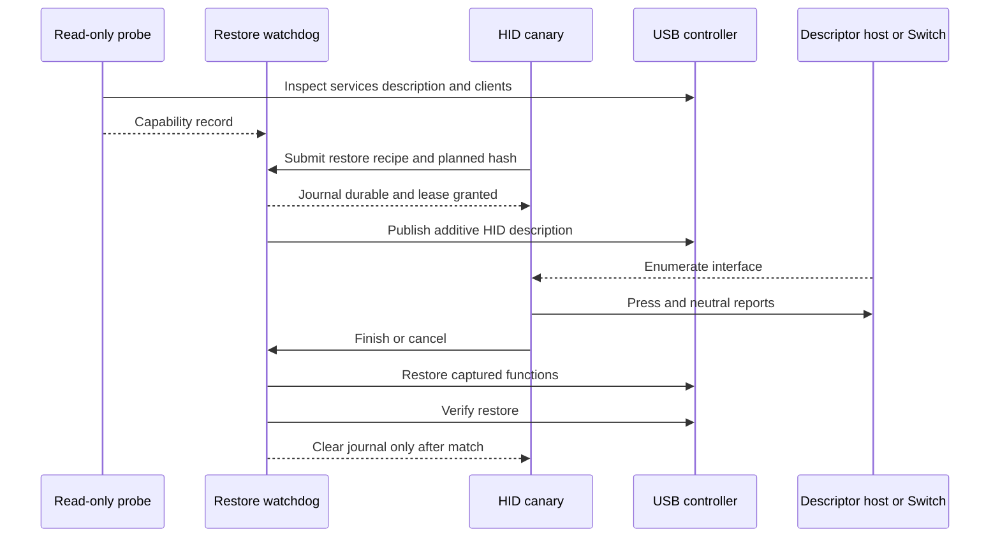
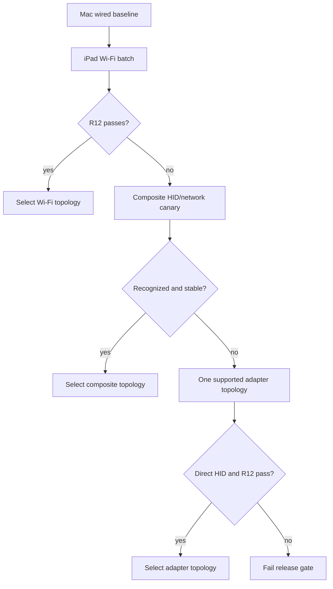

# iPad Hardware Feasibility Gates - Plan

**U2 failure analysis:** See [the focused v1–v5 comparison](../../ipad/u2-usb-recovery-failure-analysis.md). V3 and v4 held stock starting state, explicit bus cycle, and normal worker timing while changing the description constructor; only the controller clone in v4 recovered external functions. The read-only defaults-versus-clone probe found equal interface lists and visible info after in-memory patching, leaving opaque object behavior unproven. V5 changed both worker timing and starting controller state; its cause remains unisolated. No new controller trial is authorized by the current evidence.

**U2 stage cleanup update, 2026-10-30:** After the failed v5 journal was backed up and archived, exact v4/v5 trial binaries/plists and their stale socket were removed. Read-only verification passed all four archived journals, active journal absent, all jobs absent, base publication-disabled package retained, and full external USB/NCM/pairing/power equality. This prevents enabled trial plists from auto-loading after another reboot. No new controller trial ran; U2 remains open because v5 worker-death restoration failed and its timing/opaque-state causes are not yet isolated.

**U2 v5 archive update, 2026-10-30:** New-boot recovery passed full external USB/NCM/pairing/power checks. The exact failed v5 journal was backed up privately on the Mac and archived byte-for-byte under a distinct old-boot name on the iPad; its active name is absent. The exact v4, v5, and publication-disabled original jobs were booted out, and a second full external check passed. The worker-death trial still failed in-trial restoration. The timing flaw and 17-field starting-state difference remain confounded, so U2 is open and another controller trial remains stopped.

**U2 recovery update, 2026-10-30:** After the failed v5 worker-death trial, read-only checks passed on a new kernel boot with original live description, five externally equivalent USB configurations, NCM packet flow, USBMux/pairing, charging/full power, and the exact failed journal retained. This proves reboot recovery only; no journal archive or new controller trial has run. Source inspection found that worker loss starts restore without waiting for the first bus enumeration, but the failed v5 trial also started from a 17-field post-v4 description. The cause remains unisolated and U2 remains open.

**Latest U2 status, 2026-10-30:** The v4 normal no-op trial demonstrated same-boot external USB/NCM function recovery and an accepted receipt. A separate v5 service then normalized the known replacement marker in memory and passed a twice-matched current-boot reference and native dry run. Its `worker-kill` fault trial **failed external recovery**: the journal remains `awaitingVerification`, Mac USB data is absent, and the controller is off bus while Wi-Fi SSH and charging work. No proof or further controller call followed. Preserve the active journal, service, all archives, and private evidence per `docs/ipad/usb-recovery.md` and `docs/ipad/device-cleanup-ledger.md`; owner-assisted restart/re-jailbreak and new-boot verification are needed before archival. The timing difference from v4 normal and the prior 17-field controller state have not been isolated. U2 is **not cleared**, and U3 remains blocked. The execution status paragraph below is historical.

**Execution status, 2026-10-30:** U1 read-only gates passed. Three earlier U2 no-op designs failed external recovery; owner-assisted restarts recovered them and their journals are archived. A distinct signed v4 controller-clone service passed its native in-memory check, then **one normal no-op trial restored USB/NCM externally during the trial** and passed same-boot Mac descriptor/function, pairing, NCM packet, and power verification. Its external receipt cleared the journal. The live description still has an extra `AllowMultipleCreates` field and 14 renumbered string indexes, though resolved strings and external functions match. The v4 runner refuses a repeat from that 17-field state. Worker/watchdog fault trials and exact live-description restoration remain open; U2 and dependent HID work are blocked. Exact evidence and cleanup conditions are in `docs/ipad/target-device-findings.md`, `docs/ipad/usb-recovery.md`, and `docs/ipad/device-cleanup-ledger.md`. Older dated checkpoints below are historical.

## Goal Capsule

- **Objective:** Prove on the exact M2 iPad Pro target (`iPad14,5` / `J620AP` / `T8112`) running iPadOS 17.0 that direct USB HID is safe and that a reliable Switch-to-iPad IP path exists before the broader port proceeds.
- **Means:** Build read-only inventory tools first, then an independently recoverable HID canary, then a network baseline and topology bakeoff (KTD1–KTD5).
- **Authority:** The roadmap's R4–R8 are release gates; this plan may select implementation details but may not weaken them.
- **Stop conditions:** Stop descriptor work on any unrecoverable USB-function loss. Stop dependent port plans if HID enumeration/restoration or network success thresholds fail after the bounded alternatives here.

---

## Product Contract

### Summary

Create the smallest possible on-device probes needed to prove the target's USB-device controller, required entitlements, HID endpoints, restoration behavior, cable/power direction, and network topology. Produce versioned capability evidence that later plans consume instead of repeating private-API discovery.

### Problem Frame

The current USB backend targets macOS, depends on `usbgadget.kext`, and assumes `usb-drd*` controllers plus `IOUSBDeviceInterfaceUserClient`. Source inspection shows that the kext is not a HID function driver: it attaches to `IOUSBDeviceController` and forwards `SetDeviceConfiguration` from a kernel thread. In the demonstrated macOS path, controller publication creates a named generic `IOUSBDeviceInterface`; userspace then supplies its HID class tuple, descriptors, interrupt endpoint, and reports. Upstream describes the forwarding shim as an entitlement bypass, but equivalent authorized publication and arbitrary-name materialization remain to be proven on iPadOS.

The evidence therefore supports a **credible implementation path, not proof of iPad HID**. iOS 17 still constructs stock device-mode configurations in `configd`, sends them to `IOUSBDeviceController`, and exposes their named functions through `IOUSBDeviceInterface` services. Historical iOS code publishes a description, opens a stock named interface, and changes its class/subclass/protocol. Current iOS-derived code demonstrates entitled live-description replacement and re-enumeration, while TrollStore 17.0 preserves arbitrary non-banned entitlements. The remaining unknowns include arbitrary-name materialization, the exact generic-interface ABI/authorization, endpoint creation on this controller, USB-C role negotiation with the Switch, and physical host acceptance. Those require the exact-device canary; public sources cannot honestly substitute for it.

| Evidence level | What is supported | What is not established |
|---|---|---|
| Current iOS 17 research | Device mode, `IOUSBDeviceController`, stock named function materialization, and the `IOUSBDeviceInterfaceUserClient` family remain present | Arbitrary generated functions plus the exact target’s selector compatibility and endpoint-operation authorization |
| Historical iOS source | iOS can publish a description, open a named generic interface, and set its class/subclass/protocol | Modern endpoint creation, HID control handling, and restoration behavior |
| ARM64 Mac proof of concept | Apple’s generic device-interface stack can create an arbitrary named function; userspace can turn it into a working HID keyboard | Physical-iPad controller access, USB-C role behavior, or Switch compatibility |
| TrollStore/Dopamine boundary | iPadOS 17.0 can preserve `com.apple.private.usbdevice.setdescription`, IOKit exceptions, and other non-banned entitlements; a rootless package can host the broker | That the kernel accepts each entitlement and operation on the exact build |

### Requirements

**Inventory and authorization**

- R1. A read-only probe must bind evidence to the exact `iPad14,5` / `J620AP` / `T8112` target tuple—`ProductType`, board identifier, SoC, Thunderbolt/USB 4 port family, iPadOS build, Dopamine build, TrollStore build, cable/capture-host identity—plus USB controller services, active controller, device-tree `configuration-string`, stock configuration source/digest, active function services, reconstructable restore inputs, user-client classes, and relevant entitlements without changing USB state.
- R2. The signed probe must resolve private controller APIs at runtime and distinguish missing symbol/ABI, missing entitlement, missing service, user-client denial, controller-role mismatch, and unsupported operation outcomes. It must record the raw operation and `IOReturn` at every boundary instead of trusting the current backend's suppressed return values.
- R3. Before any description mutation, a direct-cable role/power test must prove that the exact iPad/cable/host combination enters USB peripheral/device role, exposes the selected device-mode controller, and has an acceptable VBUS/charging state. Test both USB-C orientations and a known-good data cable; success while connected to a Mac does not substitute for the Switch-side role test.

**USB HID and restoration**

- R4. A canary must present a standards-compliant boot keyboard with one interrupt-IN endpoint and emit bounded eight-byte reports.
- R5. Before custom HID, the probe package must capture both the live and default controller descriptions when the runtime APIs permit, canonicalize their functions and scalar descriptors, prove a no-op republish round trip, and externally compare descriptors and stock functions. If live readback is unavailable, it may reconstruct from the exact build's configuration plist, device tree, and registry only after external equivalence passes. The first HID attempt appends HID to that recipe, with exclusive HID allowed only as a recorded fallback.
- R6. Every mutation must persist and fsync a checksummed restore recipe before publishing the new configuration.
- R7. A separately supervised watchdog/controller broker must be the sole controller writer and restore the recipe on timeout, crash, cancellation, disconnect, invalid state, service update, or service death.
- R8. The canary must hold a short watchdog-issued mutation lease, send a neutral report on every controlled exit, and leave journal deletion solely to the watchdog after external restore verification.
- R9. The function-publication gate passes only if appending a unique function name produces the matching generic `IOUSBDeviceInterface`, its user client opens with the least privilege required, and the class/descriptor/pipe operations needed for HID succeed on the exact device. A successful controller description call without that usable function path is a failure. `IOHIDUserDevice` is explicitly out of scope because it creates a local virtual HID device, not a USB peripheral function.
- R10. The HID gate must capture descriptors and relevant HID control requests on a generic host before the Switch test. It must propagate every publication, interface-open, descriptor, endpoint, buffer, and commit error; a successful neutral write alone is not proof of enumeration or standards compliance.

**Network and decision evidence**

- R11. The test harness must measure wired Mac baseline and iPad candidate topology latency, jitter, loss, bind behavior, and full ns2jb outcomes under the same Switch conditions.
- R12. Wi-Fi passes when its full-attempt success rate is no worse than 10 percentage points below the wired baseline, with a minimum of 20 attempts per topology and no new repeatable failure mode attributable to transport.
- R13. If Wi-Fi fails R12, test at most two direct-cable alternatives: a composite HID/network configuration recognized by the Switch, then a documented supported adapter topology that preserves direct iPad HID.
- R14. The final report must declare each gate pass/fail/inconclusive and include raw, redactable evidence sufficient to reproduce the decision.
- R15. The canonical capability record must be signed locally by the probe package, bind its enrolled public-key fingerprint and schema version, and fail validation after any edit or when imported for a different target tuple.

### Acceptance Examples

- AE1. **Covers R1–R3.** Given an unsigned or under-entitled probe, when it observes controller arrival and attempts a read-only open, then it changes no state and reports the exact role, symbol, service, entitlement, or user-client boundary that failed.
- AE2. **Covers R4–R10.** Given the entitled canary and a USB descriptor host, when it configures, types `MAC2JB`, and exits, then the host receives correct press/release reports and the original USB description is restored.
- AE3. **Covers R6–R8.** Given an active canary, when its process is killed before cleanup, then the watchdog restores the journaled description and retains evidence until verification succeeds.
- AE4. **Covers R11–R13.** Given identical Switch and host-profile conditions, when wired and Wi-Fi batches run, then the report selects Wi-Fi only if R12 passes; otherwise it records the bounded fallback results.

### Scope Boundaries

- The canary does not type a real bootstrap until descriptor restoration has passed on a generic USB host and then the Switch keyboard screen.
- This plan does not build the production UI, Node runtime, or homebrew features.
- Kernel patching and system-process injection are not added: TrollStore documents that it cannot provide the latter, and the target should first use preserved entitlements plus the jailbreak service boundary.
- Support for other iPads, OS versions, hubs, or general adapter configurations is deferred until the exact target passes; the single adapter topology permitted by R13 is only a bounded release-gate fallback.
- A Mac relay, Bluetooth keyboard emulation, or separate USB microcontroller does not satisfy this plan's direct-iPad HID gate. If the bounded direct path fails, record the stop decision rather than silently changing the product requirement.

---

## Planning Contract

### Key Technical Decisions

- KTD1. **Separate observation from mutation.** `mac2jb-ios-probe` is read-only and safe to run before any recovery mechanism; `mac2jb-usbd-canary` is a separate entitled executable.
- KTD2. **Prefer controller readback, then reconstruct.** Probe `IOUSBDeviceDescriptionCreateFromController`, `IOUSBDeviceDescriptionCreateFromDefaultsAndController`, related copy/serialization functions, and their CF types through runtime symbol resolution on the target. Journal canonical live/default manifests plus controller/source identity, hashes, boot session, and state. Fall back to build-pinned plist/device-tree/registry reconstruction only when readback is unavailable and external equivalence is demonstrated.
- KTD3. **Prefer additive HID after a no-op round trip.** Reconstruct current functions, prove external descriptor/function equivalence, then append the generic interface. The upstream Mac POC warns that replacement can break network sharing until reboot.
- KTD4. **Make restoration independently live and single-writer.** The hardware phase ships a minimal rootless probe package with a separately supervised watchdog/controller broker. It alone opens the controller for writes, owns journal creation/deletion, and survives the canary/main-service lifecycle.
- KTD5. **Decide networking with exploit outcomes.** RTT alone is diagnostic; the pass/fail metric is the paired full-attempt success batch in R12.
- KTD6. **Test the generic function path before HID semantics.** The macOS kext forwards controller configuration from kernel context; it does not implement HID or a function driver. On that stack, the backend appends an arbitrary name, waits for a generic `IOUSBDeviceInterface`, opens its user client, and configures class, descriptors, pipes, and reports from userspace. Reproduce both materialization and configuration on the iPad one operation at a time, and stop if the generic service, open, or endpoint path differs.
- KTD7. **Do not copy a private ABI blindly.** Load private symbols dynamically, verify CF type IDs and signatures through harmless calls, and build an exact-device operation matrix. Historical vtable offsets, user-client type `123`, `PublishConfiguration`, `Poke`, random `USBDeviceFunction` names, and hard-coded `usb-drd*` order are observations to test, not iPad constants.
- KTD8. **Reuse HID semantics, replace the transport.** Reuse the corrected 9-byte HID descriptor, 65-byte report descriptor, boot-keyboard tuple, bounded eight-byte validation, no-replay rule, and three neutral attempts as fixtures. Isolate the macOS `libusbd` backend, its destructive `RemoveAllConfigurations` behavior, ignored errors, `0xA0/255` power declaration, absent VID, and SmileBASIC-specific case encoding.
- KTD9. **Republishing is an explicit state transition.** A recent iOS-derived implementation reads the controller's current description, marks its info dictionary with `AllowMultipleCreates`, calls `SetDescription`, and performs an off/on-bus cycle. Treat that as a candidate sequence to validate on the target; never omit the flag or re-enumeration merely because an API returned success.

### High-Level Technical Design





### Output Structure

```text
ios/
  entitlements/
  probes/
  usb/
  watchdog/
packaging/ios/
  probe-rootless/
scripts/
  ipad-hardware/
docs/ipad/
  hardware-matrix.md
  usb-recovery.md
```

### Risks and Mitigations

- An iPad USB misconfiguration can remove usbmux/network functions until reboot. Require a backup, verified reboot path, additive-first configuration, watchdog, and one mutation per reviewed step.
- The service entitlement names may differ from Mac evidence. Record actual registry classes and open failures before editing entitlements; do not grant broad wildcard exceptions.
- Possessing `com.apple.private.usbdevice.setdescription` may still leave the controller or function user client inaccessible. Use a staged entitlement matrix and stop at the first failing authorization layer instead of weakening AMFI or injecting into a system process.
- The iPad can be USB host or peripheral, and controller behavior remains ProductType-specific. Bind evidence to `iPad14,5`, the exact cable, orientation, peer, controller ancestry, and observed data/power roles.
- Existing iOS configurations are named driver compositions and some extended modes cannot coexist. Treat composite HID plus NCM as a separate experiment after Wi-Fi failure, not a descriptor-only assumption.
- ns2jb has inherent variability. Use paired batches under controlled conditions and preserve attempt-level outcomes instead of declaring success from one run.

### Sources and Research

- **Focused feasibility note:** [`research/usb-hid-ipad-feasibility.md`](research/usb-hid-ipad-feasibility.md). It traces the controller, entitlement, generic-interface, endpoint, and physical proof boundaries and defines the exact-device evidence needed to close the claim.
- **Repository evidence:** `sender.c`, `keyboard.c`, `commands.c`, `vendor/libusbd/src/plat/macos/impl.c`, `vendor/macos_usb_gadget_poc/`, `scripts/test-keyboard.cjs`, and `scripts/test-usb-controller-ownership.sh`. The kext matches only `IOUSBDeviceController` and forwards `SetDeviceConfiguration`; it does not implement HID. The userspace backend appends an arbitrary function name, finds the resulting generic `IOUSBDeviceInterface`, sets HID descriptors, creates the interrupt pipe, and writes reports. It still destructively removes stock configurations, suppresses several errors, and does not restore them.
- **Apple-derived device-mode API header:** <https://github.com/nabla-c0d3/iphone-dataprotection/blob/master/ramdisk_tools/IOUSBDeviceControllerLib.h>. It documents controller arrival/off-bus operations plus live/default description creation; treat it as historical API evidence, not an iPadOS 17 ABI contract.
- **Historical iOS use:** <https://github.com/nabla-c0d3/iphone-dataprotection/blob/master/ramdisk_tools/restored_external.c>. It publishes an iOS USB description, matches `IOUSBDeviceInterface` by `USBDeviceFunction`, and configures the private interface; it does not prove modern iPad HID or restoration.
- **Current iOS stack research:** <https://www.synacktiv.com/publications/ios-a-journey-in-the-usb-networking-stack>. It traces `USBDeviceConfiguration.plist`, `USBDeviceConfiguration.bundle`, `IOUSBDeviceDescriptionCreateFromDefaultsAndController`, named driver binding, and iOS 17 NCM/RemoteXPC behavior.
- **Recent iOS-derived read/republish example:** <https://github.com/Lakr233/vphone-cli/blob/main/VPhoneDaemon/Native/vphoned_usb.m>. It dynamically resolves the private API, reads the controller description, sets `AllowMultipleCreates`, republishes it, and cycles the bus in a virtual iPhone guest; this is current adjacent evidence, not physical-iPad proof.
- **Adjacent ARM64 HID proof:** <https://github.com/shinyquagsire23/macos_usb_gadget_poc>. It implements a macOS HID keyboard with the related stack, identifies `com.apple.private.usbdevice.setdescription`, and warns about losing network functions until reboot or additive reconstruction.
- **Target signing boundary:** <https://github.com/opa334/TrollStore>. It lists iOS 17.0 support and preservation of arbitrary entitlements, subject to platform restrictions and exact IOKit access.
- **Entitlement continuity:** <https://newosxbook.com/ent.php?exec=configd&osVer=iOS18>. Current `configd` still carries `com.apple.private.usbdevice.setdescription`; this corroborates continued controller authorization but does not replace an iPadOS 17.0 signed probe.
- **Adjacent-family device-tree clue:** <https://gist.github.com/zhuowei/bb8a56aaeab47af6e1fb826b8ca14168>. An extracted M1 iPad13,4/T8103 tree contains `usb-drd0`, high- and SuperSpeed port nodes, and `stdMuxPTPEthValIDA`; use it only to seed live discovery because it is neither the target SoC nor the target iPadOS 17 build.
- **Exact-model port specification:** Apple identifies the 12.9-inch iPad Pro (6th generation) as an M2 model with a Thunderbolt/USB 4 port: <https://support.apple.com/en-us/111841>.
- **Dual-role/power behavior:** <https://support.apple.com/en-ie/108894>. Apple documents iPad as a computer-connected device, accessory host, power source, and power sink, including connection-order-sensitive charging between USB-C iPads; the Switch data role still requires direct measurement.

---

## Implementation Units

### U1. Add the read-only target inventory

- **Goal:** Discover the exact USB services and authorization failures without mutating device state.
- **Requirements:** R1–R3, R14
- **Dependencies:** None
- **Files:** `ios/probes/`, `ios/entitlements/probe.plist`, `docs/plans/ipad-port/scripts/ipad-hardware/collect-inventory.sh`, `docs/ipad/hardware-matrix.md`, `ios/tests/ProbeResultTests.swift`
- **Approach:** Record the exact target tuple; enumerate controller ancestry, stock function services, device-tree configuration, and configuration-plist digest; dynamically resolve candidate controller/description APIs; and serialize a redacted JSON capability record. Use separate minimally entitled probe builds to classify symbol, service, controller-open, function-open, and entitlement outcomes. Observe controller arrival while directly attached to a capture host and the Switch with both cable orientations, but validate that no set-description, command, off-bus, or registry-write path is reachable from this binary.
- **Test scenarios:**
  - Run without private entitlements and identify the first denied open while producing a valid report.
  - Run with `com.apple.private.usbdevice.setdescription` and exact candidate IOKit user-client exceptions in separate signed builds; record each successfully opened class without a write call.
  - Record controller arrival/absence, ancestry, VBUS/charging indication, and peer identity for a Mac capture host and the Switch, in both USB-C orientations.
  - Resolve `CreateFromController`, `CreateFromDefaultsAndController`, `SetDescription`, `SendCommand`, `GoOffAndOnBus`, and related copy functions with `dlopen`/`dlsym`; verify CF type IDs through read-only calls and report missing/incompatible symbols without dereferencing guessed vtables.
  - Redact serials, UDIDs, MACs, and filesystem roots from a shareable report while retaining hashes and versions.
- **Verification:** Two consecutive probes produce equivalent target/controller/function topology, the peer-role matrix is complete, and an external capture shows no USB re-enumeration.

#### U1 progress checklist

**Final U1 checkpoint, 2026-10-30: PASS for R1–R3 and the U1-scoped R14 evidence decision.** Exact-target read-only inventory and stock-source cross-check pass. All six isolated authorization profiles have raw, validated IOKit outcomes; the formerly missing ordinary baseline and set-description-only pair each has two stable rounds in Mac A/B and owner-confirmed direct Switch 2 A/B. Six complete passive Mac windows across client, platform, and ordinary profile pairs recorded zero target lifecycle events and final presence. Both Switch orientations have device-side configured/on-bus and external-power/not-charging evidence with operator peer attribution. Private raw reports, installed-code attestations, report manifests, physical-label bindings, and monitor records are retained in ignored `build/ipad-hardware/`; the redacted pass decision and limits are in `docs/ipad/hardware-matrix.md`. U2 restoration, HID publication, and later feasibility gates remain untested. The dated paragraphs below describe earlier checkpoints and are not the current verdict.

**Latest 2026-10-30 checkpoint:** Both owner-identified direct Switch 2 orientations have same-insertion configured/on-bus controller snapshots and battery-reported external power; the owner observed not charging on both. R1 read-only inventory passes. A separate ordinary-app entitlement package was installed and attested, but its baseline and set-description executables received signal 9 before their parser. A new attested ordinary-entitlement C marker app was installed: direct mobile execution also returned signal 9 before `main`, while one accepted SpringBoard launch request left no exact data-container receipt. Its profile, SSH, stage, app, and private archive are tracked. The original R2 in-process authorization rows remain unmeasured, U1 is inconclusive, and U2 device mutation remains blocked. Earlier dated progress paragraphs below describe prior checkpoints.

**2026-10-30 current status:** Direct root SSH works through the pinned USB tunnel with the durable Mac key. A private original-byte, metadata, and ACL backup of `ClientTruth.plist` was verified outside Git; no extended attributes were found. The exact toolbox IPA was staged and hash-verified, and TrollStore `install custom` returned `0`. The app bundle appeared and the profile digest stayed unchanged. A TrollStore-aware post-install attestation passed after the earlier Mac-trust-chain validator rejected TrollStore's CoreTrust bypass signature: all installed pre-signature code bytes match the packaged executables except three expected signature-size fields, the alternate SHA-256 CodeDirectory page and special-slot hashes match, and all four effective entitlement profiles match. The fixed probe batch still cannot produce a report: the corrected GNU-stat launcher reaches the installed executable, which receives SIGKILL before its argument parser as both `mobile` and `root`. SSH/USB and the profile remain intact. **U1 and all hardware gates remain uncleared; U2 device work is blocked.** Device files, app registration, key entries, and cleanup conditions are in `docs/ipad/device-cleanup-ledger.md`. The owner dropped mandatory adversarial reviews and authorized tracked reversible changes on 2026-10-30; older review requirements below are historical.

**Later 2026-10-30 partial result:** Headless `uiopen` accepted a bundle-ID SpringBoard launch request. No-argument checks show the baseline and set-description-only variants still die with SIGKILL, but the controller-client and interface-client variants reach the argument parser. Those two variants were each run twice through the fixed read-only launcher and validator. All four private reports passed, with stable fingerprints per variant: one controller and 16 function services were observed; both tested controller user-client types were unsupported; all 32 function-open attempts were denied under the controller-client profile and succeeded under the interface-client profile. The full four-profile batch, external USB lifecycle observation, arbitrary interface publication, and Switch role tests remain outstanding. The partial reports are in ignored `build/ipad-hardware/auxiliary-probe-capture-host-a-operator-not-observed/` and summarized in `docs/ipad/target-device-findings.md`.

**Connection check after the partial result:** `idevice_id -l` exits `255` without listing a device. The Mac still has an `iproxy` listener on localhost port 2222, but pinned mobile SSH also exits `255`; the listener is not evidence of a live USB link. No new device command ran. Resume physical U1 captures only after USB discovery and pinned SSH both pass. The installed [headless iPad skill](/Users/boolean/.codex/skills/ipad-port-headless/SKILL.md) records the exact CLIs, connection procedure, current checkpoint, and cleanup constraints.

**Further host-only diagnosis:** The IOUSB registry contains one iPad node but no `AppleUSBHostiOSDevice` child node, while `idevice_id -l` still exits `255`. The cable presents a raw USB device, but Apple's iOS-device service is not currently available to usbmuxd. This check queried the Mac only and printed no device identifier. Do not treat the existing `iproxy` listener as a working connection or change USB configuration merely to make a probe run.

**After the owner reported reconnecting:** The raw iPad node is present again, but `idevice_id -l` still exits `255`. The node reports `kUSBConfigurationCurrentOverride=900`, current configuration `5` of `5`, and no `AppleUSBHostiOSDevice` child. The USB cable connection is physical only at this point; the pinned SSH tunnel cannot carry a session. No iPad command ran or USB configuration was changed by this check.

**After a further disconnect/reconnect:** The same host-only observations repeated: one raw iPad node, override `900`, current configuration `5`, no iOS-device child, and `idevice_id` exit `255` with zero devices. A reconnect alone did not restore the usbmux service. The owner has been asked to check Finder recognition and, if absent, fully quit ChatGPT before another unlocked reconnect, then reopen this chat. No device probe ran.

**Process-holder follow-up:** The owner reports that the iPad appears in Finder and suspects another process holds the USB connection. A current IOService tree query shows an `AppleUSBHostDeviceUserClient` under the iPad with `IOUserClientCreator=ChatGPT`; other user clients also exist. This is direct ownership evidence, but it does not prove that ChatGPT causes the missing iOS-device child. `devicectl list devices` timed out while initializing CoreDeviceService, and `idevice_id` still cannot enumerate. The next low-risk isolation is to fully quit ChatGPT, reconnect the unlocked iPad, then reopen the chat and repeat the host-only checks. No client was terminated or USB setting changed.

**After the full quit/reopen isolation:** The new redacted host diagnostic at `docs/plans/ipad-port/scripts/ipad-hardware/host/diagnose-usb-recognition.py` reports usbmux failure with zero devices, a raw iPad at configuration `5` under override `900`, an iOS-device child now present but `unregistered,unmatched`, and a ChatGPT-owned user client under the iPad. Quitting and reconnecting changed the registry shape but did not restore the U1 transport. The installed headless skill now requires this diagnostic after compaction and warns that Finder visibility and a localhost listener are insufficient. Further work must resolve iOS-service matching or establish a verified transport; no iPad probe ran.

**Latest replug retry:** The same diagnostic produced the same four categories after the owner's unplug/replug. usbmux still lists zero devices, so pinned SSH and U1 device probes were not attempted. No USB setting or iPad file changed.

**Closed-app A/B result:** With ChatGPT fully quit, the redacted Terminal diagnostic reported `USBMUX query=ok count=1` and no ChatGPT user client. After reopening, it returned to usbmux failure/zero devices with a ChatGPT-owned user client. Raw iPad configuration and the unregistered/unmatched iOS-service category did not change. This strongly implicates the open app's client in the current usbmux failure without proving its internal mechanism. The next pinned SSH check and U1 runner need to run in Terminal while ChatGPT is quit, publishing only private host evidence for review afterward. The four-line closed-app result is in ignored `build/ipad-hardware/usb-chatgpt-closed.txt`.

**SSH readiness correction:** The first closed-app readiness file found one usbmux device but reported both accounts failed. A host check after reopening showed the old localhost `iproxy` listener had exited; the initial script did not start a replacement, so those failures are transport setup results, not evidence against either account. The revised repo script starts the fixed USB tunnel only if port 2222 is free and stops only its own child after bounded account checks. A new closed-app run is needed before any U1 probe.

**Corrected closed-app readiness passed:** The revised Terminal script reported one usbmux device, a freshly started checked tunnel, and successful pinned `mobile` and `root` UID commands. It stopped its own tunnel afterward. This clears the connection prerequisite **only for work executed while ChatGPT is fully quit**. It does not change the pending baseline admission, peer matrix, or external lifecycle gates. The private result is saved at ignored `build/ipad-hardware/ssh-chatgpt-closed.txt`.

**Next capture preparation:** The attested auxiliary runner now accepts explicit `a`/`b` cable orientation and one of the fixed power labels, while preserving its prior no-argument capture name. It uses separate output names and refuses overwrite, so a physically observed orientation can be captured without replacing the earlier unobserved A evidence. Its argument rejection and Python syntax passed locally. An external host lifecycle wrapper and actual observed-orientation runs remain pending; this preparation is not a gate result.

**Lifecycle-bound partial runner prepared:** `docs/plans/ipad-port/scripts/ipad-hardware/host/run-auxiliary-with-usb-window.py` now requires an operator-observed A/B label, one usbmux device, an unused private output name, pinned monitor/runner sources, and a freshly started checked USB tunnel. It waits for the host monitor's ready record, runs the two admitted profiles twice each, rejects any target attach/detach event, then privately binds the partial report manifest digest to the completed 90-second monitor record. It stops only its own tunnel/monitor children. Local syntax and app-open fail-closed preflight passed; a physical closed-app run and the baseline/set-description profiles remain pending. This is still partial U1 evidence, not a complete gate pass.

**Local capture preflight:** Both host-tool metadata checks (`xcrun`, Python) passed, the proposed observed-A output paths are absent, and the exact monitor source compiled successfully with the wrapper's private module-cache environment. Compilation alone is no lifecycle evidence.

**Observed-A setup:** The owner marked the cable's side without a logo as A, confirmed the current insertion is A, and observed the iPad charging. The exact A/charging capture output paths are unused and both pinned source hashes match. The next Terminal-only run may use `a operator-observed-vbus-charging observed-a-1`; its result must still pass the 90-second host monitor and validated probe reports before any checklist cell advances.

**Observed-A interrupted run:** The `observed-a-1` Terminal run published four validated controller/interface reports and a partial manifest. A local check confirmed both rounds per profile have equal topology fingerprints and each report matches its manifest digest. The command then received `KeyboardInterrupt` while waiting for the 90-second host monitor; it published no lifecycle binding. These are observed-A, charging-labeled *partial probe* results, not external no-re-enumeration evidence. Preserve their private directory and use a fresh label for a new monitored run. The host wrapper now reports its monitor-wait stage and classifies Ctrl-C without a traceback.

**Superseded observed-A retry plan:** The original `observed-a-2` USB-tunnel paths were free, but the owner requested a run without quitting ChatGPT. The later pinned-Wi-Fi run below used a separate `-wifi-control` evidence path and completed the lifecycle window.

**Wireless-control preparation:** The durable known-hosts file has one `[127.0.0.1]:2222` host-key entry. A local `ssh -G` check proved OpenSSH accepts `HostKeyAlias=[127.0.0.1]:2222` together with strict host-key checking and the same pinned known-hosts file for a prospective wireless target. This is only configuration parsing; no wireless connection, target identity, or Switch-side control path has been verified. A private target Wi-Fi address and a live pinned-key/target-tuple check remain necessary before moving the cable.

**Wireless helper prepared:** `docs/plans/ipad-port/scripts/ipad-hardware/host/save-private-ipad-wifi-address.py` can capture the target's current RFC1918 Wi-Fi IPv4 through a hidden Terminal prompt into a durable mode-0600 Mac file; `check-pinned-wireless-ssh.py` reads that file, verifies the existing credential hashes and host key through `HostKeyAlias`, and reports only categorical mobile/root UID results. Both scripts passed syntax checks. At that point the address file was absent, so the checker failed closed before network contact. The subsequent Bonjour discovery and live check below supersede that setup state.

**Headless wireless control verified:** A Mac-only Bonjour discovery found one iPad-named companion-link advertisement. `discover-pinned-ipad-wifi.py` resolved its private address without printing it, then both `mobile` and `root` passed `id -u` through the existing digest-pinned Mac identity and USB-established SSH host key. The address is stored only in the mode-0600 private Mac credential directory; the independent `check-pinned-wireless-ssh.py` recheck passed both accounts with ChatGPT open. This establishes a usable control path for the current target while the cable remains attached to the Mac, subject to rechecking after an address/network change.

**Observed-A lifecycle capture accepted:** The new `--wifi` control mode kept ChatGPT open and the iPad cable attached to the Mac. The `observed-a-2-wifi-control` run published four validated controller/interface reports, two matching topology fingerprints per profile, and a binding to a complete 90-second passive Mac `IOUSBHostDevice` lifecycle record. The record has zero target attach/detach events and final target presence; the manifest and monitor digests match the binding. Private evidence is under ignored `build/ipad-hardware/auxiliary-probe-capture-host-a-operator-observed-vbus-charging-observed-a-2-wifi-control/` and its `host-lifecycle-` companion directory. This clears the **partial observed-A capture-host** lifecycle cell only; the baseline/set-description profiles, B orientation, Switch peer, and full R1–R3/R14 verdict remain pending.

**Admission follow-up over Wi-Fi:** Pinned root SSH found no usable `log`, `syslog`, or `dmesg` tool at the fixed checked paths. A bounded read-only `jbctl trustcache info` query found none of the four installed CodeDirectory CDHashes in that listing, including both client variants that do execute. The listing therefore does not classify the relative pre-main SIGKILL cause. Baseline/set-description admission remains unresolved; no trust or security setting changed.

**Switch capture path prepared locally:** The attested auxiliary runner now accepts final `--wifi --peer=switch`, uses a separate `auxiliary-probe-switch-*` private output name, passes the Switch peer token through the existing fixed device launcher and validator, and still refuses overwrite. It rejects unobserved/mismatched orientation or power labels and refuses to run while the Mac's USB tree still contains an iPad; the Mac-connected fail-closed check passed without device contact. It requires the owner to confirm a direct Switch cable, orientation, and power observation, plus a fresh pinned Wi-Fi SSH check. A peer label in a report is an operator assertion, not electronic peer identification. The Switch's on-screen keyboard is required for later HID typing tests, not this U1 read-only inventory.

**Observed-B lifecycle capture accepted:** The owner reversed the same Mac cable to logo-side B and observed charging. A fresh pinned Wi-Fi SSH check passed `mobile` and `root` with ChatGPT open. The `observed-b-1-wifi-control` run published four validated controller/interface reports with matching two-round fingerprints per profile and a complete, digest-bound 90-second Mac USB lifecycle record. The record has zero target attach/detach events and final target presence. Controller-client and interface-client fingerprints each match their observed-A counterpart. The private reports, manifest, monitor, and binding are in ignored `build/ipad-hardware/auxiliary-probe-capture-host-b-operator-observed-vbus-charging-observed-b-1-wifi-control/` and its `host-lifecycle-` companion directory. This completes the **partial admitted-profile Mac capture-host A/B comparison**, while baseline/set-description admission, Switch peer rows, and the full U1 decision remain open.

**Direct Switch A partial inventory accepted:** The owner connected the same cable directly to the Switch with its no-logo A side and observed charging. The Mac USB tree no longer contained an iPad, and pinned Wi-Fi SSH passed `mobile` and `root` before and after the run. The attested read-only Switch runner produced four validated controller/interface reports with stable two-round fingerprints; both profiles observed one controller service and 16 function services, with fingerprints equal to Mac A. The report and manifest are private under ignored `build/ipad-hardware/auxiliary-probe-switch-a-operator-observed-vbus-charging-observed-a-1-wifi-control/`. The report's Switch peer label and power value come from the owner-observed setup. Controller-service presence does not by itself prove active USB peripheral data role, and no external Switch-side attach/enumeration trace was captured. Switch A is therefore partial evidence, not R3 clearance. The Switch B row and baseline/set-description admission remain pending.

**Switch-side registry fallback inconclusive:** The existing read-only six-line `ioreg` status classifier was tried as root over pinned Wi-Fi SSH, but its host wrapper accepted no valid six-line receipt. A subsequent pinned mobile/root SSH check passed. Do not infer service absence, data role, or a new connection failure from this rejected classifier result; use the validated native probe and a separate role/attach observation.

**Direct Switch B partial inventory accepted:** The owner reversed the same direct Switch cable to its logo-side B and observed charging. Mac IOUSB still showed no iPad node; pinned `mobile` and `root` Wi-Fi SSH passed before and after the run. Four controller/interface reports validated, with two matching rounds per profile. Both profiles observed one controller service and 16 functions; their fingerprints match Switch A and Mac B. Private evidence is under ignored `build/ipad-hardware/auxiliary-probe-switch-b-operator-observed-vbus-charging-observed-b-1-wifi-control/` with categorical receipt `u1-switch-b1-wifi-receipt.txt`. This completes the **partial admitted-profile direct-Switch A/B inventory**. It does not prove active peripheral data role or Switch enumeration; the report's peer and power fields are operator inputs, and no external Switch attach trace exists. Baseline/set-description admission and the R3/R14 decision remain open.

**Current U1 evidence checklist:**

- [x] Verify the exact installed toolbox code and entitlement identities with the TrollStore-aware validator; retain its private attestation receipt.
- [x] Capture and validate two controller-client and two interface-client reports for one capture-host orientation, with stable fingerprints within each profile.
- [x] Record installed files, key entries, profile backup, and reversal conditions in `docs/ipad/device-cleanup-ledger.md`.
- [x] Verify USB discovery and pinned mobile/root SSH while ChatGPT is fully quit, using a fresh checked tunnel. Keep subsequent device runners in that closed-app interval; the open app still disrupts usbmux.
- [x] Record the owner's cable marking: the side without a logo is orientation A; the observed-A charging run yielded four internally validated partial reports. Its monitor was interrupted, so this does not satisfy the external lifecycle or complete matrix checks.
- [x] Verify pinned mobile/root SSH over the iPad's privately discovered Wi-Fi address, allowing headless probe control while ChatGPT remains open.
- [x] Complete one observed-A/charging capture-host interval for the admitted controller/interface profiles: four validated reports, stable fingerprints, and a bound 90-second Mac USB lifecycle record with zero target attach/detach events and final presence.
- [x] Complete observed-B/charging capture-host interval for the same two admitted profiles: four validated reports, stable fingerprints matching A, and a bound 90-second Mac USB lifecycle record with zero target attach/detach events and final presence.
- [x] Capture direct Switch A/charging partial inventory over pinned Wi-Fi SSH: four validated admitted-profile reports, stable two-round fingerprints, one controller service and 16 functions; no active data-role or external enumeration proof yet.
- [x] Capture direct Switch B/charging partial inventory: four validated admitted-profile reports, stable two-round fingerprints matching Switch A and Mac B, one controller service and 16 functions; active data-role and external enumeration still unproven.
- [x] Inspect bounded controller property names over pinned Wi-Fi SSH on the owner-reported Switch B connection. One service returned `CurrentState`, `DefaultDeviceDescription`, `DeviceDescription`, and `ScatterGatherSupport`; names alone give no active-role or enumeration proof. The owner opened a 10-character Switch text field, but no keystroke was sent and screen presence is not USB evidence.
- [x] Query allowlisted `CurrentState` fields twice on the owner-reported direct Switch B connection. Both iPad snapshots returned `state=configured onbus=yes speed=4 config=1`; pinned SSH worked before and after. This supports an active device data role on B, but does not independently identify the peer or supply a Switch-side enumeration trace.
- [x] Query the same allowlisted controller state twice after the owner connected direct Switch A. Both snapshots matched B (`configured`, `onbus=yes`, raw speed `4`, configuration `1`); the Mac had no iPad USB node and pinned SSH worked before and after. Both orientations now have device-side active-role support. Switch peer identity remains owner-observed without an independent enumeration trace.
- [x] Build a separate Mac-local admission diagnostic package from the audited stdout-only probe: one `platform-application`-only executable and one with `platform-application` plus `com.apple.private.usbdevice.setdescription`. Local code-signature verification and exact entitlement checks passed, and two package builds matched byte-for-byte. This tests the observed admission split without changing the installed toolbox; no iPad installation or launch has occurred.
- [x] Preflight and install the separate admission app from its exclusively staged, hash-verified archive. The TrollStore helper returned `0`, the live profile matched its private backup, one new app and the original toolbox were present, and pinned mobile/root SSH still worked. Its app and stage are in the cleanup ledger; no new executable has run.
- [x] Attest the new admission app's strict file layout, normalized installed code, CodeDirectory hashes, and effective entitlements. Both hash-pinned executables reached their no-argument parser (`2`). The existing toolbox remained present.
- [x] Capture two validated read-only reports per newly admitted platform profile on owner-reported direct Switch A, with power for this insertion explicitly unobserved. Both profiles had stable two-round topology, one controller, 16 functions, unsupported controller open types `0`/`123`, and 32 denied function opens; set-description did not alter these outcomes. The live profile and pinned SSH still passed afterward.
- [x] Capture the same two validated platform-profile rounds on owner-reported direct Switch B after flipping only the iPad-end plug. Both profiles matched their Switch A fingerprints and open-outcome counts. Power for the new B insertion was unobserved; earlier B charging was a separate observation. The post-run profile was unchanged and pinned `mobile`/`root` SSH passed.
- [x] Capture both newly admitted platform profiles twice on Mac capture-host A with the owner-observed no-logo iPad-end plug and charging state. Four reports validated; fingerprints matched within each profile and matched Switch A. The bound passive 90-second host window completed with zero target attach/detach events and final presence. The profile and pinned `mobile`/`root` SSH passed afterward.
- [x] Capture both newly admitted platform profiles twice on Mac capture-host B with the owner-observed logo-side iPad-end plug and charging state. Four reports validated; fingerprints matched within each profile and against Mac A and Switch B. A second bound passive 90-second host window completed with zero target attach/detach events and final presence. The live profile and pinned `mobile`/`root` SSH passed afterward. The original under-entitled baseline and set-description-only executables still die before parsing and remain a separate admission outcome.
- [x] Record an explicit 2026-10-30 U1 evidence decision in `docs/ipad/hardware-matrix.md`: **inconclusive, not cleared**. Later read-only captures added stable, externally cross-checked candidate R1 restore inputs and classified `configuration-string` as absent at the device-tree root, so R1 read-only inventory passes. R2 lacks in-process outcomes for the two original killed profiles. R3 has operator-identified Switch 2 peer, on-bus snapshots, and charging observations from different insertions; a same-insertion role/power record remains pending. The positive four-row reports and Mac windows remain accepted within their stated scope; U2 device mutation stays blocked.
- [x] Preserve the fixed stock USB configuration plist with a read-only root payload and Go host collector. Its 5,319 bytes matched the configuration-source digest in accepted platform reports from all four peer/orientation rows; the owner-only, ignored Mac copy and cleanup condition are recorded in the findings and ledger. This is source evidence, not a verified active description or restoration recipe.
- [x] Compare the connected Mac's two iPad USB product-string properties with all stock-plist `Description` strings without emitting raw identifiers. Neither matched, so this narrow host-only check does not select a live restoration recipe. The U1 decision remains inconclusive.
- [x] Classify and privately capture the controller's default/live description properties through read-only IOKit. Both are dictionaries (11 and 16 fields); a second snapshot matched byte for byte. The 11 default fields are unchanged in live, the nine-entry live configuration list exactly matches one stock-plist list, and seven numeric plus two string live fields match independent Mac USB host properties. The candidate restore inputs are retained owner-only and in the cleanup ledger. No no-op publication or full descriptor equivalence has run; those are later R5 tests.
- [x] Resolve the older ambiguous `configuration-string: not observed` shell result with a pinned native root IOKit query. `IODeviceTree:/` was queried successfully and its `configuration-string` property was absent; no value or identifier was emitted. Pinned SSH worked before and after.
- [x] Add a Mac-only admission-differential verifier over the private installed-code manifests. Original and platform-added code prefixes match for both baseline and set-description pairs; the set-description entitlement-key delta is only `platform-application`, while the baseline delta also involves `get-task-allow`. Together with prior SIGKILL/parser results this narrows R2's process-admission boundary but does not supply the original variants' in-process IOKit reports.
- [x] On a fresh owner-identified direct Switch 2 A insertion, record the owner's **not charging** indication and two read-only iPad `CurrentState` snapshots in the same insertion. Both were `configured/onbus=yes`, while Mac IOUSB had no iPad node and pinned SSH passed before/after. This proves data role for that insertion but does not equate not-charging with VBUS absence or clear the R3 power criterion.
- [x] Prepare and run the bounded read-only `AppleSmartBattery` classifier in `u1-readonly-power-source-state.py` through its hash-pinned Go `--power` mode. It returned `external=yes charging=no full=no` with pinned SSH intact. The owner confirmed the plug was still Switch 2 A at that moment, so this is paired with the two configured/on-bus A snapshots from the same insertion. These are battery flags, not a direct USB-C VBUS voltage measurement.
- [x] On the owner-confirmed direct Switch 2 B insertion (logo side at iPad end), collect two controller-state snapshots and battery-state flags. Both snapshots were `configured/onbus=yes`; the same-insertion battery query returned `external=yes charging=no full=no`. Mac USB had no iPad node, and pinned mobile/root Wi-Fi SSH passed before and after. No iPad state changed.
- [x] Record the owner's visual **not charging** indication for the same Switch 2 B insertion. Together with the two on-bus snapshots and battery `external=yes charging=no full=no`, both A and B now have same-insertion direct role/power evidence; peer identity remains owner-reported.
- [x] Test whether the already working iPad Python interpreter could serve as the no-private-entitlement R2 baseline. Its own read-only `SecTask` query as `mobile` reported `platform-application=yes`, while set-description, user-client-exception, and no-sandbox were absent. Pinned SSH remained healthy. It cannot substitute for the original under-entitled executable.
- [x] Inspect Dopamine 3.x `jbctl` trust-cache source for a targeted rollback before considering code-trust changes. Its CLI offers `info`, `add <cdhash>`, and global `clear`, with no single-hash removal. No trust-cache mutation was run; an `add` without a bounded reversal would not meet the owner's reversible-change condition.
- [x] Cross-build an entitlement-free, marker-only C executable and an otherwise identical `platform-application` control; verify local signatures, the one `libSystem` dependency, fixed bytes, and dedicated cleanup paths. Both were exclusively staged and read back on the iPad. Their bounded mobile launches each returned signal 9 before `main`, with pinned SSH healthy afterward. The direct-stage signing/trust context therefore confounds this entitlement comparison; it does not clear the original R2 rows.
- [x] Build a deterministic, separate TrollStore ordinary-app admission package from the audited stdout-only probe: main executable carries TrollStore's ordinary app identity with `get-task-allow=false` and no USB/platform private entitlement; child adds only set-description. Local signing, exact entitlement checks, and two equal ZIP builds passed. The ignored package is 232,249 bytes, SHA-256 `7dd7817c…c961`; it has not been staged or installed.
- [x] Reconcile current app state before ordinary-app installation. A broader read-only Info.plist inventory found one TrollStore bundle but neither previously installed probe app in the three known app roots; the owner confirmed removing both old test apps. The backed-up `ClientTruth.plist` still matched, the new app and stage were absent, and the TrollStore helper was present. Earlier reports remain historical evidence; registration/data-container cleanup was not independently verified. No install or USB mutation ran.
- [x] Exclusively stage the distinct ordinary-app package in its ledgered Media path and verify its complete SHA-256 readback. Post-stage preflight found the profile unchanged, new app absent, and stage present; pinned mobile/root SSH still passed. At that checkpoint no installation or probe launch had occurred.
- [x] Install the distinct ordinary-app package once through the fixed TrollStore helper. It returned `0`; the live `ClientTruth.plist` remained byte-equal to the private backup, one new app was present, and pinned mobile/root SSH passed. The owner had removed the two older test apps; their absence did not affect this distinct installation.
- [x] Privately collect and attest the installed ordinary app before launch. The exact four-file layout, normalized code, alternate CodeDirectory hashes, and effective entitlement profiles matched the package and expected TrollStore transformation. Its baseline lacks USB/platform private authority; its child adds set-description but lacks platform. Both no-argument launches as `mobile` returned `-9` before parser, with post-launch profile and SSH intact. This narrows the admission boundary but does not produce R2 in-process reports or clear U1.
- [x] Check for a ready-to-use Mac iOS development signing route without exposing identities or profile contents. The host has provisioning-profile files but no valid Apple Development/iPhone Developer or distribution code-signing identity in the current keychain. Developer signing is not immediately available headlessly; no keychain or iPad change was made.
- [x] Classify recent ordinary-app crash evidence through a hash-pinned, read-only root payload. It found no app-named filenames and no matching report among at most 32 inspected reports, but the 24-hour set was larger than the read bound. This does not explain the pre-parser signal 9 or clear R2. Pinned SSH remained healthy.
- [x] Request one exact, hash-checked SpringBoard launch of the installed ordinary app. `uiopen` accepted the request; the bounded crash sample was unchanged, and profile plus pinned SSH remained healthy. Launcher acceptance does not prove the app reached `main`.
- [x] Package a separate ordinary-entitlement C launch-marker app locally, with one exclusive receipt constrained to its own data-container `tmp`. The 4,074-byte ZIP passed local signature/entitlement checks and deterministic rebuild before the later staged install below.
- [x] Stage and install the separate marker app once, attest its installed code and ordinary entitlements, and request one SpringBoard launch. The profile and pinned SSH stayed healthy. No exact data-container receipt appeared; the request alone cannot prove whether the app reached `main`.
- [x] Directly launch the attested marker executable as `mobile` under a five-second bound. It returned signal 9 before its C `main`, narrowing the direct-execution failure to admission rather than Swift or IOKit. The installed marker app and stage remain in the cleanup ledger.
- [x] Determine whether a genuine ordinary-app SpringBoard launch can reach `main` without changing trust-cache, SSH, or USB policy. The installed `uiopen` usage exposes `--bundleid`; the first bare-ID call had entered its URL route. A corrected exact-ID launch produced the attested marker's verified receipt in its own data container. The backed-up profile and pinned SSH remained intact. An ordinary app can reach `main` through SpringBoard; the R2 probe still needs a no-argument, app-container report path.
- [x] Build and attest a separate no-argument ordinary-app R2 collector using the proven SpringBoard route, then capture baseline and set-description-only raw outcomes in two rounds. Both installed bundles passed strict code/layout/entitlement attestation. Both produced two privately retained reports with stable within-profile topology fingerprints, one controller, 16 functions, raw unsupported controller opens, and 32 denied function opens. The collector made read-only IOKit calls and created only its bounded app-container report; the backed-up profile and pinned SSH remained healthy. These reports deliberately do not attribute physical peer, orientation, or power, and no simultaneous external USB lifecycle capture was bound to these launches.
- [x] Cross-build the no-argument read-only collector from the existing inventory code and package two distinct SpringBoard apps from equal unsigned code. The baseline IPA is 109,249 bytes, SHA-256 `565ad2fd8b4d90130fd29e562ad446911a5364be67f7c8e1b3547b43b8f06c1a`; the set-description IPA is 109,335 bytes, SHA-256 `0424a37259f8c873d474dcd1965ccdcc386f0d39814f408869432f2aa235d65d`. Local signing, exact entitlement dictionaries, deterministic archive creation, and no direct USB/registry mutation imports passed. Both packages were subsequently staged, installed, attested, and run as recorded above. Their physical role fields remain unattributed.
- [x] Add and run the Mac-only `verify-controller-description-candidate.py` receipt over the saved private plists, stock source, and current Mac IOUSB registry. It accepted `default-subset=yes stock-list=unique host-fields=9-of-9` without printing identifiers; this is reproducible scoped R1 evidence.
- [x] Resolve baseline and set-description-only executable admission through the explicit SpringBoard bundle-ID route. Two valid in-process read-only reports per profile classify raw IOKit outcomes. Direct SSH executable admission remains a separate failed route; no SSH, USB, or trust policy changed to retry it.
- [x] Verify the Switch-side controller and power state after the R2 app captures. With the owner confirming the iPad remained attached to the Switch, pinned read-only Wi-Fi queries found `configured/onbus=yes speed=4 config=1` and `external=yes charging=no full=no`; mobile/root SSH still passed. The current plug orientation was not freshly confirmed for these follow-up reads.
- [x] Bind the ordinary SpringBoard R2 pair to complete, event-free Mac USB lifecycle windows. The owner confirmed B/charging after the first window and A/charging before the second. Each window ran two new validated rounds per profile inside a passive 90-second `IOUSBHostDevice` monitor; both recorded zero target events and final presence. All six retained rounds per profile share their topology fingerprint. Private monitor/report manifests and source snapshots are under ignored `build/ipad-hardware/`; pinned SSH and Mac raw USB presence passed afterward.
- [x] Capture the complete peer and cable-orientation matrix with baseline/set-description rows and device-side active-role evidence. The owner confirmed the first two ordinary app rounds were on an unchanged direct Switch 2 B connection, two further rounds per app passed on owner-confirmed Switch 2 A with matching pre/post configured/on-bus and battery external-power/not-charging states, and Mac A/B each have two lifecycle-bound ordinary rounds. Earlier admitted client/platform profiles cover the same four physical rows. Peer/cable attribution is operator evidence; no independent Switch 2 trace is claimed.
- [x] Establish a separately host-key-pinned wireless control path: the privately discovered target address passed the existing Mac key/host pin and both mobile/root UID checks with ChatGPT open. Recheck after a network change and before the Switch cable move; the Switch role itself is still unmeasured.
- [x] Bind Mac A/B client and platform read-only probe windows to passive external host attach/detach evidence: four completed 90-second windows showed zero target events and final presence. Original baseline/set-description-only variants never reached their parser, so this does not establish their runtime behavior.
- [x] Apply R1–R3 and R14 to the available redacted evidence and declare the current U1 gate **inconclusive** in `docs/ipad/hardware-matrix.md`. Reassess only after the missing original-profile and exact Switch 2 peer evidence exists.
- [x] Query the exact network-visible `iPad14,5` / `J620AP` / iPadOS 17.0 target with the read-only Developer Mode status command; it returned `enabled` repeatedly without changing the setting. Build a separate `get-task-allow=true` ordinary app, then exclusively stage, install, and attest it. The deterministic 232,168-byte IPA has SHA-256 `3f2875acb9da2da2ebad2424aeb9570aa15bfaf49865f225458784281d21d37f`; its installed code, layout, alternate CodeDirectory hashes, and exact effective entitlement profiles passed private validation. Both no-argument launches as `mobile` returned signal 9 before parser. The live profile and pinned SSH remained intact. This rules out disabled Developer Mode as the sole cause of the direct-launch failure; R2 remains inconclusive.

- [x] Record the exact target tuple (`iPad14,5` / `J620AP` / `T8112`, iPadOS 17.0) without committing unique device identifiers.
- [x] Build and locally audit the baseline, minimally entitled, and no-report diagnostic probe variants.
- [x] Establish key-only SSH access and record the read-only command-safety and adversarial-review procedure.
- [x] Record and reconfirm the owner's 2026-10-29 conditional authorization for future exact iPad work after adversarial PASS. Every review must explicitly rule out credible device/system/data harm, expected SSH or USB breakage/degradation, and harmful permanent system-file changes; uncertainty, changed bytes, or changed arguments stop execution and require a new review.
- [x] Characterize shell-level registry inspection as unusable in the current `mobile` SSH context (`ioreg` exits `137`).
- [x] Stage and hash-verify the entitlement-free baseline probe, execute it once, and confirm that its `137` result left no report or temporary file.
- [x] Harden the sixteen-phase read-only diagnostic runner, add an offline failure harness, and obtain three-lens adversarial PASS for runner SHA-256 `cbfd3783…ebd1` and harness SHA-256 `42552a73…157c`. Fourteen hermetic scenarios cover controlled and ambiguous timeouts, disconnects, preflight/canary failures, stalled SCP, marker corruption, and local evidence-sink failures; rejected predecessors were never executed.
- [x] Close the original no-report diagnostic phase-batch route as superseded, without claiming its two runs occurred. Its executable was staged and hash-verified, but direct launch failed before `main`; later attested SpringBoard R2 apps supplied the missing in-process authorization outcomes in two validated rounds each. The historical diagnostic code and failed-launch evidence remain for audit; no trust-cache change is required for U1.
- [x] Record the installed Dopamine and TrollStore application metadata required by R1. The three-review-PASS read-only collector observed Dopamine version `3.0.12`, build `1`, standard bundle, and TrollStore with no `CFBundleShortVersionString`, build `2.1.1`, standard bundle. Device payload SHA-256 `55b83cf3…429e`, host runner SHA-256 `5a4d1b4c…468d`, and harness SHA-256 `b18a2aec…efd4` are recorded in the target findings.
- [x] Build and test four deterministic single-variant TrollStore packages plus a one-install toolbox containing all four separately signed `MAC2JB_STDOUT_ONLY` probes. The compiled artifacts reject `--output`, emit the canonical report to stdout, omit the persistent report writer and normal report marker, and directly import none of the six audited USB/registry mutation APIs. Two consecutive package runs produced identical SHA-256 values; every archive member is exact and the toolbox preserves separate executables for separate entitlement profiles. This was Mac-local work; no package was installed and no iPad command ran.
- [x] Obtain three-lens exact-artifact PASS for the bundle-signed packages and runtime boundary. The final toolbox SHA-256 is `c97a5d9f…09f13`; it deep-verifies locally, its signature-stripped code matches the audited stdout-only build, and its four entitlement profiles are isolated. Review confirms that fixed-argument execution after successful post-install attestation has no reachable payload-directed persistent iPad write.
- [x] Close the old mandatory adversarial-PASS prerequisite after the owner explicitly dropped that requirement on 2026-10-30. Before later installs, the fixed workflow backed up `ClientTruth.plist` with bytes, metadata, and ACL; verified the exact IPA, stage, and app state; and checked the live profile and pinned SSH afterward. TrollStore installations and installed-code attestation are recorded in the cleanup ledger. This checkbox records a changed authorization rule and observed installation outcome, not a retrospective adversarial PASS.
- [x] Build, hermetically test, and obtain three-lens PASS for a point-in-time `cleanRestrictions()` input snapshot and a separate no-session SSH diagnostic. Final SHA-256 values are device payload `4efb71da…95e`, inspector `c25b8072…a341`, payload harness `577a2c21…946`, inspector harness `5c27a4af…9cc`, no-session diagnostic `3e885bbe…9f8`, and its harness `713ba6fd…57b`. The no-session run authenticated without a command or session; the snapshot run returned `device-input-inaccessible`. No plist state was accepted, and the snapshot is explicitly not later installation authorization.
- [x] Research the official AppSync Unified/appinst route as a possible alternative only when both are already installed. Build a fixed read-only presence selector, reject two unsafe or evidence-ambiguous predecessors before device contact, and obtain correctness, reliability, and all-three-owner-condition adversarial PASS for final payload `093a638a…a790`, runner `9e89d235…9941`, and proofs `7cdde9d3…e845` / `15b56519…308a`. The exact run failed closed with remote status `68`; output was discarded and no package/path claim was accepted.
- [x] Classify the fixed `dpkg-query` failure statuses through a separately reviewed read-only payload. After rejecting multiple pre-contact revisions for hidden-output buffering and ambiguous status-`137` process cleanup, final payload `d9618f40…7f84`, runner `43485873…0e2e`, and proofs `6d981de9…a7c9` / `cb2cf4c2…2ed8` passed correctness, reliability, and all three owner safety conditions. The exact run returned AppSync Unified `2`, appinst `2`, and ElleKit `0`; query output remained on-device in `/dev/null`. Status `2` is not package-absence evidence.
- [x] Perform one bounded full-database membership scan through a fixed on-device filter. Payload `eb0c7b08…5219` and durable-path runner `1fe9c8e4…b539` returned `dpkg-list-status: 0`, AppSync `not-observed`, appinst `not-observed`, and ElleKit `installed`. The already-installed AppSync/appinst route is unavailable; no package was installed.
- [x] Restore key-only SSH for `mobile`. The first restricted key append went to `/var/mobile/.ssh/authorized_keys`, a distinct unused file. Read-only diagnostics proved the configured home is `/var/jb/var/mobile` and its `authorized_keys` is safe and lacks the new key. The corrected helper derived the account home, preserved existing lines, and appended the replacement key there. The pinned USB tunnel authenticated; a separate sanitized check proved OpenSSH accepted that offered public key. The old keys remain pending deliberate identification and cleanup. The file changes and AFC staging paths are in `docs/ipad/device-cleanup-ledger.md`.
- [x] Identify NewTerm as an available owner-operated access path and obtain adversarial PASS for a fixed read-only interpreter-presence check. Repository script `u1-readonly-key-management-capabilities.sh` SHA-256 `d7f2f810…c242` embeds the exact one-line NewTerm command. Review explicitly passes all three owner safety criteria and confirms that it executes no interpreter, reads no key or user file, and changes no iPad configuration. The owner reported all four names absent, then independently installed Python and Perl. Their new paths and capabilities remain unverified.
- [x] Add and adversarially review a categorical NewTerm account and SSH-path-shape check at `u1-readonly-ssh-key-path-shape.sh` SHA-256 `17c18bdb…a8138`. A raw-UID-output predecessor failed privacy review and was never run. The corrected command passes all three owner safety criteria and emits only four fixed categories. The owner reported `other`, `directory`, `regular`, `present` in command order, then stated that NewTerm's username is `mobile`; the discrepancy remains unresolved. File ownership, mode, contents, and newline state remain unknown. Exact local and iPad file locations are recorded in the target findings for the next agent.
- [x] Recover the original private-key **location** from the conversation transcript. The original key was generated at Mac `/tmp/mac2jb-ipad-probe-ed25519` on 2026-10-28. A different replacement key was created at that path on 2026-10-29, then copied to durable Mac storage and its `/tmp` source removed. The original private bytes were not recovered, and no durable alternate original-key path was found in the inspected transcript.
- [x] Recheck Mac-local SSH state after the owner's reported restart. The replacement private/public pair and original-digest server host pin remain present; the old tunnel process handle and loopback listener are absent. The restart may explain the prior original-key loss, but the timing does not prove causation. Restart and revalidate the exact reviewed tunnel before future iPad contact.
- [x] Persist the replacement private/public pair and original host pin outside `/tmp` in `/Users/boolean/.ssh/mac2jb-ipad/`, a mode-`0700` Mac directory. All three copies were byte-identical; the private key and pin are mode `0600`. Repoint the active no-session diagnostic and membership runner to those durable paths, pass their local harnesses, and remove only the three verified redundant `/tmp` copies. The tunnel was restarted through the reviewed launcher. The isolated diagnostic `fdc03491…e8c0` passed correctness/adversarial review and returned `public-key-rejected` on the real iPad; the relocated membership runner `1fe9c8e4…b539` has correctness PASS but needs fresh adversarial PASS before execution. The target findings contain the restart runbook.
- [x] Add an exact NewTerm UID and interpreter-path classifier at `u1-readonly-newterm-account-and-interpreters.sh` SHA-256 `de3e1829…3543` to resolve the earlier `account=other` mismatch and find the owner-installed Python/Perl without executing them. Adversarial review passes all three owner safety criteria and privacy. Owner execution and the three-line result remain pending.
- [x] Review a post-install NewTerm command-path check for `id`, Python, Perl, `sudo`, and `stat`. Script `u1-readonly-newterm-command-paths.sh` SHA-256 `8b12245c…d46c5` has adversarial PASS for all three owner criteria and does not execute the tools. The owner says Python/Perl were installed after earlier absent results and expects `sudo` for the key file. The owner reported all five rootless paths; actual UID and target ownership are still needed before a privileged key operation can be designed and reviewed.
- [x] Record the owner's post-install NewTerm path report: `id`, `python3`, `perl`, `sudo`, and `stat` resolve at their corresponding `/var/jb/usr/bin/` paths. A fixed read-only UID and metadata preflight at `u1-readonly-newterm-keyfile-metadata.sh` SHA-256 `a25f9e96…b740` has adversarial PASS for all three owner safety criteria. The owner ran it in NewTerm and reported `account=mobile`, `python=symlink`, `ssh-dir=501:700:2:directory`, and `key-file=501:600:1:regular file`. Python's resolved executable and capabilities still need verification. The first replacement-key append helper SHA-256 `bfa0036f…e1dc` failed correctness/adversarial review before execution, and no iPad key was changed.
- [x] Complete the reviewed stat-only executable metadata preflight `u1-readonly-newterm-python-capabilities.sh` SHA-256 `26c929ad…1dfb1`. The owner-provided screenshot shows root-owned `0755` rootless directories and a root-owned `0755` Python target behind a UID-505 symlink, plus a root-owned `4755` regular `sudo`. The preflight ran neither executable and changed no SSH file. Python capabilities and the exact reviewed key-update workflow remain pending.
- [x] Record the owner's 2026-10-30 instruction to drop mandatory adversarial reviews for iPad work. Preserve concrete safety checks and known findings without blocking on a new review receipt. The oversized one-paste NewTerm command froze the app and was abandoned. Short-command AFC staging with exact-byte readback enabled the two key-file diagnostics and the corrected append. The owner later allowed reversible permanent changes if a cleanup file tracks them; `docs/ipad/device-cleanup-ledger.md` now does. Pinned SSH authentication and the AppSync membership probe both pass.
- [x] Inspect TrollStore's fixed `ClientTruth.plist` metadata and nested cleanup input using interactive NewTerm sudo. The owner reported a regular, small, root-readable file under the expected parent, with non-root ownership and shared mode. The bounded semantic classifier returned `plist=dictionary`, `values=nonempty`, `cleanup-write=possible`. Pinned TrollStore 2.1.1 source writes/restarts `profiled` only if its nested list contains values that the helper filters. Preserve a private byte-for-byte backup and restoration plan before installation. The known device files and reversal conditions are tracked in `docs/ipad/device-cleanup-ledger.md`.
- [x] Add and adversarially review a fixed NewTerm runtime-path classifier at `u1-readonly-newterm-runtime-paths.sh` SHA-256 `f9b1f11a…f0a5`. It categorizes the account and only eight literal Python/Perl paths without executing an interpreter or touching key contents; all three owner safety criteria PASS. The owner reported `account=other` only; Python/Perl paths remain unreported, and any candidate requires a separate type/owner/mode/interpreter review before use.
- [x] Build and hermetically test the post-install read-only evidence path without contacting the iPad. Five device-payload groups cover exact-bundle discovery, absence, duplicates, symlink non-dereference, timeouts, and arguments. Seven validator groups use real signed Mach-O fixtures and cover twenty-three hostile rejection scenarios, a re-sealed corrupt auxiliary signature, bounded binary-plist graphs, exact TrollStore metadata/ownership/modes, direct signature and entitlement checks, no-replace publication races, and HUP/INT/TERM cleanup. Seven collector groups cover thirteen scenarios including preflight no-contact, credential/digest drift, SSH and validator outer watchdogs, an inner `codesign` timeout that fires before the outer deadline, descendant teardown, and stale-stage retry refusal. The device payload only streams ustar; accepted evidence uses fixed local names and omits the random iOS container component.
- [x] Consolidate all current Mac-local iPad test harnesses under `docs/plans/ipad-port/scripts/ipad-hardware/tests/`, update planned release-test paths to the same folder, and rerun every moved suite successfully from its new location. The `docs/plans/ipad-port/scripts/ipad-hardware/` subtree now contains all iPad test tooling, with operational host scripts at its root and exact on-device payloads isolated under `device/`.
- [x] Obtain three-lens exact-byte PASS for the post-install attestation chain. Final SHA-256 values are device payload `97f8132e…f7e8`, validator `f972938f…6a72`, collector `50c38166…c9a2`, payload harness `d8bfdb90…b926`, validator harness `fb11d9bc…a570`, and collector harness `f9a816b7…fe5`. All lenses explicitly confirm no reachable persistent iPad write and no installed-code launch. Two rejected host-side predecessors were never run on the iPad.
- [x] Build, hermetically test, and obtain correctness, reliability, and adversarial PASS for the fixed post-attestation authorization batch. Final SHA-256 values are device launcher `53f86a36…110c`, stdout validator `7afa3421…55a9`, host runner `581dc411…659b`, and their harnesses `666fb647…855d`, `eba20342…a28e`, and `ff19cd0b…01a6`. The suites pass 37, 46, and 12 scenarios, including Swift-omitted optional fields, bounded transport failures, descendant teardown, two-round topology comparison, no-replace local publication, and a 128 KiB signature-stripping scratch regression under the separate 4 MiB attestation ceiling. The runner self-reexecutes its privately staged exact bytes while using a fixed repository-directory contract only to locate separately pinned dependencies and evidence. Review confirms no reachable payload-directed persistent iPad write within the documented honest-`mobile` boundary. No iPad command ran.
- [x] Add and three-lens-review a Mac-local redacted authorization-batch summarizer. Summarizer SHA-256 `f76dd739…f2e1f` and nineteen-scenario harness SHA-256 `3ac83a71…d242` PASS bounded-file, symlink, FIFO, duplicate-key, digest, role, topology, mutation-record, omitted-parent, and privacy cases. It performs no subprocess, network, device, or file-content write. Because current captures are unsigned, it explicitly reports only unauthenticated local self-consistency and cannot independently prove execution or clear a U1 matrix cell.
- [x] Build and three-lens-review the generic-host lifecycle observer without taking its real IOKit path. Observer SHA-256 `da900b13…9199` and twenty-two-scenario harness SHA-256 `4e12ab80…10b1` PASS termination-first setup, pre-ready reconciliation, deadline draining, full-window/final-presence checks, bounded callback buffering, privacy, and build-process cleanup. Reviews explicitly confirm no harm, SSH/USB modification or breakage, file write, USB request, device contact, or permanent system change. Its narrow lifecycle result now has reviewed interval binding through the orchestrator below; physical evidence remains pending.
- [x] Build, repeatedly test, and obtain correctness, reliability, and adversarial PASS for the capture-host interval orchestrator. Wrapper SHA-256 `365d18f7…d456` and harness SHA-256 `e48f02c4…2583` PASS five groups / twenty-four scenarios three consecutive times. The parent-side pipe pump independently caps the compiler log at 1 MiB and the exact runner receipt at 4 KiB while retaining 64 MiB compiler and 4 MiB nested-attestation working-file ceilings; oversized output, short or early windows, lifecycle events, output races, and timeout/HUP/INT/TERM descendant cleanup all reject. The exact limits compile the real monitor to 175,048 bytes with a 684-byte log, and its seventeen-scenario self-test passes. All reviews explicitly confirm no device/system/data harm, no expected SSH/USB breakage or degradation, and no harmful permanent system-file change. No real IOKit, network, SSH, or iPad path ran.
- [x] Attest each installed probe before its accepted run: exact TrollStore-transformed code, identifiers, bundle file set, CodeDirectory hashes, effective entitlements, ownership, and modes were checked from private installed archives. The older toolbox/platform apps were later removed by the owner; the current two SpringBoard R2 apps remain installed and attested.
- [x] Run baseline, set-description-only, controller-client, and interface-client read-only authorization rows with raw `IOReturn` classifications. The two under-entitled rows came from two rounds each of separate, attested ordinary SpringBoard apps; the earlier controller/interface rows came from the owner-removed toolbox. These reports establish authorization behavior, while the physical peer and orientation claims are limited to the previously bound client-profile runs.
- [x] Complete two consecutive runs for the generic capture host in USB-C orientations A and B and compare topology fingerprints. Each earlier admitted client/platform profile had two validated Mac A/B rounds with bound host windows; the newly admitted ordinary baseline/set-description pair now has two further validated rounds per orientation within separate complete event-free 90-second Mac windows. The owner confirmed charging in both orientations.
- [x] Complete the direct-Switch A/B read-only matrix with device-side active peripheral-role evidence and the previously excluded baseline/set-description profiles. Both ordinary profiles now have two validated rounds per owner-confirmed Switch 2 orientation. Earlier admitted client/platform profiles already had two validated rounds in each. Same-insertion controller configured/on-bus and battery external-power/not-charging observations support both Switch orientations. No keyboard input was sent; independent Switch-side enumeration remains unavailable and is not part of U1's written pass condition.
- [x] Capture generic-host attach/detach evidence for every read-only authorization profile. Earlier admitted client/platform profiles and the new ordinary baseline/set-description apps each have complete passive Mac A/B windows with zero target events and final presence. This is lifecycle-notification evidence, not electrical or packet-level capture; independent Switch 2 enumeration remains unavailable and is not an explicit U1 requirement.
- [x] Replace every pending U1 matrix cell with redacted private-artifact references and declare U1 **pass** against R1–R3 and the U1-scoped R14 evidence decision in `docs/ipad/hardware-matrix.md`. Independent local audit revalidated 32 earlier admitted-profile reports, 16 ordinary-profile reports, six complete zero-event Mac lifecycle windows, four ordinary-profile physical bindings, and the exact stock-source digest across all 48 reports. The pass is limited to read-only inventory, authorization, and role/power; it does not imply U2 restoration or HID feasibility.

### U2. Implement the restoration journal and watchdog

- **Goal:** Make restoration provable before any custom descriptor is published.
- **Requirements:** R5–R8
- **Dependencies:** U1
- **Files:** `ios/watchdog/`, `ios/usb/USBRestoreJournal.*`, `ios/tests/USBRestoreJournalTests.*`, `packaging/ios/probe-rootless/`
- **Approach:** Build the minimal rootless probe package. Capture live and default descriptions through target-validated APIs when available; canonicalize device scalars, configurations, ordered function names, source hashes, controller identity, and external descriptor observations. If readback is unavailable, reconstruct a build-pinned recipe from the configuration plist, device tree, and registry and mark its provenance. Validate whether republishing requires `AllowMultipleCreates` and a bounded off/on-bus cycle. Implement atomic journal creation plus file/parent fsync, restrictive ownership, lifecycle states, leases, hash/boot/source validation, and idempotent external restore verification. The watchdog is the only journal/controller writer.
- **Execution note:** Test journal corruption and watchdog restarts against fixtures before granting it a controller entitlement.
- **Test scenarios:**
  - Reject a truncated, wrong-owner, wrong-controller, or wrong-boot journal without applying its payload.
  - Restore the same valid journal twice and report the second pass as already restored.
  - Preserve a failed journal and surface recovery-required instead of deleting evidence.
  - Kill and restart the watchdog, canary, and future main-service stand-in independently; prevent concurrent writers and restore on lease expiry.
  - Compare live-readback, default-plus-controller, and externally captured descriptors; reject a reconstructed fallback whose functions or scalar descriptors differ.
- **Verification:** The watchdog passes fixture fault injection and completes a no-op republish/restore against the captured live description, with usbmux/trust/charging and any active network function externally recovered.

#### U2 task checklist

Complete these in order. Mark a conditional task N/A with its evidence when its condition does not apply. Keep raw controller descriptions, device identifiers, credentials, and recovery artifacts outside Git; put only redacted decisions and artifact hashes in the hardware matrix. A checked task needs its stated evidence, not just code that compiles.

**1. Freeze the restore baseline (R5, R6)**

- [x] Revalidate the U1 target/build tuple, controller identity, stock configuration digest, live/default description snapshots, and pinned Wi-Fi SSH access immediately before U2 work. The fresh private current-boot record is `build/ipad-hardware/u2-baseline/current.json` (SHA-256 `39afcfbc…2f4883`); live description SHA-256 `4abc5c52…c1fa01`, retained default snapshot SHA-256 `0e9136b2…5eebc8`. The default/live relation was rechecked over pinned root Wi-Fi SSH, and Mac usbmux found one matching USB/network device with valid existing pairing under normal host permissions. The private record contains exact boot/session and controller identity. This is a read-only baseline, not full external function-descriptor equivalence.
- [x] Obtain live and default descriptions through target-validated read-only APIs where available. The private current-boot baseline binds exact target/build, controller, source, live/default registry descriptions, and pinned Wi-Fi SSH. Normal-permission Mac IOUSBLib captured all five raw USB configurations without opening the device (`raw-configs.bin`, SHA-256 `bffeea0b…15a599f`); the active configuration contains six primary interfaces, eight interface/alternate descriptors, and ten endpoints. `compare-u2-external-descriptors.py` validates full framing, five stock/live function counts, eight device scalars, and six active alternate-zero interfaces against independent Mac IOService properties. This is pre-trial equivalence evidence, not a successful republish or restore.
- [x] **N/A: fallback reconstruction is unnecessary for this target/build.** The complete 16-field live registry description was captured and matched an in-memory `CreateFromDefaultsAndController` reconstruction with four live-only fields copied, and an external Mac raw descriptor baseline is now available. The raw live description is journaled for the future no-op trial; no reconstructed-only field is accepted as a write recipe.
- [x] Record a recovery path independent of USB data/trust: pinned Wi-Fi SSH works as mobile/root with the Mac cable attached, the owner previously restored access by rebooting and re-jailbreaking, the exact stock USB configuration source bytes and live/default snapshots are privately retained, and every installed U2 package/path has a reversal condition in `docs/ipad/device-cleanup-ledger.md`. The stepwise failure procedure is in `docs/ipad/usb-recovery.md`. A real post-publication recovery has not yet been tested, so the U2 gate remains open.

**2. Implement and fault-test the durable journal (R6)**

- [x] Define a versioned canonical recipe and journal state machine containing target/build, controller, boot/session, source hash, original binary-plist description, planned description hash, lease, and lifecycle state. The Swift journal rejects unknown versions, missing fields, malformed or wrong-shaped binary plists, and invalid phase/proof combinations. The coordinator permits U2 only when planned bytes equal the saved original.
- [x] Implement exclusive journal creation with restrictive owner/mode, checksum, atomic replacement, file and parent-directory fsync, and a refusal path for an existing unresolved journal. The native coordinator transitions the durable journal to `published` before its controller call. Mac Swift journal/coordinator tests pass; the installed disabled service predates the newest validation source and will need a separately attested upgrade before any publication.
- [x] Add fixture tests for truncated/corrupt data, wrong owner or permissions, wrong controller/build/boot, stale lease, conflicting writer, and interrupted write. The Mac Swift journal/coordinator suite and 25 Python journal/broker fixtures pass. The Mac-only native service fixture links the real Swift socket loop/journal/coordinator to a fake controller and passes normal recovery, worker death, forced watchdog restart, competing service, lease expiry, failed verification with retained journal, and neutral exit. These are fault fixtures, not an iPad USB trial.

**3. Implement the single-writer broker and watchdog (R7, R8)**

- [ ] Build the separately supervised rootless broker/watchdog; only it may open the controller for writes or create/delete the journal. Keep the read-only probe and canary without a direct controller-write path.
- [ ] Require a short broker-issued lease and explicit state transitions before publication. On timeout, cancellation, disconnect, invalid state, service update/death, or canary/main-service death, attempt restoration independently of that process.
- [ ] Define the canary-to-broker shutdown contract: controlled exits must request a neutral report before restoring, while crashes and expired leases restore without waiting for the canary. Verify the state transitions with a stand-in; actual HID report delivery is tested in U3.
- [ ] Implement idempotent restore: verify the restored controller state and external host observations before the watchdog clears a journal; on failed or unverifiable restore, retain the journal and report `recovery-required`.
- [x] Exercise fixture fault injection for watchdog restart, killed worker/canary stand-in, lease expiry, competing service, repeated restore, and failed verification. The native Swift service fixture passed on the Mac with a fake file-backed controller and no USB linkage; the 25 Python broker/journal cases also passed. The installed iPad binary has the entitlement but keeps publication hard-disabled; this fixture work precedes any enabled build or controller call.

After the first real no-op trial failed exact external restoration, the watchdog gained an `awaitingVerification` phase. Mac fixtures prove a restart after a successful restore call or failed external verification does not automatically issue another controller write. The owner rebooted and re-jailbroke; the failed old-boot journal was backed up and archived, and the old enabled service was removed. A distinct corrected v2 service was staged and its normal no-op round ran. It too failed external recovery: Mac USB data disappeared while Wi-Fi SSH remained healthy, so its new `awaitingVerification` journal is retained. No further publication or fault trial is authorized by this result.

The owner subsequently restarted again, producing a new kernel boot. A read-only cross-boot comparison passed all five USB configurations by resolved strings, Mac interface/scalar/NCM binding, one NCM packet reply, pairing, charging, and the original live description. This proves postreboot recovery, not in-trial watchdog restoration. The v2 journal was backed up exactly, archived under a distinct old-boot name, and its active name removed after both jobs were booted out; the exact v2 trial stage was then cleaned. The publication-disabled package and both failed-trial journal archives remain. A separate Mac-only signed v3 candidate enables the explicit bounded `GoOffAndOnBus` call after `SetDescription`, and a read-only target lookup found that symbol. This is a hypothesis for a future distinct trial, not device evidence or U2 completion.

The subsequent v3 trial tested that hypothesis after a fresh, twice-matched same-boot baseline and exact staged-service preflight. The native client again reported publication and watchdog recovery success, but the complete Mac observation window ended with the iPad absent from USB. Read-only iPad state is off bus with configuration zero while charging and Wi-Fi SSH remain available. Its distinct v3 `awaitingVerification` journal remains active and unconfirmed; no fault trial or further controller write followed. See the latest findings and recovery runbook. This result rules out a missing explicit `GoOffAndOnBus` call as a sufficient fix in this implementation; it does not identify the underlying cause.

After owner-assisted new-boot recovery, the v3 journal was backed up and archived, its enabled stage removed, and a full post-clean external check passed. A separate read-only probe found that `CreateFromController` returns an opaque description whose 16-field info is equal to the restored live registry description. All three failed trials used a reconstructed defaults-plus-controller object. This gives a concrete source-level alternative to investigate, but it is not a validated restore path: the watchdog must still prove it can reproduce the journaled original after an interrupted or partially applied publication. No fourth controller trial has run.

A distinct opt-in v4 clone candidate was signed and staged on the iPad after a twice-matched fresh current-boot external reference. Its native in-memory validation passed. The first normal journaled round trip then passed full same-boot external function recovery and confirmation with journal clearance; the Mac lifecycle window completed with five target events. Its live description is original plus `AllowMultipleCreates`, with 14 string-index values renumbered to equal resolved strings. This is a meaningful normal-trial recovery result, but exact live restoration and fault trials remain open. The runner now refuses any second trial from the 17-field state.

**4. Package and validate the device trial (R5–R8)**

- [x] Build the minimal rootless probe package with only the required entitlement and a separately managed watchdog lifecycle. The signed `iphoneos-arm64` native binary has exactly platform and set-description entitlements; its installed SHA-256 matches the Mac build (`1c7530d5…baad14`). The rootless launchd plist only runs `--serve`, which hard-disables publication in this build. A supervised service smoke and the installed service both returned `phase=absent publication=disabled`, refused `prepare`, and held no journal. The package and its private state paths are tracked in `docs/ipad/device-cleanup-ledger.md`. This completes package/lifecycle attestation only, not a no-op USB trial.
- [x] Capture an external pre-trial baseline for descriptors and stock functions plus usbmux, trust, charging, SSH, and any active network function. The private current-boot baseline includes all five raw Mac configuration streams and active interfaces; an independent bounded Mac lifecycle observer ran with the first trial. The pre-trial exact checker passed.
- [x] With the journal durable and watchdog armed, prove a no-op republish/restore round trip with semantic external function recovery. The first three designs failed, but the separately staged v4 controller-clone normal trial passed full same-boot Mac USB/NCM/pairing/power checks, the passive lifecycle window, and receipt confirmation; its journal cleared. The live description retains an extra replacement flag and renumbered string indexes, so the stricter exact-restoration criterion below remains open. No custom HID function was published.
- [ ] Restore the original description through the watchdog and prove external equivalence. The v4 watchdog restored all externally checked functions during one normal trial and accepted an independent receipt, but its live description still contains `AllowMultipleCreates` and string indexes were renumbered (resolved strings match). Exact live-description restoration remains unproven. Earlier v2/v3 calls returned success while Mac USB data vanished; owner-assisted reboots recovered them and their journals were archived. See `docs/ipad/target-device-findings.md` and `docs/ipad/device-cleanup-ledger.md`.
- [ ] Repeat the no-op trial with a killed worker/watchdog restart and other bounded fault cases that can safely be induced after the normal round trip. The v5 `worker-kill` trial returned publication success and reached `awaitingVerification` but failed external recovery; its journal and evidence remain. Stop further mutation until owner-assisted recovery and independent new-boot proof. Watchdog-kill and other fault cases have not run.

**5. Close the U2 gate**

- [ ] Add redacted baseline, journal, package, normal/fault-trial, and external-restore evidence references to `docs/ipad/hardware-matrix.md`; document the manual recovery procedure and exact cleanup conditions in `docs/ipad/usb-recovery.md` and the cleanup ledger.
- [ ] Mark U2 pass only after the journal/watchdog fixture suite and device no-op plus recovery trials pass with external equivalence and all baseline functions recovered. **Current verdict: one v4 normal trial passed semantic external recovery, but exact live-description restoration and fault trials remain open; U2 uncleared and U3 publication blocked.** All three earlier failed journals are archived with private Mac backups. The v4 journal was confirmed and cleared only after external proof; its stage remains idle for analysis.

### U3. Build the additive HID canary

- **Goal:** Enumerate a direct USB boot keyboard and send bounded reports without losing original functions.
- **Requirements:** R4–R10
- **Dependencies:** U1, U2
- **Files:** `ios/usb/`, `ios/entitlements/usb-helper.plist`, `ios/tests/HIDDescriptorTests.*`, `docs/plans/ipad-port/scripts/ipad-hardware/run-hid-canary.sh`
- **Approach:** Create an iPad-specific broker backend rather than compiling the macOS `libusbd` transport unchanged. Reuse the corrected HID/report descriptors and bounded raw-report semantics as golden fixtures. After the U2 no-op round trip, append a unique generic function name and require the matching `IOUSBDeviceInterface` plus a successful least-privileged open. Exercise class, subclass, protocol, descriptor append, interrupt-IN pipe creation, buffer creation, callback registration, and commit individually while recording every `IOReturn`; stop at the first unsupported or denied operation. Only then capture enumeration on a generic host, send explicit raw press-neutral fixtures without replay, and ask the broker to restore. Keep SmileBASIC text encoding out of this generic-host stage.
- **Test scenarios:**
  - Reject publication when `SetDescription` returns success but no matching function service appears, the service appears under another controller, or its user client cannot open.
  - Golden-test the 9-byte HID descriptor, 65-byte report descriptor, class/subclass/protocol, 8-byte interrupt-IN endpoint, power attributes, and VID/PID policy; do not inherit the Mac backend's missing VID or `0xA0/255` values.
  - Capture enumeration and the host's GET_DESCRIPTOR, SET_IDLE, and SET_PROTOCOL behavior before declaring standards compliance.
  - Covers AE2. Type the canary string into a generic host capture and compare every HID report.
  - Time out enumeration without sending a non-neutral report and restore cleanly.
  - Disconnect during key press and make three bounded neutral attempts before restoration.
  - Kill the worker during configuring, enumerated, and active states and verify AE3.
- **Verification:** Thirty generic-host cycles and thirty direct Switch keyboard-screen cycles pass with exact descriptor/report capture and externally verified restoration. A neutral endpoint write without host-side enumeration evidence does not count.

### U4. Characterize exclusive-HID fallback only if needed

- **Goal:** Determine whether exclusive HID can satisfy R4–R10 when additive configuration is unsupported.
- **Requirements:** R4–R10, R14
- **Dependencies:** U3 additive failure with retained evidence
- **Files:** `ios/usb/`, `docs/plans/ipad-port/scripts/ipad-hardware/run-exclusive-canary.sh`, `docs/ipad/hardware-matrix.md`
- **Approach:** Reuse the same journal/watchdog and constrain the experiment to one descriptor host followed by the Switch; record which standard functions disappear and require verified restoration after every cycle. Do not copy the current backend's remote-wakeup/power declaration, absent VID, or success-on-error behavior.
- **Test scenarios:**
  - Refuse to run without a valid captured description and armed watchdog.
  - Restore after normal exit, SIGKILL, cable removal, and watchdog restart.
  - Verify usbmux/charging/trust behavior returns to the captured state after each cycle.
- **Verification:** Either the fallback passes the U3 cycle matrix or the USB gate is marked failed; it never becomes an unverified release path.

### U5. Benchmark and select the network topology

- **Goal:** Prove an IP path that meets R11–R13 while the iPad remains the direct HID device.
- **Requirements:** R11–R14
- **Dependencies:** U3 or U4 USB gate pass
- **Files:** `docs/plans/ipad-port/scripts/ipad-hardware/network-benchmark.cjs`, `docs/plans/ipad-port/scripts/ipad-hardware/run-ns2jb-batch.cjs`, `docs/ipad/hardware-matrix.md`, `scripts/tests/network-benchmark.test.cjs`
- **Approach:** Automate attempt identifiers, route/interface capture, RTT/loss/jitter samples, host logs, 4/4 result, and failure stage. Run Mac wired baseline and iPad Wi-Fi first. Enter bounded alternatives only on R12 failure; for composite HID/network, inventory the exact build's permitted named configurations and treat iOS extended-mode switching, function coexistence, and Switch host support as separate gates.
- **Test scenarios:**
  - Produce deterministic summaries from synthetic pass, timeout, bind-failure, and partial-verification logs.
  - Reject mixed host profiles, firmware, or Switch states within a comparison batch.
  - Covers AE4. Select or reject each topology strictly from R12 and preserve raw attempt records.
- **Verification:** The report names one topology passing R12 or fails the release gate with at least 20 comparable attempts per tested topology.

### U6. Publish the capability contract

- **Goal:** Give later plans stable controller, entitlement, restoration, and network inputs.
- **Requirements:** R2, R14, R15
- **Dependencies:** U1–U5
- **Files:** `ios/hardware-capabilities.schema.json`, `docs/ipad/hardware-matrix.md`, `docs/ipad/usb-recovery.md`, `docs/plans/ipad-port/scripts/ipad-hardware/validate-report.cjs`, `docs/plans/ipad-port/scripts/ipad-hardware/sign-report.cjs`
- **Approach:** Define a canonical schema containing hardware identity hashes, supported configuration mode, controller selection rules, required entitlement classes, watchdog guarantees, selected network topology, metrics, unsupported outcomes, signing algorithm, and enrolled public-key fingerprint. Generate a device-local report-signing key in root-owned probe state, export only its public key, sign canonical bytes, and bind later release imports to the enrolled fingerprint.
- **Test scenarios:**
  - Validate the accepted target record and reject missing restore or network evidence.
  - Reject a record from a different device/OS build when used for a mutating test.
  - Reject edited bytes, an unknown signing key, a substituted public key, a non-canonical encoding, or a signature from a different schema/target tuple.
  - Render the redacted markdown summary from the machine record without leaking device identifiers.
- **Verification:** Later child plans can authenticate and consume the schema without re-probing, trusting an unbound embedded key, or using hard-coded controller names.

---

## Verification Contract

| Gate | Pass condition |
|---|---|
| Read-only safety | Probe causes no re-enumeration and makes no configuration call |
| Exact target and role | ProductType/board/port/cable/peer tuple is recorded; the iPad reaches peripheral/device role with the direct Switch path |
| Authorization and ABI | Required symbols, controller calls, named-function binding, and user-client operations succeed only in the least-privileged broker; every denial/error is classified |
| Additive or fallback HID | Generic capture validates descriptors/control behavior, then the Switch directly recognizes a boot keyboard and exact press-neutral reports arrive |
| Restoration | 30 normal cycles plus every crash/disconnect case restore externally captured descriptors, usbmux/trust/charging, and prior network functions |
| Network | R12 passes for one topology using comparable 20-attempt minimum batches |
| Evidence | Canonical schema and enrolled-key signature validate, raw logs are retained locally, and shareable report is redacted |

---

## Definition of Done

- U1–U6 are complete and the signed target capability record is committed without private device identifiers.
- Direct HID and restoration pass; otherwise the roadmap is explicitly stopped.
- One network topology passes R12; otherwise the roadmap is explicitly stopped.
- Recovery instructions have been exercised from a failed journal and a reboot/re-jailbreak.
- No experimental broad entitlement, system injection, device dump, or raw identifier remains in the repository.
- The final verdict remains “plausible but unproven” until the exact-device U1–U4 evidence passes; public adjacent proofs alone cannot advance dependent plans.
