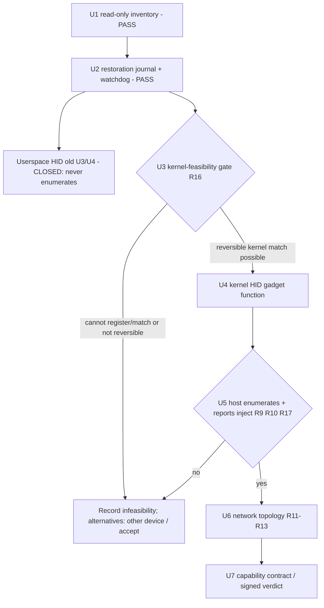

# iPad Hardware Feasibility Gates - Plan

**Status, 2026-11-02:** U1 and U2 passed. **The userspace private-API HID approach (old U3/U4) is CLOSED: it does not enumerate on this controller.** Five device trials (composite, exclusive, usbmux-preserving, and the stock `Keyboard` name) all left the device off bus (`goOnBus: not on bus`) while device-side ABI calls returned `0x0`. The mechanism is now understood (`IOUSBDeviceController::createUSBDevice` matches each interface of the selected configuration to an **in-kernel IOKit driver** before bringing the config on bus; a userspace-configured function has nothing to bind), and the plan **pivots to a kernel HID-gadget-function approach** — the iOS equivalent of the macOS `usbgadget.kext` path — gated on a hard feasibility check first. Current device state: `docs/ipad/target-device-findings.md`. Gate evidence and the full verdict: `docs/ipad/hardware-matrix.md`. Recovery spine: `docs/ipad/usb-auto-recovery.md`, `docs/ipad/usb-recovery.md`. Product scope: every jailbroken/TrollStore USB-C iPad and iPhone, M2 iPad the reference device. Dated execution history is in git.

## Goal Capsule

- **Objective:** Determine whether a jailbroken iPad can present a direct USB boot keyboard to an external host, now that the userspace private-API path is proven not to enumerate. The deciding question is no longer "can userspace configure a function" (it can; it just never comes on bus) but **"can the jailbreak's kernel primitives make `createUSBDevice` bind our HID function so the controller brings it on bus"** — and do so recoverably.
- **Means:** Keep U1 (read-only inventory) and U2 (restoration journal + watchdog + Wi-Fi recovery spine) as the proven safety floor. Replace the userspace HID units with a **kernel-feasibility gate** (can third-party kernel code register/match a gadget function on this Dopamine rootless iPadOS 17.0 build at all), and only on its pass, a kernel HID-gadget-function unit, an enumeration/injection unit, then the unchanged network and capability units.
- **Authority:** The roadmap's R4–R8 release gates still hold; this plan selects implementation details but may not weaken them. **This plan reverses the prior "no kernel patching" scope boundary** (see Scope Boundaries) because the feasibility evidence shows enumeration requires a kernel-side function match; the reversal is bounded by a feasibility gate and the U2 recovery spine.
- **Stop conditions:** Stop if the kernel-feasibility gate (new U3) shows the jailbreak cannot register or match a gadget function without an unacceptable stability/brick risk. Stop descriptor/kernel work on any unrecoverable USB-function loss. Fall to the recorded alternatives (another controller/iOS build; accept infeasibility) rather than weakening the direct-HID requirement.

---

## Product Contract

### Summary

Having proven the smallest userspace probes and the restoration spine, determine whether direct iPad USB HID is reachable through a **kernel-resident gadget function** that the controller will enumerate, while never losing recoverability. Produce versioned capability evidence (or a signed infeasibility verdict) that later plans consume instead of repeating private-API or kernel discovery.

### Problem Frame

The userspace private-API path is **closed by evidence, not assumption.** iOS 17 constructs stock device-mode configurations in `configd`, sends them to `IOUSBDeviceController`, and exposes named functions through `IOUSBDeviceInterface`. mac2jb reproduced the full userspace sequence on the exact target — append/replace a function in the selected configuration, open the resulting `IOUSBDeviceInterface` user client, set HID class/subclass/protocol, append standard/nonstandard descriptors, create the interrupt pipe, commit — and **every call returned success, yet the controller never brought the configuration on bus.** Five trials (composite 7-function, exclusive, usbmux-preserving 3-function, and twice with the stock catalog name `Keyboard`) all ended `usb=absent` / `goOnBus: not on bus`.

The mechanism is now established. Per Synacktiv's iOS USB reverse-engineering (verified against our evidence), **`IOUSBDeviceController::createUSBDevice` matches each interface of the selected configuration to an in-kernel IOKit driver before the controller goes on bus.** Stock functions enumerate because each has a kernel driver match *plus* a userspace backend (PTP+`ptpd`, audio+`audiomxd`); our canary supplied only a userspace user client with **no kernel driver to bind**, so `createUSBDevice` could not build the interface and the config never enumerated — exactly the `0x0`-everywhere / `missing=none`-served / not-on-bus signature we observed. The macOS reference (`macos_usb_gadget_poc`) defeated this same path by shipping a **kext** that bypasses the `createUSBDevice` entitlement/matching check and publishes from a kernel thread. No public project has made any jailbroken iOS device act as a USB device-mode HID keyboard to an external host.

The port therefore depends on a question we have not answered and that the prior plan deliberately excluded: **can this jailbreak place kernel-side code that `createUSBDevice` will match for a HID function?** Modern iOS does not load third-party kexts; jailbreaks provide kernel read/write and patch-finding, not a kext loader. Whether Dopamine's primitives can register an in-kernel gadget function (or patch the matching path) on iPadOS 17.0 `21A329`, without an unacceptable brick/stability cost, is the load-bearing unknown this plan now exists to settle.

| Evidence level | What is supported | What is not established |
|---|---|---|
| mac2jb on-device trials (U1–U2 + 5 HID trials) | Read-only inventory; restoration/recovery with no reboot; the userspace HID ABI (open/class/descriptors/pipe/commit all `0x0`) | That a userspace-configured function ever enumerates — **refuted**: it never comes on bus |
| Synacktiv iOS USB RE (2024), verified here | `createUSBDevice` matches each interface to an in-kernel driver before on-bus; stock functions have kernel + userspace backing | Exactly which registry/match the gadget core requires, and whether jailbreak kernel r/w can satisfy it |
| macOS `usbgadget.kext` PoC | A kernel-resident shim bypassing the `createUSBDevice` entitlement/match and publishing from a kernel thread makes a HID keyboard enumerate on macOS | Any iOS port; iOS does not load third-party kexts, so the mechanism must be re-achieved via jailbreak kernel primitives |
| Dopamine 3 rootless + TrollStore boundary | Entitlement preservation and a root launchd daemon (the broker); kernel read/write and patchfinder exist in the jailbreak | That third-party kernel code can register/match a USB gadget function, and that doing so is stable and recoverable on `21A329` |

### Requirements

**Inventory, authorization, role (unchanged — U1/U2 spine)**

- R1. (Unchanged, **met**) A read-only probe binds evidence to the exact target tuple, controller services, device-tree `configuration-string`, stock configuration source/digest, function services, restore inputs, user-client classes, and entitlements without changing USB state.
- R2. (Unchanged, **met**) The signed probe resolves private controller APIs at runtime and classifies missing-symbol/ABI, missing-entitlement, missing-service, user-client-denial, controller-role-mismatch, and unsupported-operation outcomes, recording the raw operation and `IOReturn` at every boundary.
- R3. (Unchanged, **met**) A direct-cable role/power test proves the exact iPad/cable/host enters USB peripheral/device role on the selected controller with acceptable VBUS, in both orientations, Switch-side separately.

**Restoration spine (unchanged — the safety floor for any on-device USB experiment)**

- R5. (Scope updated) Before any mutation, the broker captures/validates the stock description and proves a no-op republish round trip. The stored-description restore (push the exact journaled stock bytes) is proven to recover the device with **no reboot**, including after an interface-list publication. Kernel-side experiments inherit this spine unchanged.
- R6. Every mutation persists and fsyncs a checksummed restore recipe before publishing.
- R7. A separately supervised watchdog/broker is the sole controller writer and restores on timeout, crash, cancellation, disconnect, invalid state, service update, or service death — now extended to restore after a kernel-side experiment or a kernel fault, as far as a userspace broker can.
- R8. The canary/injector holds a short watchdog-issued lease, sends a neutral report on every controlled exit, and leaves journal deletion to the watchdog after external restore verification.

**Direct USB HID — kernel-gadget path (replaces the userspace HID requirements)**

- R4. (Unchanged target) The device must present a standards-compliant boot keyboard with one interrupt-IN endpoint and emit bounded eight-byte reports — now via a kernel-matched function, not userspace configuration alone.
- R9. (**Reframed**) The function-publication gate passes only if a HID function appended to the selected configuration is **matched by an in-kernel driver such that `createUSBDevice` brings the configuration on bus** and the host enumerates it. A userspace description/user-client call that returns success without the controller going on bus is a failure — this is the exact failure the five closed trials recorded. `IOHIDUserDevice` remains out of scope (local virtual HID, not a USB peripheral function).
- R10. The HID gate must capture descriptors and relevant HID control requests on a generic host before the Switch test, and propagate every kernel-registration, match, enumeration, endpoint, and report-injection error. A neutral write without host-side enumeration is not proof. `boot_session`/lifecycle and the Wi-Fi SSH lifeline remain the observation channel while USB is off bus.
- **R16 (new). Kernel-code feasibility and safety.** Before any kernel-side gadget work, prove on the exact build whether the jailbreak's kernel primitives can (a) register an in-kernel function/driver that `createUSBDevice` matches, or (b) patch the matching/entitlement path, and do so **reversibly and without persistent instability**. Record the exact kernel primitive used (Dopamine KRW/patchfinder surface), its iOS-build dependence, and a measured recovery (clean state after the kernel change is removed and after a reboot). A kernel change that cannot be cleanly removed, or that risks a boot loop, fails this gate.
- **R17 (new). Report injection into the kernel function.** Once a kernel-matched HID function enumerates, prove a userspace path (held under the U2 lease) that sources the corrected 8-byte boot-keyboard reports to that function and that the host receives correct press/release sequences — so enumeration is not merely by a driver that sources its own reports.

**Network and decision evidence (unchanged)**

- R11–R15. (Unchanged) Wired/Wi-Fi topology measurement and thresholds, the bounded fallbacks, the pass/fail/inconclusive report with reproducible evidence, and the locally signed, tuple-bound capability record.

### Acceptance Examples

- AE1. **Covers R1–R3.** (Met) An under-entitled probe changes no state and reports the exact failing boundary.
- AE2. **Covers R4, R9, R10, R16, R17.** Given a kernel-matched HID function and a USB descriptor host, when the controller brings it on bus, the canary types `MAC2JB`, and exits, then the host receives correct press/release reports and the original USB description is restored — with the kernel change cleanly removed afterward.
- AE3. **Covers R5–R8.** (Spine met) Given an active experiment, when its process is killed or a kernel change is backed out, the watchdog restores the journaled description and retains evidence until verification; a reboot path is always available as the ultimate restore.
- AE4. **Covers R11–R13.** (Unchanged) Wired vs Wi-Fi batches select Wi-Fi only if R12 passes; otherwise the bounded fallbacks are recorded.
- **AE5 (new). Covers R16.** Given the kernel-feasibility probe, when the jailbreak cannot register or match a gadget function (or cannot do so reversibly), then the gate records an evidenced infeasibility verdict and the plan stops at the recorded alternatives rather than forcing an unsafe kernel change.

### Scope Boundaries

- **Kernel work is now IN scope, reversing the prior boundary — bounded by a feasibility gate.** The 2026-10-28 plan excluded kernel patching and system-process injection ("the target should first use preserved entitlements plus the jailbreak service boundary"). That userspace boundary has been exhausted and proven insufficient (the `createUSBDevice` kernel-match requirement). This plan therefore permits jailbreak kernel read/write and gadget-function registration/patching **only** behind the R16 feasibility-and-safety gate, only on the reference device first, and only on top of the U2 recovery spine. It does **not** permit disabling AMFI broadly, persistent kernel patches that survive a clean removal, or anything that risks an unrecoverable device.
- The canary does not type a real bootstrap until restoration has passed on a generic host and then the Switch keyboard screen.
- This plan does not build the production UI, Node runtime, or homebrew features.
- Each gate is proven on the reference M2 iPad (`iPad14,5` / `T8112`, iPadOS 17.0) first. Reference-device constants (product/build pins, `AppleT8112USBXDCI`, the function list, the owner map, **and now the exact kernel offsets/primitives**) belong in a per-device/per-build profile, never baked in. Qualifying another model/build means recapturing that profile and rerunning U2 and the HID gates there — **kernel work is especially build-specific**, so a kernel success on `21A329` does not transfer without re-derivation.
- A Mac relay, Bluetooth keyboard emulation, or separate USB microcontroller does not satisfy the direct-iPad HID gate. If the bounded kernel path fails R16, record the stop decision (and the "another device/controller" alternative) rather than silently changing the product requirement.

---

## Planning Contract

### Key Technical Decisions

- KTD1. (Unchanged) **Separate observation from mutation.** The read-only probe is distinct from any entitled/kernel writer.
- KTD2. (Unchanged) **Prefer controller readback, then reconstruct.** Journal canonical live/default manifests plus identity, hashes, boot session, state.
- KTD4. (Unchanged, **proven**) **Restoration is independently live and single-writer.** The broker alone opens the controller, owns the journal, survives the canary lifecycle, and the stored-description restore recovers the device with no reboot. This spine now wraps kernel-side experiments.
- KTD5. (Unchanged) **Decide networking with exploit outcomes**, not RTT alone.
- **KTD3 — SUPERSEDED.** "Prefer additive HID after a no-op round trip" assumed userspace configuration of an appended function would enumerate. It does not: five trials proved the userspace path never brings the configuration on bus (see the U3 verdict in `docs/ipad/hardware-matrix.md`).
- **KTD6 — SUPERSEDED / corrected.** "Test the generic function path before HID semantics" was done and passed at the ABI level (R9's open/configure) but the generic userspace function is never matched by the kernel, so it never enumerates. The decision is replaced by KTD10.
- KTD7. (Unchanged) **Do not copy a private ABI blindly.** Resolve symbols dynamically, verify CF types, build an exact-device operation matrix — now extended to kernel offsets/primitives, which must be verified per build and never hard-coded.
- KTD8. (Partly retained) **Reuse HID semantics, replace the transport.** The corrected 9-byte HID descriptor, 65-byte report descriptor, boot-keyboard tuple, 8-byte validation, no-replay rule, and neutral-report fixtures are reused as the reports a kernel-matched function must carry (R17). The macOS `libusbd` userspace backend remains isolated as reference.
- **KTD10 (new). Enumeration requires a kernel function match; settle feasibility before building.** `createUSBDevice` binds each interface to an in-kernel driver. The achievable path is to make the jailbreak place/patch a kernel-side HID gadget function the controller will match (the iOS analogue of `usbgadget.kext`). Because iOS loads no third-party kexts, this means kernel read/write + patchfinder (Dopamine) registering a function or patching the match/entitlement path — a far larger, build-specific, higher-risk effort than userspace. **Gate it (R16) before investing in the function itself.**
- **KTD11 (new). Keep the userspace broker as the recovery authority even for kernel experiments.** The kernel change is the smallest possible, is applied behind the broker's lease, and is removable; the broker + stored-description restore + the reboot path remain the layered safety net. Prefer a kernel change that is purely additive to the match path and self-reverts on removal.

### High-Level Technical Design



```mermaid
sequenceDiagram
  participant B as Broker (U2, recovery authority)
  participant K as Kernel gadget function (new)
  participant C as HID report injector
  participant U as USB controller (createUSBDevice)
  participant H as Descriptor host or Switch
  C->>B: Submit restore recipe + take lease
  B->>K: Place/enable kernel function match (reversible, behind lease)
  B->>U: Publish HID configuration
  U->>K: createUSBDevice matches the function -> go on bus
  H-->>C: Enumerate interface
  C->>H: Press + neutral reports (R17)
  C->>B: Finish or cancel
  B->>K: Remove kernel function match
  B->>U: Restore stock description; verify; reboot path if needed
```

### Output Structure

```text
ios/
  entitlements/
  probes/            # U1 (done)
  usb/               # shim: description edits + stored-description restore (done)
  watchdog/          # U2 broker (done)
  kernel/            # NEW: kernel-feasibility probe + gadget-function match/patch
scripts/
  ipad-hardware/     # host runners, recovery, enumeration capture (reused)
docs/ipad/
  hardware-matrix.md
  usb-recovery.md
```

### Risks and Mitigations

- **Kernel work can brick the device or boot-loop it.** This is the dominant new risk and dwarfs the userspace risks. Mitigate: the R16 gate proves reversibility first; every kernel change is applied behind the broker lease and is removable; a reboot always restores stock USB (the custom description does not survive reboot); the owner is on hand for kernel experiments; never apply a persistent kernel patch.
- **iOS loads no third-party kexts; the jailbreak may simply not expose a way to register/match a gadget function.** This may be a hard dead end. R16 is designed to discover it cheaply and record an evidenced infeasibility verdict rather than forcing an unsafe workaround.
- **Kernel offsets/primitives are build-specific.** A success on iPadOS 17.0 `21A329` does not transfer. Keep all kernel specifics in a per-build profile; re-derive for any other device/build; treat the reference result as a single data point, not the product verdict.
- **A kernel-matched function may source its own reports.** Enumeration alone is not the goal; R17 requires proving our 8-byte reports reach the host. Mitigate: design the function so a userspace injector (under the lease) supplies reports, and verify press/release on the host.
- (Retained) A USB misconfiguration can remove usbmux/network functions until reboot; the audio re-registration race can hold the device off bus. Mitigate with the broker's owner-restart recovery (`recover-u2-over-wifi`, proven) and the reboot path.
- (Retained) ns2jb variability; paired batches; preserve attempt-level outcomes.

### Sources and Research

- **Settled verdict and evidence (this repo):** `docs/ipad/target-device-findings.md` (Current state), `docs/ipad/hardware-matrix.md` (U3 verdict + the five trials), `docs/ipad/usb-auto-recovery.md`.
- **Current iOS stack RE (the mechanism):** <https://www.synacktiv.com/publications/ios-a-journey-in-the-usb-networking-stack> — `createUSBDevice` matches each interface of the selected configuration to an in-kernel IOKit driver before bringing the config on bus; stock functions are kernel-driver-backed. This is the basis for the pivot.
- **Adjacent ARM64 HID proof (the mechanism to re-achieve on iOS):** <https://github.com/shinyquagsire23/macos_usb_gadget_poc> — a macOS kext that bypasses the `createUSBDevice` entitlement/match and publishes from a kernel thread; the explicit model for a kernel-resident gadget function.
- **Dopamine (kernel primitives available on the target):** the jailbreak provides kernel read/write and patchfinding on iPadOS 17.0, not a kext loader; U3 must establish exactly what of the gadget match path those primitives can reach. (Capture the primitive surface on-device; do not assume.)
- **Userspace references (now reference-only):** `vendor/libusbd/src/plat/macos/impl.c`, `vendor/macos_usb_gadget_poc/`, the historical iOS `restored_external.c`, and `IOUSBDeviceControllerLib.h` — the userspace ABI these describe is proven to open/configure a function but not to enumerate it on this controller.
- **TrollStore/signing boundary:** <https://github.com/opa334/TrollStore> — entitlement preservation; it explicitly cannot provide system-process injection, which is why the kernel path goes through the jailbreak's KRW, not TrollStore.

---

## Implementation Units

### U1. Read-only target inventory — DONE

- **Plan and evidence:** [`01-u1-readonly-inventory.md`](01-u1-readonly-inventory.md) — **PASS 2026-10-30** (R1–R3, U1-scoped R14). Unchanged by the pivot; the inventory and per-device profile remain the foundation.

### U2. Restoration journal and watchdog — DONE (now the safety spine for kernel work)

- **Plan and evidence:** [`01-u2-usb-restoration.md`](01-u2-usb-restoration.md) — **PASS 2026-10-31**. The broker, journal, Wi-Fi SSH recovery tooling, owner-restart heal, and stored-description restore all recover the device with no reboot (proven again across the five HID trials). Mechanism: [`../../ipad/usb-auto-recovery.md`](../../ipad/usb-auto-recovery.md). **This unit is the precondition and recovery authority for every kernel experiment below** (R5–R8).

### U3 (old). Userspace additive HID canary — CLOSED (does not enumerate)

- **Verdict:** CLOSED 2026-11-02. The userspace approach — append/replace a function, open its `IOUSBDeviceInterface` user client, configure HID from userspace — materializes the interface and returns `0x0` for every operation, but the controller never brings the configuration on bus (`goOnBus: not on bus`). Composite, exclusive, and usbmux-preserving shapes, and the invented and stock (`Keyboard`) names, all failed identically.
- **Why:** `createUSBDevice` requires an in-kernel driver match per interface (see Problem Frame). A userspace-configured function has none. Full detail and the five trials: [`01-u3-hid-canary.md`](01-u3-hid-canary.md) (closure notice), `docs/ipad/hardware-matrix.md` (U3 verdict), `docs/ipad/target-device-findings.md`.
- **Reusable outputs:** the HID fixtures/report descriptor, the host enumeration-capture tooling, the interface-list publish path, and the stored-description restore all carry forward to the kernel path.

### U4 (old). Exclusive / usbmux-preserving userspace HID — CLOSED (same failure)

- **Verdict:** CLOSED 2026-11-02. Tested as part of the five trials; `[PTP, AppleUSBMux, Mac2jbCanary]` and `[AppleUSBMux, Keyboard]` failed exactly like the composite — not a count ceiling, not a name/definition problem. Same root cause and cross-references as above.

### U3. Kernel-code feasibility and safety gate (NEW — the make-or-break unit)

- **Goal:** Settle, on the exact build and before building any gadget function, whether the jailbreak's kernel primitives can make `createUSBDevice` match a HID function **reversibly and without persistent instability** — or produce an evidenced infeasibility verdict.
- **Requirements:** R16, and R5–R8 (the experiment runs behind the broker/recovery spine)
- **Dependencies:** U1, U2
- **Files:** `ios/kernel/` (new, read-only kernel-surface probe first), `docs/ipad/hardware-matrix.md`, per-build kernel profile under the device profile
- **Approach:** First, a **read-only kernel-surface probe**: using the Dopamine KRW/patchfinder primitives available to a root context, locate the gadget-stack objects involved in `createUSBDevice`'s interface→driver matching (the function-driver registry/match table, the entitlement check the macOS kext bypassed) and record what is reachable, at what offsets, for this build only. Then design the *smallest* candidate change — register an in-kernel function match for one named HID interface, or patch the match/entitlement path — and evaluate it **in principle and in reversibility** before any live publication: can it be applied and cleanly removed from userspace via KRW, does removal restore the exact prior kernel state, and does a reboot restore stock regardless. Do not publish a HID configuration in this unit; this unit decides whether U4 is safe to attempt.
- **Test scenarios:**
  - Enumerate and record the reachable gadget-match structures and the entitlement check, bound to `21A329` offsets; confirm two reads agree and nothing is written.
  - Apply and then remove the smallest candidate kernel change with the device idle (no publication); verify the kernel state is byte-identical before and after, and that USB/usbmux are unaffected.
  - Force a worst case (remove the change while "applied", kill the applier) and confirm the broker + reboot path still restore stock.
- **Verification:** Either (pass) a specific, reversible kernel primitive that can register/match a gadget function is identified and demonstrated to apply+remove cleanly with the device idle, recorded in the per-build profile; or (fail) an evidenced verdict that the jailbreak cannot do this safely, which stops the HID path and routes to the alternatives in the Definition of Done. **No HID publication happens until this gate passes.**
- **Subtasks:** ordered as U3.1–U3.6 in [`01-u3u4-kernel-hid-gadget.md`](01-u3u4-kernel-hid-gadget.md).

### U4. Kernel HID gadget function (NEW — only if U3 passes)

- **Goal:** Make a HID boot-keyboard function, appended to the selected configuration, be matched by the kernel so `createUSBDevice` brings the configuration on bus.
- **Requirements:** R4, R9, R16
- **Dependencies:** U3 pass
- **Files:** `ios/kernel/`, `ios/usb/` (publish path, reused), `ios/watchdog/` (broker integration)
- **Approach:** Using only the primitive U3 proved reversible, register/enable the kernel function match for one HID interface, behind the broker lease, then publish the HID configuration via the existing interface-list path and cycle the bus. Keep the change minimal and self-reverting on lease end/worker death; the broker removes the kernel match as part of restore. Observe on-bus via the device syslog (`handleUSBConnectionDone`, no `goOnBus: not on bus`) and the Wi-Fi lifeline, since usbmux may be absent during the hold.
- **Test scenarios:**
  - With the kernel match enabled, publish `[AppleUSBMux, <HID>]`; confirm the controller goes on bus (the opposite of the five closed trials) and the host sees a device.
  - Kill the injector / expire the lease mid-hold; confirm the broker removes the kernel match and the stored-description restore returns stock (owner-restart heal available for the audio race).
  - Confirm the kernel match is gone after restore and after a reboot.
- **Verification:** The controller brings the HID configuration on bus with the kernel match present, and does not when it is absent (the discriminating result), with restoration verified externally.
- **Subtasks:** ordered as U4.1–U4.5 in [`01-u3u4-kernel-hid-gadget.md`](01-u3u4-kernel-hid-gadget.md).

### U5. Host enumeration and report injection (NEW — the HID proof)

- **Goal:** Prove the host enumerates the kernel-matched keyboard and receives our `MAC2JB` reports, generic host first, then the Switch.
- **Requirements:** R4, R9, R10, R17
- **Dependencies:** U4 pass
- **Files:** `scripts/ipad-hardware/` (enumeration capture + report reader, reused), `ios/kernel/` + `ios/usb/` (report injection path)
- **Approach:** Reuse the host enumeration-capture and seized report-reader tooling. Capture descriptors (class 3 / subclass 1 / protocol 1, one interrupt-IN endpoint), then inject the corrected 8-byte boot-keyboard reports under the lease and compare the host-observed press/release sequence against the fixtures. Only after a generic host passes, repeat on the Switch keyboard screen.
- **Test scenarios:** descriptor match; `MAC2JB` press/release captured on the Mac; non-enumeration and empty-capture reported distinctly (reusing the existing labels); Switch recognition.
- **Verification:** 30 generic-host cycles and 30 Switch keyboard-screen cycles pass with exact descriptor/report capture and externally verified restoration; a neutral write without host enumeration does not count.

### U6. Benchmark and select the network topology — UNCHANGED (renumbered from U5)

- **Goal / Requirements / Approach / Verification:** as before (R11–R14); gated on the HID USB gate (now U5) passing. Files and test scenarios unchanged (`scripts/ipad-hardware/network-benchmark.cjs`, `run-ns2jb-batch.cjs`, `docs/ipad/hardware-matrix.md`).

### U7. Publish the capability contract (or signed infeasibility verdict) — UPDATED (renumbered from U6)

- **Goal:** Give later plans stable controller/entitlement/restoration/kernel/network inputs — or a signed, tuple-bound **infeasibility verdict** if U3 or U5 fails.
- **Requirements:** R2, R14, R15
- **Dependencies:** U1–U6 (or U1–U3 plus a stop verdict)
- **Approach / Test scenarios:** as before, extended so the canonical schema can also encode an evidenced "direct HID infeasible on this build via the kernel path" result (with the reason: no reversible kernel match) that later plans consume without re-probing. Signing, tuple binding, and redaction unchanged.

---

## Verification Contract

| Gate | Pass condition |
|---|---|
| Read-only safety (U1) | **Met.** Probe causes no re-enumeration and makes no configuration call |
| Exact target and role (U1) | **Met.** Tuple recorded; iPad reaches peripheral/device role on the direct path |
| Restoration spine (U2) | **Met.** Normal + crash/disconnect cases restore externally-captured descriptors, usbmux/trust/charging, and prior functions with no reboot |
| Userspace HID (old U3/U4) | **CLOSED/failed.** Userspace-configured function never enumerates; recorded verdict, not a release path |
| Kernel feasibility (U3, R16) | A specific reversible kernel primitive registers/matches a gadget function and applies+removes cleanly with the device idle — or an evidenced infeasibility verdict stops the path |
| Kernel HID on bus (U4) | Controller goes on bus with the kernel match present and not without it; restoration verified |
| HID enumeration + injection (U5) | Generic host then Switch enumerate the keyboard and receive exact `MAC2JB` press/neutral reports; restoration verified |
| Network (U6) | R12 passes for one topology over comparable 20-attempt batches |
| Evidence (U7) | Canonical schema + enrolled-key signature validate (capability record or signed infeasibility verdict); raw logs retained; shareable report redacted |

---

## Definition of Done

- U1–U2 complete (done). The userspace HID verdict is recorded and cross-referenced.
- **The R16 kernel-feasibility gate (U3) has a decision:** either a reversible kernel gadget-match primitive is proven and recorded in the per-build profile, or a signed infeasibility verdict is produced.
- If feasible: U4 brings the kernel-matched HID on bus, U5 passes enumeration + `MAC2JB` injection on a generic host and the Switch, and restoration is exercised from a failed journal, a backed-out kernel change, and a reboot/re-jailbreak.
- If infeasible: the plan stops at the recorded alternatives — **(a) try another controller/iOS build** (capture its profile, re-derive kernel specifics, rerun U2→U5), or **(b) accept that direct iPad HID is not reachable on this build** — and does not substitute a Mac relay / Bluetooth / microcontroller for the direct-HID requirement.
- One network topology passes R12 (only on the feasible branch); otherwise the roadmap is explicitly stopped.
- No broad entitlement, **persistent kernel patch**, system injection, device dump, or raw identifier remains in the repository; every kernel change is removable and is removed.
- The final verdict remains "plausible but unproven" until the exact-device U3–U5 evidence passes; the macOS kext proof and the Synacktiv mechanism are supporting evidence, not substitutes for the on-device kernel result.
