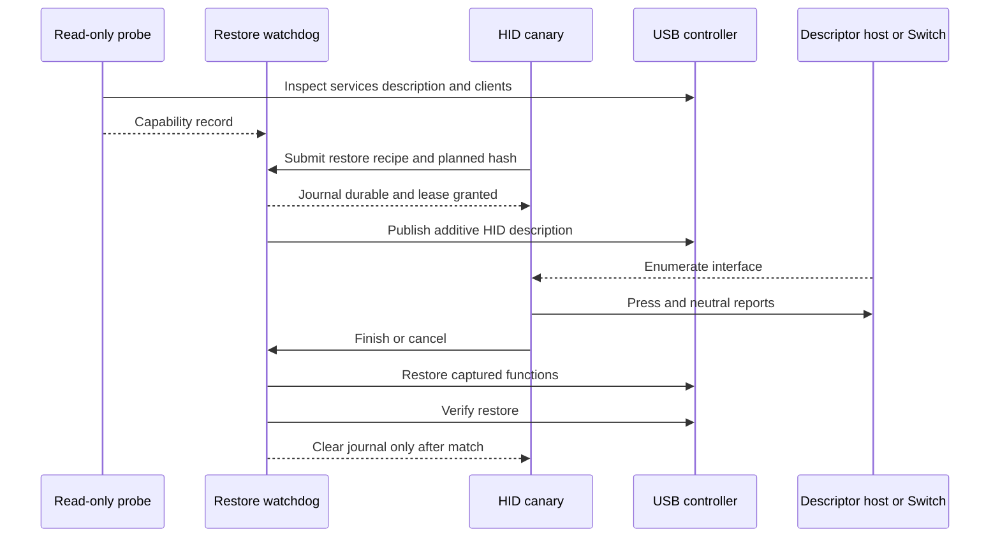
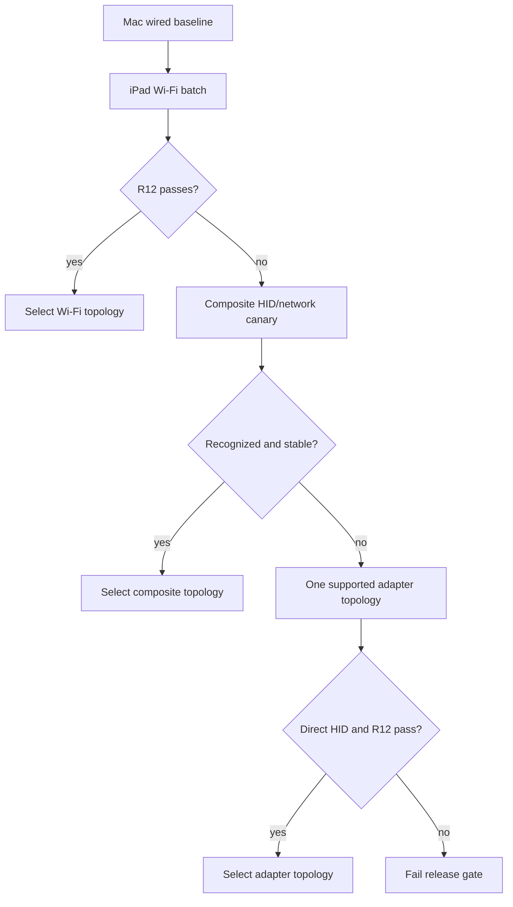

# iPad Hardware Feasibility Gates - Plan

## Goal Capsule

- **Objective:** Prove on the exact M2 iPad Pro target (`iPad14,5` / `J620AP` / `T8112`) running iPadOS 17.0 that direct USB HID is safe and that a reliable Switch-to-iPad IP path exists before the broader port proceeds.
- **Means:** Build read-only inventory tools first, then an independently recoverable HID canary, then a network baseline and topology bakeoff (KTD1–KTD5).
- **Authority:** The roadmap's R4–R8 are release gates; this plan may select implementation details but may not weaken them.
- **Stop conditions:** Stop descriptor work on any unrecoverable USB-function loss. Stop dependent port plans if HID enumeration/restoration or network success thresholds fail after the bounded alternatives here.

---

## Product Contract

### Summary

Create the smallest possible on-device probes needed to prove the target's USB-device controller, required entitlements, HID endpoints, restoration behavior, cable/power direction, and network topology. Produce versioned capability evidence that later plans consume instead of repeating private-API discovery.

### Problem Frame

The current USB backend targets macOS, depends on `usbgadget.kext`, and assumes `usb-drd*` controllers plus `IOUSBDeviceInterfaceUserClient`. Source inspection shows that the kext is not a HID function driver: it attaches to `IOUSBDeviceController` and forwards `SetDeviceConfiguration` from a kernel thread. In the demonstrated macOS path, controller publication creates a named generic `IOUSBDeviceInterface`; userspace then supplies its HID class tuple, descriptors, interrupt endpoint, and reports. Upstream describes the forwarding shim as an entitlement bypass, but equivalent authorized publication and arbitrary-name materialization remain to be proven on iPadOS.

The evidence therefore supports a **credible implementation path, not proof of iPad HID**. iOS 17 still constructs stock device-mode configurations in `configd`, sends them to `IOUSBDeviceController`, and exposes their named functions through `IOUSBDeviceInterface` services. Historical iOS code publishes a description, opens a stock named interface, and changes its class/subclass/protocol. Current iOS-derived code demonstrates entitled live-description replacement and re-enumeration, while TrollStore 17.0 preserves arbitrary non-banned entitlements. The remaining unknowns include arbitrary-name materialization, the exact generic-interface ABI/authorization, endpoint creation on this controller, USB-C role negotiation with the Switch, and physical host acceptance. Those require the exact-device canary; public sources cannot honestly substitute for it.

| Evidence level | What is supported | What is not established |
|---|---|---|
| Current iOS 17 research | Device mode, `IOUSBDeviceController`, stock named function materialization, and the `IOUSBDeviceInterfaceUserClient` family remain present | Arbitrary generated functions plus the exact target’s selector compatibility and endpoint-operation authorization |
| Historical iOS source | iOS can publish a description, open a named generic interface, and set its class/subclass/protocol | Modern endpoint creation, HID control handling, and restoration behavior |
| ARM64 Mac proof of concept | Apple’s generic device-interface stack can create an arbitrary named function; userspace can turn it into a working HID keyboard | Physical-iPad controller access, USB-C role behavior, or Switch compatibility |
| TrollStore/Dopamine boundary | iPadOS 17.0 can preserve `com.apple.private.usbdevice.setdescription`, IOKit exceptions, and other non-banned entitlements; a rootless package can host the broker | That the kernel accepts each entitlement and operation on the exact build |

### Requirements

**Inventory and authorization**

- R1. A read-only probe must bind evidence to the exact `iPad14,5` / `J620AP` / `T8112` target tuple—`ProductType`, board identifier, SoC, Thunderbolt/USB 4 port family, iPadOS build, Dopamine build, TrollStore build, cable/capture-host identity—plus USB controller services, active controller, device-tree `configuration-string`, stock configuration source/digest, active function services, reconstructable restore inputs, user-client classes, and relevant entitlements without changing USB state.
- R2. The signed probe must resolve private controller APIs at runtime and distinguish missing symbol/ABI, missing entitlement, missing service, user-client denial, controller-role mismatch, and unsupported operation outcomes. It must record the raw operation and `IOReturn` at every boundary instead of trusting the current backend's suppressed return values.
- R3. Before any description mutation, a direct-cable role/power test must prove that the exact iPad/cable/host combination enters USB peripheral/device role, exposes the selected device-mode controller, and has an acceptable VBUS/charging state. Test both USB-C orientations and a known-good data cable; success while connected to a Mac does not substitute for the Switch-side role test.

**USB HID and restoration**

- R4. A canary must present a standards-compliant boot keyboard with one interrupt-IN endpoint and emit bounded eight-byte reports.
- R5. Before custom HID, the probe package must capture both the live and default controller descriptions when the runtime APIs permit, canonicalize their functions and scalar descriptors, prove a no-op republish round trip, and externally compare descriptors and stock functions. If live readback is unavailable, it may reconstruct from the exact build's configuration plist, device tree, and registry only after external equivalence passes. The first HID attempt appends HID to that recipe, with exclusive HID allowed only as a recorded fallback.
- R6. Every mutation must persist and fsync a checksummed restore recipe before publishing the new configuration.
- R7. A separately supervised watchdog/controller broker must be the sole controller writer and restore the recipe on timeout, crash, cancellation, disconnect, invalid state, service update, or service death.
- R8. The canary must hold a short watchdog-issued mutation lease, send a neutral report on every controlled exit, and leave journal deletion solely to the watchdog after external restore verification.
- R9. The function-publication gate passes only if appending a unique function name produces the matching generic `IOUSBDeviceInterface`, its user client opens with the least privilege required, and the class/descriptor/pipe operations needed for HID succeed on the exact device. A successful controller description call without that usable function path is a failure. `IOHIDUserDevice` is explicitly out of scope because it creates a local virtual HID device, not a USB peripheral function.
- R10. The HID gate must capture descriptors and relevant HID control requests on a generic host before the Switch test. It must propagate every publication, interface-open, descriptor, endpoint, buffer, and commit error; a successful neutral write alone is not proof of enumeration or standards compliance.

**Network and decision evidence**

- R11. The test harness must measure wired Mac baseline and iPad candidate topology latency, jitter, loss, bind behavior, and full ns2jb outcomes under the same Switch conditions.
- R12. Wi-Fi passes when its full-attempt success rate is no worse than 10 percentage points below the wired baseline, with a minimum of 20 attempts per topology and no new repeatable failure mode attributable to transport.
- R13. If Wi-Fi fails R12, test at most two direct-cable alternatives: a composite HID/network configuration recognized by the Switch, then a documented supported adapter topology that preserves direct iPad HID.
- R14. The final report must declare each gate pass/fail/inconclusive and include raw, redactable evidence sufficient to reproduce the decision.
- R15. The canonical capability record must be signed locally by the probe package, bind its enrolled public-key fingerprint and schema version, and fail validation after any edit or when imported for a different target tuple.

### Acceptance Examples

- AE1. **Covers R1–R3.** Given an unsigned or under-entitled probe, when it observes controller arrival and attempts a read-only open, then it changes no state and reports the exact role, symbol, service, entitlement, or user-client boundary that failed.
- AE2. **Covers R4–R10.** Given the entitled canary and a USB descriptor host, when it configures, types `MAC2JB`, and exits, then the host receives correct press/release reports and the original USB description is restored.
- AE3. **Covers R6–R8.** Given an active canary, when its process is killed before cleanup, then the watchdog restores the journaled description and retains evidence until verification succeeds.
- AE4. **Covers R11–R13.** Given identical Switch and host-profile conditions, when wired and Wi-Fi batches run, then the report selects Wi-Fi only if R12 passes; otherwise it records the bounded fallback results.

### Scope Boundaries

- The canary does not type a real bootstrap until descriptor restoration has passed on a generic USB host and then the Switch keyboard screen.
- This plan does not build the production UI, Node runtime, or homebrew features.
- Kernel patching and system-process injection are not added: TrollStore documents that it cannot provide the latter, and the target should first use preserved entitlements plus the jailbreak service boundary.
- Support for other iPads, OS versions, hubs, or general adapter configurations is deferred until the exact target passes; the single adapter topology permitted by R13 is only a bounded release-gate fallback.
- A Mac relay, Bluetooth keyboard emulation, or separate USB microcontroller does not satisfy this plan's direct-iPad HID gate. If the bounded direct path fails, record the stop decision rather than silently changing the product requirement.

---

## Planning Contract

### Key Technical Decisions

- KTD1. **Separate observation from mutation.** `mac2jb-ios-probe` is read-only and safe to run before any recovery mechanism; `mac2jb-usbd-canary` is a separate entitled executable.
- KTD2. **Prefer controller readback, then reconstruct.** Probe `IOUSBDeviceDescriptionCreateFromController`, `IOUSBDeviceDescriptionCreateFromDefaultsAndController`, related copy/serialization functions, and their CF types through runtime symbol resolution on the target. Journal canonical live/default manifests plus controller/source identity, hashes, boot session, and state. Fall back to build-pinned plist/device-tree/registry reconstruction only when readback is unavailable and external equivalence is demonstrated.
- KTD3. **Prefer additive HID after a no-op round trip.** Reconstruct current functions, prove external descriptor/function equivalence, then append the generic interface. The upstream Mac POC warns that replacement can break network sharing until reboot.
- KTD4. **Make restoration independently live and single-writer.** The hardware phase ships a minimal rootless probe package with a separately supervised watchdog/controller broker. It alone opens the controller for writes, owns journal creation/deletion, and survives the canary/main-service lifecycle.
- KTD5. **Decide networking with exploit outcomes.** RTT alone is diagnostic; the pass/fail metric is the paired full-attempt success batch in R12.
- KTD6. **Test the generic function path before HID semantics.** The macOS kext forwards controller configuration from kernel context; it does not implement HID or a function driver. On that stack, the backend appends an arbitrary name, waits for a generic `IOUSBDeviceInterface`, opens its user client, and configures class, descriptors, pipes, and reports from userspace. Reproduce both materialization and configuration on the iPad one operation at a time, and stop if the generic service, open, or endpoint path differs.
- KTD7. **Do not copy a private ABI blindly.** Load private symbols dynamically, verify CF type IDs and signatures through harmless calls, and build an exact-device operation matrix. Historical vtable offsets, user-client type `123`, `PublishConfiguration`, `Poke`, random `USBDeviceFunction` names, and hard-coded `usb-drd*` order are observations to test, not iPad constants.
- KTD8. **Reuse HID semantics, replace the transport.** Reuse the corrected 9-byte HID descriptor, 65-byte report descriptor, boot-keyboard tuple, bounded eight-byte validation, no-replay rule, and three neutral attempts as fixtures. Isolate the macOS `libusbd` backend, its destructive `RemoveAllConfigurations` behavior, ignored errors, `0xA0/255` power declaration, absent VID, and SmileBASIC-specific case encoding.
- KTD9. **Republishing is an explicit state transition.** A recent iOS-derived implementation reads the controller's current description, marks its info dictionary with `AllowMultipleCreates`, calls `SetDescription`, and performs an off/on-bus cycle. Treat that as a candidate sequence to validate on the target; never omit the flag or re-enumeration merely because an API returned success.

### High-Level Technical Design





### Output Structure

```text
ios/
  entitlements/
  probes/
  usb/
  watchdog/
packaging/ios/
  probe-rootless/
scripts/
  ipad-hardware/
docs/ipad/
  hardware-matrix.md
  usb-recovery.md
```

### Risks and Mitigations

- An iPad USB misconfiguration can remove usbmux/network functions until reboot. Require a backup, verified reboot path, additive-first configuration, watchdog, and one mutation per reviewed step.
- The service entitlement names may differ from Mac evidence. Record actual registry classes and open failures before editing entitlements; do not grant broad wildcard exceptions.
- Possessing `com.apple.private.usbdevice.setdescription` may still leave the controller or function user client inaccessible. Use a staged entitlement matrix and stop at the first failing authorization layer instead of weakening AMFI or injecting into a system process.
- The iPad can be USB host or peripheral, and controller behavior remains ProductType-specific. Bind evidence to `iPad14,5`, the exact cable, orientation, peer, controller ancestry, and observed data/power roles.
- Existing iOS configurations are named driver compositions and some extended modes cannot coexist. Treat composite HID plus NCM as a separate experiment after Wi-Fi failure, not a descriptor-only assumption.
- ns2jb has inherent variability. Use paired batches under controlled conditions and preserve attempt-level outcomes instead of declaring success from one run.

### Sources and Research

- **Focused feasibility note:** [`research/usb-hid-ipad-feasibility.md`](research/usb-hid-ipad-feasibility.md). It traces the controller, entitlement, generic-interface, endpoint, and physical proof boundaries and defines the exact-device evidence needed to close the claim.
- **Repository evidence:** `sender.c`, `keyboard.c`, `commands.c`, `vendor/libusbd/src/plat/macos/impl.c`, `vendor/macos_usb_gadget_poc/`, `scripts/test-keyboard.cjs`, and `scripts/test-usb-controller-ownership.sh`. The kext matches only `IOUSBDeviceController` and forwards `SetDeviceConfiguration`; it does not implement HID. The userspace backend appends an arbitrary function name, finds the resulting generic `IOUSBDeviceInterface`, sets HID descriptors, creates the interrupt pipe, and writes reports. It still destructively removes stock configurations, suppresses several errors, and does not restore them.
- **Apple-derived device-mode API header:** <https://github.com/nabla-c0d3/iphone-dataprotection/blob/master/ramdisk_tools/IOUSBDeviceControllerLib.h>. It documents controller arrival/off-bus operations plus live/default description creation; treat it as historical API evidence, not an iPadOS 17 ABI contract.
- **Historical iOS use:** <https://github.com/nabla-c0d3/iphone-dataprotection/blob/master/ramdisk_tools/restored_external.c>. It publishes an iOS USB description, matches `IOUSBDeviceInterface` by `USBDeviceFunction`, and configures the private interface; it does not prove modern iPad HID or restoration.
- **Current iOS stack research:** <https://www.synacktiv.com/publications/ios-a-journey-in-the-usb-networking-stack>. It traces `USBDeviceConfiguration.plist`, `USBDeviceConfiguration.bundle`, `IOUSBDeviceDescriptionCreateFromDefaultsAndController`, named driver binding, and iOS 17 NCM/RemoteXPC behavior.
- **Recent iOS-derived read/republish example:** <https://github.com/Lakr233/vphone-cli/blob/main/VPhoneDaemon/Native/vphoned_usb.m>. It dynamically resolves the private API, reads the controller description, sets `AllowMultipleCreates`, republishes it, and cycles the bus in a virtual iPhone guest; this is current adjacent evidence, not physical-iPad proof.
- **Adjacent ARM64 HID proof:** <https://github.com/shinyquagsire23/macos_usb_gadget_poc>. It implements a macOS HID keyboard with the related stack, identifies `com.apple.private.usbdevice.setdescription`, and warns about losing network functions until reboot or additive reconstruction.
- **Target signing boundary:** <https://github.com/opa334/TrollStore>. It lists iOS 17.0 support and preservation of arbitrary entitlements, subject to platform restrictions and exact IOKit access.
- **Entitlement continuity:** <https://newosxbook.com/ent.php?exec=configd&osVer=iOS18>. Current `configd` still carries `com.apple.private.usbdevice.setdescription`; this corroborates continued controller authorization but does not replace an iPadOS 17.0 signed probe.
- **Adjacent-family device-tree clue:** <https://gist.github.com/zhuowei/bb8a56aaeab47af6e1fb826b8ca14168>. An extracted M1 iPad13,4/T8103 tree contains `usb-drd0`, high- and SuperSpeed port nodes, and `stdMuxPTPEthValIDA`; use it only to seed live discovery because it is neither the target SoC nor the target iPadOS 17 build.
- **Exact-model port specification:** Apple identifies the 12.9-inch iPad Pro (6th generation) as an M2 model with a Thunderbolt/USB 4 port: <https://support.apple.com/en-us/111841>.
- **Dual-role/power behavior:** <https://support.apple.com/en-ie/108894>. Apple documents iPad as a computer-connected device, accessory host, power source, and power sink, including connection-order-sensitive charging between USB-C iPads; the Switch data role still requires direct measurement.

---

## Implementation Units

### U1. Add the read-only target inventory

- **Goal:** Discover the exact USB services and authorization failures without mutating device state.
- **Requirements:** R1–R3, R14
- **Dependencies:** None
- **Files:** `ios/probes/`, `ios/entitlements/probe.plist`, `scripts/ipad-hardware/collect-inventory.sh`, `docs/ipad/hardware-matrix.md`, `ios/tests/ProbeResultTests.swift`
- **Approach:** Record the exact target tuple; enumerate controller ancestry, stock function services, device-tree configuration, and configuration-plist digest; dynamically resolve candidate controller/description APIs; and serialize a redacted JSON capability record. Use separate minimally entitled probe builds to classify symbol, service, controller-open, function-open, and entitlement outcomes. Observe controller arrival while directly attached to a capture host and the Switch with both cable orientations, but validate that no set-description, command, off-bus, or registry-write path is reachable from this binary.
- **Test scenarios:**
  - Run without private entitlements and identify the first denied open while producing a valid report.
  - Run with `com.apple.private.usbdevice.setdescription` and exact candidate IOKit user-client exceptions in separate signed builds; record each successfully opened class without a write call.
  - Record controller arrival/absence, ancestry, VBUS/charging indication, and peer identity for a Mac capture host and the Switch, in both USB-C orientations.
  - Resolve `CreateFromController`, `CreateFromDefaultsAndController`, `SetDescription`, `SendCommand`, `GoOffAndOnBus`, and related copy functions with `dlopen`/`dlsym`; verify CF type IDs through read-only calls and report missing/incompatible symbols without dereferencing guessed vtables.
  - Redact serials, UDIDs, MACs, and filesystem roots from a shareable report while retaining hashes and versions.
- **Verification:** Two consecutive probes produce equivalent target/controller/function topology, the peer-role matrix is complete, and an external capture shows no USB re-enumeration.

### U2. Implement the restoration journal and watchdog

- **Goal:** Make restoration provable before any custom descriptor is published.
- **Requirements:** R6–R8
- **Dependencies:** U1
- **Files:** `ios/watchdog/`, `ios/usb/USBRestoreJournal.*`, `ios/tests/USBRestoreJournalTests.*`, `packaging/ios/probe-rootless/`
- **Approach:** Build the minimal rootless probe package. Capture live and default descriptions through target-validated APIs when available; canonicalize device scalars, configurations, ordered function names, source hashes, controller identity, and external descriptor observations. If readback is unavailable, reconstruct a build-pinned recipe from the configuration plist, device tree, and registry and mark its provenance. Validate whether republishing requires `AllowMultipleCreates` and a bounded off/on-bus cycle. Implement atomic journal creation plus file/parent fsync, restrictive ownership, lifecycle states, leases, hash/boot/source validation, and idempotent external restore verification. The watchdog is the only journal/controller writer.
- **Execution note:** Test journal corruption and watchdog restarts against fixtures before granting it a controller entitlement.
- **Test scenarios:**
  - Reject a truncated, wrong-owner, wrong-controller, or wrong-boot journal without applying its payload.
  - Restore the same valid journal twice and report the second pass as already restored.
  - Preserve a failed journal and surface recovery-required instead of deleting evidence.
  - Kill and restart the watchdog, canary, and future main-service stand-in independently; prevent concurrent writers and restore on lease expiry.
  - Compare live-readback, default-plus-controller, and externally captured descriptors; reject a reconstructed fallback whose functions or scalar descriptors differ.
- **Verification:** The watchdog passes fixture fault injection and completes a no-op republish/restore against the captured live description, with usbmux/trust/charging and any active network function externally recovered.

### U3. Build the additive HID canary

- **Goal:** Enumerate a direct USB boot keyboard and send bounded reports without losing original functions.
- **Requirements:** R4–R10
- **Dependencies:** U1, U2
- **Files:** `ios/usb/`, `ios/entitlements/usb-helper.plist`, `ios/tests/HIDDescriptorTests.*`, `scripts/ipad-hardware/run-hid-canary.sh`
- **Approach:** Create an iPad-specific broker backend rather than compiling the macOS `libusbd` transport unchanged. Reuse the corrected HID/report descriptors and bounded raw-report semantics as golden fixtures. After the U2 no-op round trip, append a unique generic function name and require the matching `IOUSBDeviceInterface` plus a successful least-privileged open. Exercise class, subclass, protocol, descriptor append, interrupt-IN pipe creation, buffer creation, callback registration, and commit individually while recording every `IOReturn`; stop at the first unsupported or denied operation. Only then capture enumeration on a generic host, send explicit raw press-neutral fixtures without replay, and ask the broker to restore. Keep SmileBASIC text encoding out of this generic-host stage.
- **Test scenarios:**
  - Reject publication when `SetDescription` returns success but no matching function service appears, the service appears under another controller, or its user client cannot open.
  - Golden-test the 9-byte HID descriptor, 65-byte report descriptor, class/subclass/protocol, 8-byte interrupt-IN endpoint, power attributes, and VID/PID policy; do not inherit the Mac backend's missing VID or `0xA0/255` values.
  - Capture enumeration and the host's GET_DESCRIPTOR, SET_IDLE, and SET_PROTOCOL behavior before declaring standards compliance.
  - Covers AE2. Type the canary string into a generic host capture and compare every HID report.
  - Time out enumeration without sending a non-neutral report and restore cleanly.
  - Disconnect during key press and make three bounded neutral attempts before restoration.
  - Kill the worker during configuring, enumerated, and active states and verify AE3.
- **Verification:** Thirty generic-host cycles and thirty direct Switch keyboard-screen cycles pass with exact descriptor/report capture and externally verified restoration. A neutral endpoint write without host-side enumeration evidence does not count.

### U4. Characterize exclusive-HID fallback only if needed

- **Goal:** Determine whether exclusive HID can satisfy R4–R10 when additive configuration is unsupported.
- **Requirements:** R4–R10, R14
- **Dependencies:** U3 additive failure with retained evidence
- **Files:** `ios/usb/`, `scripts/ipad-hardware/run-exclusive-canary.sh`, `docs/ipad/hardware-matrix.md`
- **Approach:** Reuse the same journal/watchdog and constrain the experiment to one descriptor host followed by the Switch; record which standard functions disappear and require verified restoration after every cycle. Do not copy the current backend's remote-wakeup/power declaration, absent VID, or success-on-error behavior.
- **Test scenarios:**
  - Refuse to run without a valid captured description and armed watchdog.
  - Restore after normal exit, SIGKILL, cable removal, and watchdog restart.
  - Verify usbmux/charging/trust behavior returns to the captured state after each cycle.
- **Verification:** Either the fallback passes the U3 cycle matrix or the USB gate is marked failed; it never becomes an unverified release path.

### U5. Benchmark and select the network topology

- **Goal:** Prove an IP path that meets R11–R13 while the iPad remains the direct HID device.
- **Requirements:** R11–R14
- **Dependencies:** U3 or U4 USB gate pass
- **Files:** `scripts/ipad-hardware/network-benchmark.cjs`, `scripts/ipad-hardware/run-ns2jb-batch.cjs`, `docs/ipad/hardware-matrix.md`, `scripts/tests/network-benchmark.test.cjs`
- **Approach:** Automate attempt identifiers, route/interface capture, RTT/loss/jitter samples, host logs, 4/4 result, and failure stage. Run Mac wired baseline and iPad Wi-Fi first. Enter bounded alternatives only on R12 failure; for composite HID/network, inventory the exact build's permitted named configurations and treat iOS extended-mode switching, function coexistence, and Switch host support as separate gates.
- **Test scenarios:**
  - Produce deterministic summaries from synthetic pass, timeout, bind-failure, and partial-verification logs.
  - Reject mixed host profiles, firmware, or Switch states within a comparison batch.
  - Covers AE4. Select or reject each topology strictly from R12 and preserve raw attempt records.
- **Verification:** The report names one topology passing R12 or fails the release gate with at least 20 comparable attempts per tested topology.

### U6. Publish the capability contract

- **Goal:** Give later plans stable controller, entitlement, restoration, and network inputs.
- **Requirements:** R2, R14, R15
- **Dependencies:** U1–U5
- **Files:** `ios/hardware-capabilities.schema.json`, `docs/ipad/hardware-matrix.md`, `docs/ipad/usb-recovery.md`, `scripts/ipad-hardware/validate-report.cjs`, `scripts/ipad-hardware/sign-report.cjs`
- **Approach:** Define a canonical schema containing hardware identity hashes, supported configuration mode, controller selection rules, required entitlement classes, watchdog guarantees, selected network topology, metrics, unsupported outcomes, signing algorithm, and enrolled public-key fingerprint. Generate a device-local report-signing key in root-owned probe state, export only its public key, sign canonical bytes, and bind later release imports to the enrolled fingerprint.
- **Test scenarios:**
  - Validate the accepted target record and reject missing restore or network evidence.
  - Reject a record from a different device/OS build when used for a mutating test.
  - Reject edited bytes, an unknown signing key, a substituted public key, a non-canonical encoding, or a signature from a different schema/target tuple.
  - Render the redacted markdown summary from the machine record without leaking device identifiers.
- **Verification:** Later child plans can authenticate and consume the schema without re-probing, trusting an unbound embedded key, or using hard-coded controller names.

---

## Verification Contract

| Gate | Pass condition |
|---|---|
| Read-only safety | Probe causes no re-enumeration and makes no configuration call |
| Exact target and role | ProductType/board/port/cable/peer tuple is recorded; the iPad reaches peripheral/device role with the direct Switch path |
| Authorization and ABI | Required symbols, controller calls, named-function binding, and user-client operations succeed only in the least-privileged broker; every denial/error is classified |
| Additive or fallback HID | Generic capture validates descriptors/control behavior, then the Switch directly recognizes a boot keyboard and exact press-neutral reports arrive |
| Restoration | 30 normal cycles plus every crash/disconnect case restore externally captured descriptors, usbmux/trust/charging, and prior network functions |
| Network | R12 passes for one topology using comparable 20-attempt minimum batches |
| Evidence | Canonical schema and enrolled-key signature validate, raw logs are retained locally, and shareable report is redacted |

---

## Definition of Done

- U1–U6 are complete and the signed target capability record is committed without private device identifiers.
- Direct HID and restoration pass; otherwise the roadmap is explicitly stopped.
- One network topology passes R12; otherwise the roadmap is explicitly stopped.
- Recovery instructions have been exercised from a failed journal and a reboot/re-jailbreak.
- No experimental broad entitlement, system injection, device dump, or raw identifier remains in the repository.
- The final verdict remains “plausible but unproven” until the exact-device U1–U4 evidence passes; public adjacent proofs alone cannot advance dependent plans.
