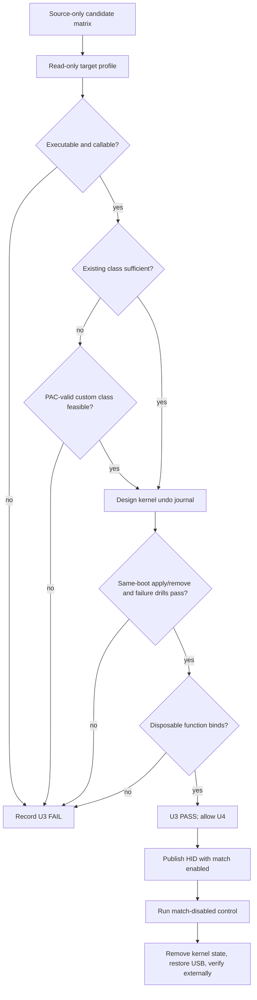
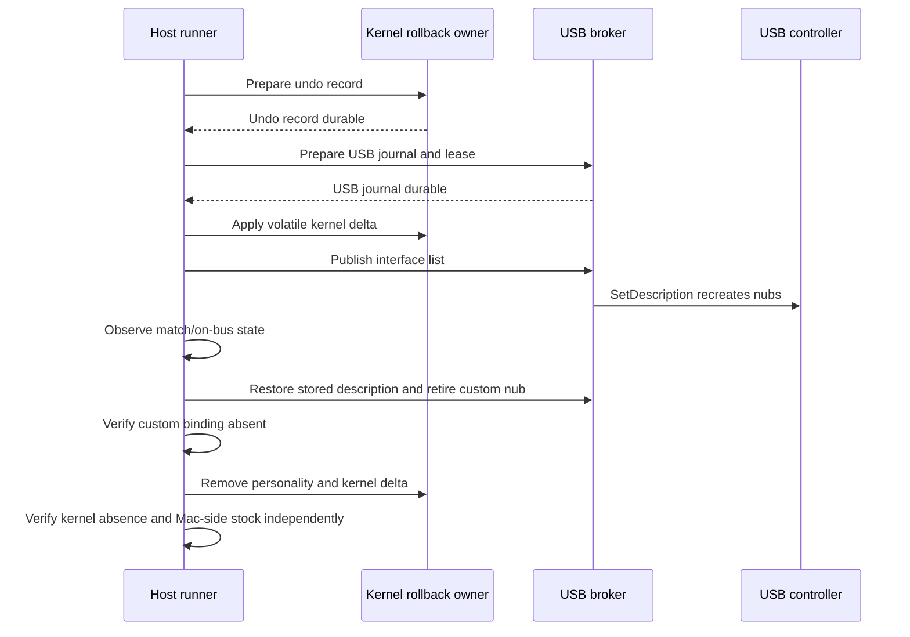

# iPad Kernel HID Gadget (U3 feasibility + U4 function) - Plan

> **Closed as a failed experiment, 2026-11-02.** The source eligibility gate
> produced no surviving candidate; subsequent U3 device units and U4 were not
> executed. The plan below is retained for reference, not as an active work queue.
> See [the candidate matrix](research/kernel-gadget-candidate-matrix.md).

## Goal Capsule

- **Objective:** Determine whether the reference iPad can host a reversible kernel-matched USB function and, only if it can, use that mechanism to bring a HID configuration on bus without leaving kernel or USB state behind.
- **Means:** Advance through separate kernel capability gates before integrating any mutation with the USB broker; U4 uses description-triggered nub recreation rather than an explicit bus cycle. (KTD1–KTD5)
- **Authority:** The Product Contract and R-IDs in [`01-hardware-feasibility.md`](01-hardware-feasibility.md) govern behavior. This child plan governs the U3/U4 implementation sequence. The iPad skill and the Current state block in [`../../ipad/target-device-findings.md`](../../ipad/target-device-findings.md) govern device safety.
- **Execution profile:** Sequential hardware gates on the reference device. No later capability or device-facing unit starts when an earlier gate fails; U3.9 still runs to record the gate-specific verdict. Repository changes may be reviewed together, but no device-facing U4 integration begins until U3 passes.
- **Stop conditions:** Stop before the first kernel write if the only candidate requires persistent kernelcache replacement, an unavailable boot-chain primitive, an unconstructable arm64e class/vtable, or reboot-only cleanup. Stop after any write if same-boot rollback, independent inspection, or stock USB recovery cannot be proved.
- **Finisher:** An owner-supervised implementer performs any authorized device unit, records the evidence, and ships only the source, tests, redacted conclusions, and durable procedure changes.

---

## Product Contract

### Summary

This plan refines U3 and U4 of [`01-hardware-feasibility.md`](01-hardware-feasibility.md). It adds no product scope and leaves R4, R5–R10, R16, R17, AE2, AE3, and AE5 unchanged.

### Problem Frame

The closed userspace path proved that `IOUSBDeviceController::createUSBDevice` needs an in-kernel driver match before a custom function can reach the bus. Public prior art proves narrower capabilities on other targets: KTRW loaded a GDB-stub `.ikext` on A11 under exceptional KTRR-bypass or preboot conditions, while KCMod and `insert_kext` can replace or inject kernelcache code in research-device-style environments. None proves a custom arm64e IOKit class, a removable personality, or a USB gadget-function match on this M2/iPadOS 17 target.

The previous plan collapsed those capabilities into one “register or patch” decision. It also assumed the U2 broker could undo arbitrary kernel state after failure and prescribed an explicit bus cycle even though description publication already recreates and re-matches the function nubs. The refined plan treats the capabilities as separate gates and avoids a redundant controller transition.

### Requirements

- R4, R9. U4 passes only when a kernel-backed HID configuration reaches on-bus state with the match enabled and fails the otherwise identical control without it.
- R5–R8, R16. Every kernel mutation has a pre-write undo record, an idempotent same-boot removal path owned independently of the mutated worker, a separately verified reboot fallback, and externally verified USB restoration.
- R10, R17. Enumeration and HID report transport remain separate proofs; U4 establishes matching/on-bus behavior, while the parent plan's U5 proves descriptors, reports, and host-visible input.
- R16. Intermediate evidence—kernel code execution, a callable entry, a registered stock `IOService`, or an installed personality—never counts as a gadget-match pass without actual binding to a disposable function nub.

### Scope Boundaries

- **In scope:** source-only candidate triage; read-only target capability profiling; volatile same-boot mutations; rollback ownership; disposable-function binding; HID matching/on-bus proof; kernel and USB cleanup evidence.
- **Out of scope:** boot-image or kernelcache replacement on the reference device; broad AMFI/PPL/KTRR disablement; persistent patches; report injection and Switch 2 validation, which remain in U5 and later parent-plan units.
- **Considered but not built:** extending the lease for `GoOffAndOnBus`. Description publication already recreates and re-matches function nubs inside the proven observation window. Reconsider an explicit cycle only if later evidence proves publication cannot trigger the required match.

**Product Contract preservation:** unchanged; this plan only refines the technical gate sequence and verification contract.

---

## Planning Contract

### Key Technical Decisions

- KTD1. **Use a rung-gated capability ladder.** Settle writable data, executable placement, callable entry, existing-class registration, custom-class/PAC feasibility, personality installation, actual function binding, and report transport as distinct capabilities. A failure stops later work instead of being papered over by a weaker success.
- KTD2. **Reject persistent research-loader mechanisms for this gate.** KTRW preboot insertion, KCMod replacement, and `insert_kext`-style kernelcache injection are prior art, not candidates for R16 unless the parent Product Contract is changed. U3 considers only volatile mechanisms that can be removed same-boot and that reboot returns to stock.
- KTD3. **Give kernel rollback its own journal and launchd-supervised owner.** `USBRestoreJournal` continues to own the controller description only. A separate root launchd service owns the kernel-change record and idempotent removal independently of both the mutation worker and U2 broker. It must restart into stale-journal recovery before the first live write is eligible. Reboot recovery is a second backstop, not a substitute for same-boot rollback.
- KTD4. **Trigger matching through description publication.** The existing interface-list publication recreates function nubs and invokes fresh matching. U4 does not call `GoOffAndOnBus` because that extra controller transition adds a measured ~328-second outage without adding a match boundary the publication does not already provide. Every observer derives its deadline from the built broker's configured publication-life cap rather than copying a fixed value into the runner.
- KTD5. **Use evidence states that cannot be conflated.** Every trial reports the highest independently proven state: `code-executed`, `entry-called`, `service-registered`, `personality-installed`, `function-bound`, `controller-on-bus`, `host-enumerated`, or `reports-observed`. Kernel absence, USB-description restoration, and Mac-side recovery are verified separately.
- KTD6. **Keep raw build facts private and validate their shape in Git.** Exact offsets, addresses, before/after bytes, and device identifiers live under ignored `build/ipad-hardware/`. Git contains a profile schema, validators, redacted digests, and conclusions; source code never hard-codes target facts.

### High-Level Technical Design

The kernel and USB transactions remain separate even when one broker coordinates them:

### Standing Safety Rules

- The U2 broker, stored-description journal, pinned Wi-Fi SSH, recovery tools, and reboot procedure remain the USB recovery spine. They do not prove or own kernel rollback.
- Every device action is separately authorized after stating device-data risk, stability risk, SSH/USB-access risk, exact target, inspection method, and reversal. Read-only discovery never implies authorization for a later write.
- No kernel write occurs until a fresh private restore kit exists, the exact target/build is pinned, both journals are prepared, the launchd-supervised rollback service is live and has passed stale-journal restart recovery, and the owner is physically available for restart/re-jailbreak.
- Do not repeat a failed mutation or recovery action on the same boot. Stop, preserve evidence, obtain a fresh-agent second opinion, and update the findings before choosing a different discriminating check.

---

## Implementation Units

### U3.1. Source-only candidate matrix

- **Goal:** Eliminate mechanisms that cannot meet R16 before touching the device.
- **Requirements:** R16; KTD1, KTD2.
- **Dependencies:** None.
- **Files:** Modify `docs/plans/ipad-port/01-u3u4-kernel-hid-gadget.md`; create `docs/plans/ipad-port/research/kernel-gadget-candidate-matrix.md`; create `docs/plans/ipad-port/scripts/ipad-hardware/tests/test-u3-kernel-candidate-matrix.py`.
- **Approach:** Compare existing-class/personality reuse, a catalogue personality targeting an existing class, new executable code using existing classes, a new arm64e class/personality, and a narrowly scoped match-path patch. For each candidate record executable-code need, PAC/vtable need, catalogue mutation, persistence, same-boot removal, surviving rollback owner, build dependence, and whether the mechanism can later carry HID reports.
- **Test scenarios:** The validator accepts a fully classified volatile candidate; rejects a candidate missing rollback ownership; rejects boot-image replacement as R16-ineligible; and refuses to advance a candidate that proves only code execution or stock-service registration.
- **Verification:** One candidate survives every hard stop, or U3 records an evidenced source-only FAIL with no device action.

### U3.2. Per-build read-only capability profile

- **Goal:** Confirm that the surviving candidate's required kernel surfaces are observable on `21A329` without mutation.
- **Requirements:** R16; KTD1, KTD6.
- **Dependencies:** U3.1.
- **Files:** Create `ios/kernel/KernelCapabilityProfile.*`; create `docs/plans/ipad-port/scripts/ipad-hardware/device/u3-readonly-kernel-capabilities.*`; create `docs/plans/ipad-port/scripts/ipad-hardware/host/read-u3-kernel-capabilities-wifi.py`; create `docs/plans/ipad-port/scripts/ipad-hardware/tests/test-u3-kernel-profile.py`; write private evidence under `build/ipad-hardware/`.
- **Approach:** Pin the exact target and build, inventory the Dopamine primitive and patchfinder provenance, and classify only the regions and kernel APIs the surviving candidate needs. Two bounded reads must agree for stability, and every mutation-critical surface must also pass an independent provenance, known-value, or separately resolved observation check. Commit the schema and a redacted digest, not raw addresses or identifiers.
- **Test scenarios:** The profile validator accepts stable reads plus independent validation for the pinned build; rejects a build mismatch, missing provenance, a protected required surface, agreeing reads with no correctness check, disagreeing reads, and raw private values in committed output.
- **Verification:** The candidate's required surfaces are classified with reproducible read-only evidence, or U3 stops without a kernel write.

### U3.3. Executable and callable-entry gate

- **Goal:** Establish whether the target can place and invoke the minimum kernel-side behavior the candidate requires.
- **Requirements:** R16; KTD1, KTD2.
- **Dependencies:** U3.2.
- **Files:** Extend `ios/kernel/KernelCapabilityProfile.*` and `docs/plans/ipad-port/scripts/ipad-hardware/tests/test-u3-kernel-profile.py`; update `docs/plans/ipad-port/research/kernel-gadget-candidate-matrix.md`.
- **Approach:** Resolve this from source and read-only target evidence first. Distinguish writable kernel data from executable allocation, a callable entry, relocation/symbol resolution, code-signing or executable-page constraints, and cleanup. If the candidate needs executable placement and no volatile path exists, stop before mutation.
- **Test scenarios:** A data-only candidate does not claim executable support; a code candidate cannot advance without placement, invocation, and cleanup evidence; KTRW/KCMod/`insert_kext` evidence is classified as target-specific prior art rather than target capability.
- **Verification:** The profile states exactly which executable/callable rung is supported and why; unsupported required capability yields U3 FAIL.

### U3.4. IOKit class, personality, and binding design

- **Goal:** Prove on paper that the candidate can progress from a kernel entry to an actual USB-function driver match.
- **Requirements:** R9, R16; KTD1, KTD5.
- **Dependencies:** U3.3.
- **Files:** Extend `docs/plans/ipad-port/research/kernel-gadget-candidate-matrix.md`; create `docs/plans/ipad-port/scripts/ipad-hardware/tests/test-u3-kernel-match-design.py`.
- **Approach:** Prefer an existing Apple class whose behavior can satisfy the disposable binding proof. If a new class is required, identify how its `OSMetaClass`, vtable entries, and PAC signatures would be valid on arm64e. Separately specify personality/catalogue installation, same-boot removal, the description-publication rematch boundary, and negative evidence that the personality is absent after cleanup.
- **Test scenarios:** Reject a stock `IOService` node as driver proof; reject an installed personality with no binding predicate; reject a custom class with no PAC-valid vtable plan; reject a catalogue addition with reboot-only removal; accept only a design that reaches and later removes an actual function binding.
- **Verification:** The design names a viable class, personality, binding trigger, observation seam, and removal proof, or U3 stops before mutation.

### U3.5. Kernel rollback transaction and independent owner

- **Goal:** Make partial apply, worker death, and broker death classifiable and recoverable before the first kernel write.
- **Requirements:** R5–R8, R16; KTD3.
- **Dependencies:** U3.4.
- **Files:** Create `ios/kernel/KernelChangeJournal.*`, `ios/kernel/KernelChangeCoordinator.*`, and `ios/kernel/KernelRollbackService.*`; create the allowlisted launchd job and bounded install/remove tooling under `docs/plans/ipad-port/scripts/ipad-hardware/device/`; create `docs/plans/ipad-port/scripts/ipad-hardware/tests/test-u3-kernel-change-lifecycle.py`.
- **Approach:** Keep the kernel journal separate from `USBRestoreJournal`. Record the exact inverse before each write, use monotonic phases for partial apply, and make removal idempotent. A dedicated root launchd service owns recovery and follows the existing watchdog supervision pattern, with tweak injection disabled and no dependency on the mutation worker or U2 broker. Treat reboot as a distinct last-resort cleanup path.
- **Test scenarios:** Cover prepare failure, first-write failure, partial multi-write apply, repeated removal, worker death, rollback-service restart, U2 broker death, stale journal on service restart, and reboot cleanup classification. A missing, injected, unhealthy, or restart-untested rollback service must fail closed before mutation.
- **Verification:** Offline lifecycle fixtures prove every phase has one safe next action and no path clears either journal before independent verification.

### U3.6. Idle-device apply/remove proof

- **Goal:** Demonstrate one authorized volatile kernel mutation and byte/object/catalogue-identical same-boot removal without publishing a custom function.
- **Requirements:** R5–R8, R16; KTD3, KTD5.
- **Dependencies:** U3.5.
- **Files:** Create a bounded device payload and pinned host runner under `docs/plans/ipad-port/scripts/ipad-hardware/{device,host}/`; extend `docs/plans/ipad-port/scripts/ipad-hardware/tests/test-u3-kernel-change-lifecycle.py`; write private evidence under `build/ipad-hardware/`.
- **Approach:** Prepare the kernel undo record, USB journal, broker lease, and rollback owner before the first write. Apply only the candidate delta, read it back, remove it through the independent owner, and prove the exact baseline is restored. Verify stock USB separately with the strict external check; confirm or preserve each journal only from its own proof. This unit requires fresh, exact owner authorization.
- **Test scenarios:** Normal apply/remove; apply read-back mismatch; removal invoked twice; observer disconnect after apply; rollback owner handles a stale active journal; USB remains healthy while kernel cleanup is independently confirmed; USB journal confirmation cannot clear an active or unverified kernel record.
- **Verification:** Same-boot removal returns every recorded delta to baseline and Mac-side checks show stock. Reboot recovery is recorded separately and cannot rescue a same-boot failure.

### U3.7. Failure-owner and reboot drills

- **Goal:** Prove cleanup when the normal applier or coordinator disappears, still without HID publication.
- **Requirements:** R5–R8, R16; KTD3.
- **Dependencies:** U3.6.
- **Files:** Extend the proposed U3 host runner under `docs/plans/ipad-port/scripts/ipad-hardware/host/` and `docs/plans/ipad-port/scripts/ipad-hardware/tests/test-u3-kernel-change-lifecycle.py`; update `docs/ipad/usb-recovery.md` only if the durable recovery procedure changes.
- **Approach:** Exercise applier death, lost connection, lease expiry, U2 broker restart, rollback-owner restart, and partial apply one at a time while preserving the pinned Wi-Fi inspection channel. Test reboot as a separate fallback. Do not use a cable pull unless the rollback owner and inspection channel remain observable.
- **Test scenarios:** Each failure causes same-boot kernel removal by the surviving owner; the U2 broker restores USB state independently; stale or ambiguous state fails closed; reboot returns stock but is reported as fallback rather than same-boot success.
- **Verification:** Every required failure path proves both kernel absence and externally verified stock USB, or U3 fails.

### U3.8. Disposable-function binding proof

- **Goal:** Prove that the installed kernel personality actually binds a newly recreated, non-HID disposable function nub.
- **Requirements:** R9, R16; KTD4, KTD5.
- **Dependencies:** U3.7.
- **Files:** Extend `ios/kernel/KernelChangeCoordinator.*`; create `docs/plans/ipad-port/scripts/ipad-hardware/host/run-u3-kernel-bind-trial-wifi.py`; create `docs/plans/ipad-port/scripts/ipad-hardware/tests/test-u3-kernel-bind-trial-tooling.py`; reuse the census and restore seams from `docs/plans/ipad-port/scripts/ipad-hardware/device/u3-rematch-driverless-function.py` and `docs/plans/ipad-port/scripts/ipad-hardware/host/rematch-u2-driverless-function-wifi.py`.
- **Approach:** Install the candidate under the kernel transaction, publish one disposable function name through the existing interface-list path, and let `SetDescription` recreate the nubs. Record `service-registered`, `personality-installed`, and `function-bound` independently. Cleanup first restores the stock description while the implementation remains callable, then proves the custom nub and binding are gone, removes the personality and kernel delta through the independent owner, and finally verifies kernel absence and Mac-side stock. This unit requires separate authorization for the kernel mutation and controller publication.
- **Test scenarios:** Binding-enabled trial reaches `function-bound`; identical disabled control does not; a registered stock service without a bound client fails; personality installation without binding fails; cleanup retires the bound nub before removing its implementation and confirms neither journal until its own proof passes.
- **Verification:** The disposable nub binds iff the kernel candidate is enabled, and both kernel and USB state return to verified stock.

### U3.9. U3 verdict and per-build profile

- **Goal:** Record a gate-specific R16 verdict without promoting partial evidence.
- **Requirements:** R16; KTD1, KTD5, KTD6.
- **Dependencies:** U3.1–U3.8 as far as the first failed gate.
- **Files:** Modify `docs/ipad/target-device-findings.md`, `docs/ipad/hardware-matrix.md`, and the committed profile schema/digest artifacts; update `docs/ipad/device-cleanup-ledger.md` for any persistent device-side tooling installed during authorized execution.
- **Approach:** Record the highest evidence state reached and the first failed gate. PASS requires actual disposable-function binding, clean same-boot removal under every required failure owner, and independent reboot recovery. Anything less is FAIL or stopped-for-constraints.
- **Test scenarios:** Documentation validation refuses PASS when evidence stops at code execution, service registration, or personality installation; refuses PASS when same-boot rollback failed but reboot succeeded; accepts PASS only with binding and both recovery classes.
- **Verification:** The Current state and hardware matrix agree on the verdict and point to redacted evidence digests.

### U4.1. Broker integration with separate kernel transaction

- **Goal:** Coordinate kernel apply/remove with USB publication without merging their journals or failure semantics.
- **Requirements:** R5–R9, R16; KTD3, KTD4.
- **Dependencies:** U3.9 PASS.
- **Files:** Modify `ios/watchdog/NativeUSBWatchdogService.swift`, `ios/watchdog/USBRestoreCoordinator.swift`, and the broker source used by `docs/plans/ipad-port/scripts/ipad-hardware/build-u2-noop-trial-binary.py`; extend `docs/plans/ipad-port/scripts/ipad-hardware/tests/test-u3-additive-publication.py`; create `docs/plans/ipad-port/scripts/ipad-hardware/tests/test-u4-kernel-match-lifecycle.py`.
- **Approach:** Prepare both undo records before mutation. Apply the kernel candidate before publication. On any exit after a custom nub may exist, restore the stock description and prove the binding is gone before removing the personality or executable delta; earlier failures can remove the unapplied or unbound kernel delta directly. Confirm neither journal until its own external proof passes. Keep the path behind a compile-time flag so the stock broker behavior remains available.
- **Test scenarios:** Cover prepare failure, partial kernel apply, publish failure before binding, normal restore, worker death, lease expiry, heal, and broker restart; prove teardown never removes an implementation from a live binding; prove USB restoration does not falsely mark kernel cleanup complete; prove a build without the feature flag preserves v21 behavior.
- **Verification:** Offline fixtures show every exit returns both state machines to verified stock or leaves an explicit recoverable journal.

### U4.2. Match-enabled HID publication

- **Goal:** Bring `[AppleUSBMux, <HID>]` on bus through description-triggered nub recreation while the proven lease remains live.
- **Requirements:** R4, R9; KTD4, KTD5.
- **Dependencies:** U4.1.
- **Files:** Extend `docs/plans/ipad-port/scripts/ipad-hardware/host/run-u2-hid-trial-wifi.py` or create `docs/plans/ipad-port/scripts/ipad-hardware/host/run-u4-kernel-hid-trial-wifi.py`; create `docs/plans/ipad-port/scripts/ipad-hardware/tests/test-u4-kernel-match-trial-tooling.py`; reuse `docs/plans/ipad-port/scripts/ipad-hardware/host/capture-u2-hid-enumeration.py` and the existing HID fixtures.
- **Approach:** Apply the kernel match, publish the HID interface list once, and observe fresh matching and on-bus state without `GoOffAndOnBus`. The runner obtains or validates the publication-life cap from the built broker fixture and binds the worker wait, host observation, and broker lease to that same value. If publication cannot trigger matching inside the configured horizon, stop and redesign the lease before another trial.
- **Test scenarios:** Match-enabled publication reaches `function-bound` and `controller-on-bus` inside the live lease; a runner/broker cap mismatch fails before publication; timeout restores rather than extending silently; evidence captured after restore is labelled stale and cannot pass; no explicit bus-cycle selector is reachable.
- **Verification:** The controller reaches on-bus state while the kernel match and lease are both live, then kernel and USB state return to verified stock.

### U4.3. Match-disabled discriminating control

- **Goal:** Isolate the kernel match as the cause of the on-bus result.
- **Requirements:** R4, R9; KTD5.
- **Dependencies:** U4.2.
- **Files:** Extend the proposed U4 runner under `docs/plans/ipad-port/scripts/ipad-hardware/host/` and `docs/plans/ipad-port/scripts/ipad-hardware/tests/test-u4-kernel-match-trial-tooling.py`.
- **Approach:** Capture a match-disabled baseline before enabling the candidate. Then run the enabled publication and, after verified cleanup, a second disabled publication from an equivalent starting-state digest. Record the exact highest evidence state in every run.
- **Test scenarios:** Both disabled controls stop before binding while enabled reaches on-bus; any run-order gap or starting-state drift invalidates causality; every run restores independently; an enabled-only service registration without on-bus state does not pass.
- **Verification:** On-bus occurs only in the enabled run, and both disabled controls began from and returned to equivalent verified state, with redacted evidence for all three.

### U4.4. Kernel-aware fault matrix

- **Goal:** Prove normal and abnormal U4 exits remove kernel state and restore USB state independently.
- **Requirements:** R5–R9, R16; KTD3, KTD5.
- **Dependencies:** U4.3.
- **Files:** Extend `docs/plans/ipad-port/scripts/ipad-hardware/tests/test-u4-kernel-match-lifecycle.py`, the proposed U4 runner under `docs/plans/ipad-port/scripts/ipad-hardware/host/`, and recovery documentation only where durable procedure changes.
- **Approach:** Exercise normal restore, injector death, worker death, lease expiry, publication failure, rollback-owner restart, U2 broker restart, and partial kernel apply. When a custom nub may be bound, restore stock and prove the binding is gone before removing its kernel implementation. Use the existing owner-restart heal for the audio re-registration race. Keep physical cable removal out unless both rollback and inspection remain available.
- **Test scenarios:** Each fault proves bound instances are retired before implementation removal, then proves kernel absence and strict Mac-side stock independently; kernel cleanup failure cannot be hidden by healthy USB; USB recovery failure cannot be hidden by removed kernel state; journal confirmation occurs only after its corresponding proof.
- **Verification:** Every required fault path restores both state domains without an unrecorded manual action; reboot independently returns stock.

### U4.5. U4 result and handoff to U5

- **Goal:** Record whether kernel-backed HID matching reaches on-bus state and state exactly what U5 still must prove.
- **Requirements:** R4, R9, R10, R17; KTD5.
- **Dependencies:** U4.4.
- **Files:** Modify `docs/ipad/target-device-findings.md`, `docs/ipad/hardware-matrix.md`, `docs/ipad/device-cleanup-ledger.md`, and the parent plan's U5 entry if its prerequisites changed.
- **Approach:** Record the enabled/disabled control, cleanup evidence, highest evidence state, and redacted digests. Do not claim host HID enumeration or report delivery unless the corresponding evidence states were independently reached; those remain U5's contract.
- **Test scenarios:** Documentation validation distinguishes `controller-on-bus` from `host-enumerated` and `reports-observed`; records any installed tooling and its cleanup condition; refuses a U4 PASS when either state domain lacks verified cleanup.
- **Verification:** The findings, matrix, ledger, and parent-plan handoff agree on the U4 verdict and remaining U5 work.

---

## Verification Contract

| Gate | Required proof | Fails when |
|---|---|---|
| Source eligibility | Candidate matrix validator and cited primary sources | Only persistent/preboot mechanisms survive, or rollback/report implications are unknown |
| Read-only target profile | Two agreeing reads, exact build pin, private raw profile, committed schema and digest | Build/provenance mismatch, protected required surface, or inconsistent reads |
| Kernel lifecycle | `test-u3-kernel-change-lifecycle.py` plus owner-authorized device evidence | Undo record follows the write, rollback owner does not survive, or reboot is the only cleanup |
| Driver match | Disposable nub binds iff the candidate is enabled | Evidence stops at code, service, or personality state |
| HID on-bus | Match-enabled publication reaches on-bus inside the live lease; disabled control does not | Explicit bus cycle is required without a separately proven horizon, or observation occurs after restore |
| Cleanup | Kernel absence, USB description restoration, and strict Mac-side stock each pass independently | One healthy domain masks residue or failure in another |

All Mac-only hardware-script tests under `docs/plans/ipad-port/scripts/ipad-hardware/tests/` must pass. Every device run stores private evidence under a new label in `build/ipad-hardware/`, bounds output and runtime, and records only redacted conclusions in Git.

---

## Definition of Done

- U3 is complete only when it records PASS or a gate-specific evidenced FAIL/stopped verdict; partial capability evidence is retained without being promoted.
- U3 PASS requires actual binding of a disposable function, same-boot rollback across the required failure owners, separate reboot recovery, and an exact-build profile with no raw private facts committed.
- U4 PASS requires an enabled/disabled causal control, on-bus observation inside the live lease, and independently verified cleanup of kernel and USB state on every required exit.
- The plan never uses `GoOffAndOnBus` as a redundant match trigger, derives observation deadlines from the built broker's configured publication-life cap, and never treats USB recovery as proof of kernel cleanup.
- Findings, matrix, cleanup ledger, recovery docs, and parent-plan prerequisites agree with the final evidence.
- All temporary payloads, dead-end candidate code, stale profiles, and abandoned trial tooling are removed; installed device artifacts have explicit cleanup entries and are removed unless the next authorized unit needs them.

---

## Sources and Reusable Assets

- [Synacktiv, “iOS: a journey in the USB networking stack”](https://www.synacktiv.com/publications/ios-a-journey-in-the-usb-networking-stack) — `createUSBDevice` function matching and description-driven recreation.
- [Google Project Zero KTRW](https://github.com/googleprojectzero/ktrw) — real A11 `.ikext` loading prior art with an empty `IOKitPersonalities` dictionary and direct USB-controller takeover, not a gadget-function driver.
- [KCMod](https://github.com/skr0x1c0/kcmod) and [insert_kext](https://github.com/mowisec/insert_kext) — research-kernelcache replacement/injection; `insert_kext` demonstrates a stock `IOService` node but not a custom PAC-valid driver class.
- `docs/ipad/usb-auto-recovery.md` — matching boundary, catalogue limitations, and the rule that registered nubs without drivers cannot be generically re-matched from ordinary userspace.
- `ios/usb/USBRestoreJournal.swift`, `ios/watchdog/USBRestoreCoordinator.swift`, and `ios/watchdog/NativeUSBWatchdogService.swift` — proven USB transaction pattern; not a kernel rollback mechanism.
- `docs/plans/ipad-port/scripts/ipad-hardware/tests/test-u3-additive-publication.py` — lease, rollback, restart, and fault-fixture patterns.
- Closed userspace assets remain reusable: `ios/canary/HIDKeyboardReport.*`, `docs/plans/ipad-port/scripts/ipad-hardware/host/capture-u2-hid-enumeration.py`, `docs/plans/ipad-port/scripts/ipad-hardware/host/capture-u2-hid-reports.py`, `docs/plans/ipad-port/scripts/ipad-hardware/host/run-u2-hid-trial-wifi.py`, the interface-list publication, stored-description restore, and pinned Wi-Fi recovery runners.
