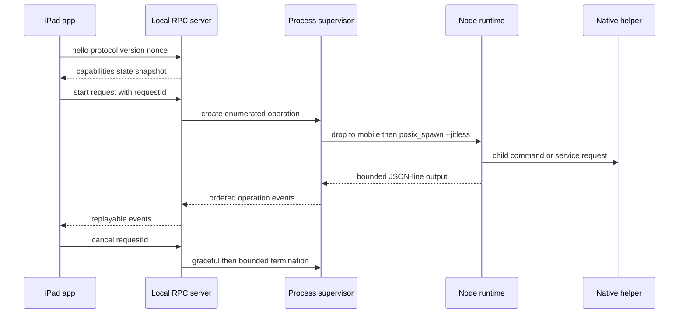
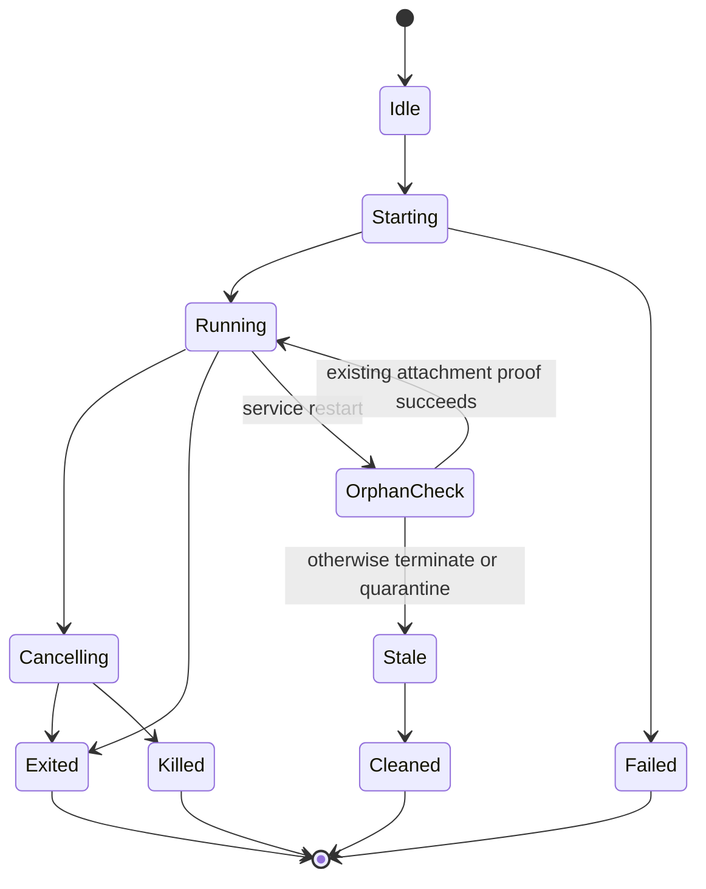

# iOS Runtime and Services - Plan

## Goal Capsule

- **Objective:** The target iPad can run and supervise mac2jb's host, HID, held-session, attachment, dump, and recovery workloads locally and durably.
- **Means:** Introduce a versioned local service protocol, an iOS `posix_spawn` supervisor, a pinned `--jitless` Node runtime, and platform adapters that preserve the current script contracts (KTD1–KTD9).
- **Authority:** The roadmap R2, R3, R9, R10, and R19 govern behavior; the hardware capability record governs USB and network integration.
- **Stop conditions:** Do not connect the production UI until process, protocol, ownership, and crash-recovery fixtures pass. Do not ship if Node cannot run the required module/process matrix on M1 iPadOS 17.0.

---

## Product Contract

### Summary

Move process ownership out of `gui/SessionModel.swift` into a Dopamine rootless service that survives UI lifecycle changes. Preserve the repository's JSON-line event model and JavaScript orchestration where it works, while providing native service commands for privileged USB and any subprocess capability that iOS Node cannot safely own.

### Problem Frame

The macOS app launches embedded Node and native helpers through `Foundation.Process`, extracts a tar payload with `/usr/bin/tar`, and assumes desktop filesystem/ownership semantics. iOS lacks `Process`, TrollStore cannot install a launch daemon, and A12+ devices cannot rely on JIT entitlements. The service boundary must therefore supply durable process supervision, secure local IPC, runtime extraction/validation, and explicit compatibility with Dopamine forkfix.

### Requirements

**Service and protocol**

- R1. A rootless service must own long-running host, HID, session, media, and cleanup processes independently of the app lifecycle.
- R2. The app/service protocol must be local-only, authenticated by peer identity and per-install secret, length-bounded, versioned, cancellable, and resilient to reconnects.
- R3. Every command must have a stable request ID and emit ordered structured events compatible with the state transitions currently driven by `MAC2JB_GUI` JSON lines.
- R4. The service must reject incompatible clients before launching or mutating anything.

**Runtime and process supervision**

- R5. The release must pin and verify an arm64 iOS Node build capable of required filesystem, TCP, TLS, timers, signals, `child_process`, and CommonJS behavior under `--jitless`.
- R6. Native process supervision must use bounded pipes, explicit working directories/environment, process groups, cancellation escalation, exit classification, and output size limits.
- R7. UI termination must be transparent, but root-service death must terminate or quarantine unverifiable process trees, restore USB through the independent watchdog, and require a new Switch workflow unless the existing live-attachment proof succeeds.
- R8. Runtime payload installation must reject traversal, links, wrong ownership/modes, unexpected executables, and hash mismatches without depending on `/usr/bin/tar`.

**Portability and compatibility**

- R9. Existing macOS `Process` behavior remains behind a shared execution interface and retains current tests.
- R10. Existing host profiles, session directories, attachment tokens, ownership checks, and cleanup semantics remain authoritative unless iOS path differences require a documented adapter.
- R11. The service must expose diagnostics for runtime integrity, jailbreak root, Node capability, forkfix behavior, USB helper authorization, selected interface, ports, and stale ownership.
- R12. Privileged commands must be enumerated high-level operations over opaque, session-bound, expiring handles; callers cannot supply executable paths, raw argument vectors, environments, USB descriptors, or arbitrary controller commands.
- R13. Durable events and logs may contain only state, sequence numbers, counts, opaque IDs/hashes, and stable error identifiers; keyboard text, commands, account data, URLs, library items, and user content remain transient.
- R14. Node, ns2jb, Python, FFmpeg, and homebrew children must run as `mobile` with cleared supplementary groups, scrubbed environment, and no inherited privileged descriptor or access to daemon secrets/journals.
- R15. Runtime installation must keep a verified immutable payload separate from a newly materialized private workspace for each launch/profile selection.

### Acceptance Examples

- AE1. **Covers R1–R4.** Given an authenticated compatible app, when it starts a host, backgrounds, terminates, and reconnects, then the same service-owned operation continues and event replay restores UI state.
- AE2. **Covers R2, R4.** Given an unauthenticated, oversized, malformed, or incompatible request, when it reaches the local transport, then it is rejected before process launch and an audit event is recorded.
- AE3. **Covers R5–R6.** Given the packaged Node runtime, when the capability suite runs under `--jitless`, then every required module and child lifecycle passes on the target iPad.
- AE4. **Covers R7, R10.** Given a root-service crash during a held session, when state is reconciled, then USB restores, unverifiable children and ports are gone, and only the existing live-token attachment proof can reconnect.
- AE5. **Covers R8.** Given a payload with traversal, symlink, wrong mode, or wrong digest, when installation runs, then no active runtime is changed.

### Scope Boundaries

- This plan provides service commands and compatibility fixtures but does not implement final iPad screens.
- Python, SPIR-V, FFmpeg, and homebrew-specific ports belong to the homebrew parity plan; this service exposes their process/plugin boundary.
- Remote IPC, SSH control, and LAN API exposure are excluded; all control remains local to the device.

---

## Planning Contract

### Key Technical Decisions

- KTD1. **Use a rootless LaunchDaemon for durability.** Install it through the Dopamine `.deb`, because TrollStore explicitly cannot spawn launch daemons.
- KTD2. **Use a launchd Mach service with bounded XPC envelopes.** Register an exact Mach service name in the rootless launch plist, give the sandboxed app only the matching lookup entitlement, preserve the repository's structured-event idiom inside canonical bounded envelopes, and apply the app-specific audit-token and pairing contract in KTD7. Treat transport reachability on the target as an early gate; do not broaden the UI to platform/no-sandbox if lookup fails.
- KTD3. **Make the service the sole process owner.** The app receives snapshots/events and sends commands; it never sends signals directly or infers liveness from cached UI state.
- KTD4. **Pin a forked Node build from source.** Adapt the public jailbroken-iOS Node precedent to the repository's pinned major, build it reproducibly, and default to `--jitless`.
- KTD5. **Replace archive shelling with in-process extraction.** Use a linked archive implementation or a simple repository-owned format with the same validation guarantees already encoded in `gui/Runtime.swift`.
- KTD6. **Preserve script entry points behind a platform manifest.** Add platform capability/path data instead of forking every `gui-*.cjs` script.
- KTD7. **Authenticate the specific installed app, not only its UID.** Verify the peer audit token/PID and installed bundle identity/CDHash against the signed manifest, then complete challenge-response with a per-install pairing nonce whose verifier is stored by the daemon and rotated on reinstall.
- KTD8. **Drop privilege before runtime work.** Keep the controller broker/watchdog and narrow USB helper privileged; spawn every parser, runtime, vendor script, and imported app as `mobile` after closing privileged descriptors and clearing groups/environment.
- KTD9. **Preserve immutable-runtime and fresh-workspace layers.** Install one verified runtime version, then materialize a private real-file workspace for each profile/session because current canonical-path, ownership, and source-hash validators reject aliases and shared mutation.

### High-Level Technical Design





### Output Structure

```text
ios/
  app-protocol/
  service/
  supervisor/
  runtime/
  shared/
  tests/
packaging/ios/
  node-runtime.lock.json
  rootless/
```

### Sources and Research

- Current orchestration: `gui/SessionModel.swift`, `gui/Runtime.swift`, `scripts/gui-host.cjs`, `scripts/gui-session.cjs`, `scripts/gui-homebrew.cjs`, `scripts/rpc-attachment.cjs`, and `host-wrapper.cjs`.
- Runtime build: `scripts/build-gui.sh`, `packaging/homebrew-runtime.lock.json`, and `.github/workflows/build.yml`.
- TrollStore service limitations/root helpers: <https://github.com/opa334/TrollStore>.
- Dopamine forkfix loading: <https://github.com/opa334/Dopamine/blob/3.x/BaseBin/systemhook/src/main.c>.
- Node iOS source-build precedent: <https://github.com/j0shua-SYSON/node-ios>.
- Theos rootless layout: <https://theos.dev/docs/rootless>.

---

## Implementation Units

### U1. Extract shared workflow state and execution transport

- **Goal:** Create the seam the service integration needs without changing current Mac behavior.
- **Requirements:** R3, R9, R10
- **Dependencies:** None
- **Files:** `gui/SessionModel.swift`, `gui/SessionTypes.swift`, `gui/WorkflowProgress.swift`, `gui/ExecutionTransport.swift`, `scripts/test-workflow-progress.swift`, `scripts/test-session-recovery.sh`
- **Approach:** Add characterization coverage, extract event reduction and command intent from AppKit and `Process` ownership, and keep current macOS launching behind a Mac transport before adding iOS RPC.
- **Test scenarios:**
  - Replay current host/HID/session fixtures through the reducer and produce unchanged Mac state and guidance.
  - Cancel and fail at every current workflow stage through the Mac transport and retain existing recovery output.
  - Prove shared files compile without AppKit, UIKit, or direct process types.
- **Verification:** Existing Mac GUI/self-test fixtures pass and U7 can consume a stable transport contract.

### U2. Define the shared service protocol

- **Goal:** Establish a versioned command/event contract before moving process ownership.
- **Requirements:** R2–R4, R11
- **Dependencies:** U1 and the hardware capability schema
- **Files:** `ios/app-protocol/`, `ios/shared/ServiceModels.swift`, `ios/tests/ProtocolTests.swift`, `scripts/test-ios-service-protocol.cjs`
- **Approach:** Define handshake, audit-token/code-identity verification, pairing-nonce challenge, protocol compatibility range, abstract app/service update status, capabilities, high-level operations, opaque handles, request IDs, snapshots, events, cancellation, errors, size bounds, and R13 redaction rules. The update portion describes installed/candidate identities and compatibility without choosing download, signing, or installer mechanics; Distribution U1 later binds it to the signed release manifest. Generate or share fixtures between Swift and service implementations.
- **Execution note:** Start with cross-language golden fixtures for every frame and error.
- **Test scenarios:**
  - Round-trip every command/event through Swift and native decoders with identical canonical fixtures.
  - Reject negative/oversized lengths, trailing data, duplicate IDs, unsupported versions, and invalid state transitions.
  - Reconnect with a last-seen event sequence and replay only the bounded missing window.
  - Round-trip compatible, update-available, mixed-version diagnostic-only, and unknown-candidate states without requiring a distribution implementation.
  - Reject arbitrary path, argv, environment, or USB descriptor fields; stale/cross-session handles; replayed challenges; and a same-UID client with the wrong CDHash.
- **Verification:** Swift and service fixture suites agree byte-for-byte and no command can bypass handshake/authentication.

### U3. Build the rootless service and secure local transport

- **Goal:** Provide durable authenticated local control and lifecycle management.
- **Requirements:** R1–R4, R7, R11
- **Dependencies:** U2
- **Files:** `ios/service/`, `packaging/ios/rootless/Library/LaunchDaemons/`, `ios/tests/ServiceAuthTests.*`
- **Approach:** Resolve the active jailbreak root, register the exact Mach service through the rootless launch plist, grant the app only the corresponding lookup entitlement, validate the XPC peer audit token/code identity and pairing proof per KTD7, maintain a redacted operation registry/event journal, rotate pairing on reinstall, and fail closed on daemon restart per R7.
- **Test scenarios:**
  - Covers AE1. Reconnect after app termination and recover the same operation snapshot.
  - Before integration, prove a normally sandboxed TrollStore app can connect, reconnect, and receive an audit-token-bound reply on the target without platform/no-sandbox entitlement.
  - Covers AE2. Reject another UID, same-UID wrong binary, copied/stale nonce, replayed handshake, PID reuse, connection forwarding, and incompatible client.
  - Restart with running, exited, and corrupted operation journals; terminate or quarantine unverifiable trees and attach only through the existing live proof.
  - Inspect durable state after keyboard and Stremio fixtures and find none of the R13 prohibited values.
- **Verification:** The daemon starts after re-jailbreak, accepts only the installed app, and exposes no network listener.

### U4. Implement native process supervision

- **Goal:** Replace `Foundation.Process` with reliable service-owned spawning and cancellation.
- **Requirements:** R3, R6, R7, R10
- **Dependencies:** U3
- **Files:** `ios/supervisor/`, `ios/tests/ProcessSupervisorTests.*`, `scripts/fixtures/process-supervisor/`
- **Approach:** Wrap `posix_spawn`, privilege drop to `mobile`, group/environment/descriptor scrubbing, nonblocking pipes, process groups, working directories, output framing, graceful signals, timeout escalation, and PID-reuse-resistant identity checks.
- **Test scenarios:**
  - Spawn a fixture that emits split/multiple JSON lines and preserve ordered events.
  - Cancel a cooperative child, then an ignoring child, and verify escalation plus complete reaping.
  - Fill stdout/stderr, exceed output limits, exit by signal, and fork a child without deadlocking the service.
  - Restart service and reject a PID whose executable/token does not match durable metadata.
  - Assert every ordinary child's euid/egid/groups, inability to read root journals/secrets, and absence of inherited service/transport/controller descriptors.
- **Verification:** No fixture leaves a zombie, unbounded buffer, or ambiguous terminal state.

### U5. Cross-build and qualify Node for the target

- **Goal:** Produce a pinned Node runtime that satisfies the repository's actual JavaScript capability set.
- **Requirements:** R5, R8, R11
- **Dependencies:** U4
- **Files:** `packaging/ios/node-runtime.lock.json`, `scripts/build-node-ios.sh`, `scripts/check-node-ios.cjs`, `.github/workflows/ios-runtime.yml`, `packaging/licenses/`
- **Approach:** Pin Node source and patches, cross-build arm64 iOS, bundle CA roots/licenses, sign with minimal entitlements, run `--jitless`, and test required built-ins plus Dopamine forkfix on device.
- **Test scenarios:**
  - Covers AE3. Exercise CommonJS, TCP client/server, TLS, timers, signals, filesystem, crypto, child spawn, cancellation, and inherited file descriptors.
  - Prove WebAssembly-dependent paths are absent or replaced while `--jitless` is active.
  - Refuse startup when binary/source/patch/CA digest differs from the lock.
- **Verification:** Host audit and physical-device capability matrix pass with the exact packaged binary.

### U6. Port runtime installation and integrity checks

- **Goal:** Activate packaged runtime content without desktop shell utilities or unsafe extraction.
- **Requirements:** R8, R11
- **Dependencies:** U3
- **Files:** `ios/runtime/`, `gui/Runtime.swift`, `ios/tests/RuntimeInstallerTests.swift`, `packaging/ios/runtime-manifest.json`
- **Approach:** Extract the immutable payload to private staging, validate manifest paths/types/modes/digests/ownership, fsync, then atomically switch an active-version pointer. For every launch/profile, materialize a fresh private real-file workspace before `prepare-host-profiles.cjs` mutates vendor/bootstrap selection; preserve the Mac implementation behind the shared runtime interface.
- **Test scenarios:**
  - Covers AE5. Reject traversal, absolute path, symlink/hardlink, special file, duplicate path, wrong digest, and unexpected executable.
  - Interrupt before and after activation and retain either the previous complete runtime or the new complete runtime.
  - Detect altered active runtime during self-test and quarantine it.
  - Create two workspaces concurrently, mutate different host profiles, and prove vendor/bootstrap/run roots and attachment validation remain isolated.
- **Verification:** Fixture corpus matches or strengthens the current `Runtime.swift` validation behavior on both platforms.

### U7. Adapt existing orchestration to service execution

- **Goal:** Run host, HID, attach, dump, held-session, and keyboard paths without duplicating core scripts.
- **Requirements:** R3, R9–R11
- **Dependencies:** U4–U6, U1
- **Files:** `scripts/gui-host.cjs`, `scripts/gui-session.cjs`, `scripts/gui-attach.cjs`, `scripts/gui-dump.cjs`, `scripts/runtime-platform.cjs`, `gui/SessionModel.swift`, `ios/tests/SessionServiceTests.swift`
- **Approach:** Add a platform manifest plus opaque controller catalog for paths/capabilities, retain `usb-drdN` only in the Mac adapter, route high-level HID intents through broker-issued handles, retain existing JSON records, and replace Swift process handles with protocol operation handles.
- **Test scenarios:**
  - Run every existing Node fixture under macOS and iOS platform manifests.
  - Covers AE4. After service death, restore USB and terminate/quarantine the tree; reconnect only when `rpc-attachment.cjs` proves the live held connection.
  - Cancel host, HID, attach, dump, and keyboard operations at each documented stage and preserve existing guidance.
  - Extend `scripts/test-gui-host.cjs` and `scripts/test-keyboard.cjs` with opaque iPad controller fixtures and platform-specific network guidance.
  - Attempt path/argv/environment injection, symlink swap, arbitrary descriptor/controller command, stale token, replay, and cross-session handle use; reject before privilege.
- **Verification:** Current orchestration tests remain green and iOS service fixtures cover each command family.

### U8. Add service diagnostics and compatibility reporting

- **Goal:** Make runtime/service failures actionable without a shell.
- **Requirements:** R4, R11
- **Dependencies:** U3–U7
- **Files:** `ios/service/Diagnostics.*`, `ios/shared/DiagnosticModels.swift`, `ios/tests/DiagnosticsTests.*`, `docs/ipad/service-diagnostics.md`
- **Approach:** Return structured checks with stable IDs, severity, redacted details, remediation, and evidence links for protocol, jailbreak root, runtime, forkfix, USB, network, port conflicts, and stale state.
- **Test scenarios:**
  - Map every injected failure to one stable diagnostic and never expose install secrets or raw identifiers.
  - Report mixed app/service versions before accepting a mutating command.
  - Distinguish stopped jailbreak service from corrupted runtime and entitlement denial.
- **Verification:** The UI can render all roadmap R19 categories solely from this contract.

---

## Verification Contract

| Check | Proof |
|---|---|
| Protocol | Cross-language golden fixtures, malformed-frame fuzz corpus, compatibility tests |
| Security | Peer/secret rejection tests, restrictive ownership audit, no network listeners |
| Supervisor | Process lifecycle/fault fixtures, zombie scan, bounded output and cancellation |
| Node | Reproducible source lock, Mach-O audit, on-device `--jitless` capability matrix |
| Runtime | Extraction/adversarial fixtures, atomic activation interruption tests |
| Orchestration | Existing Node tests plus iOS platform-manifest and reconnect fixtures |
| macOS regression | Current `SessionModel`/runtime/self-test workflow remains green |

---

## Definition of Done

- The app can lose foreground status or terminate without ending a service-owned operation.
- All service commands are authenticated, versioned, bounded, cancellable, and observable.
- The exact packaged Node binary passes the physical-device capability suite under `--jitless`.
- Existing script behavior and macOS tests remain intact behind platform adapters.
- Restart reconciliation never attaches to an unverified process/session.
- Runtime activation cannot leave a partially installed active payload.
- No abandoned runtime patch, debug entitlement, secret, or unbounded log remains.
