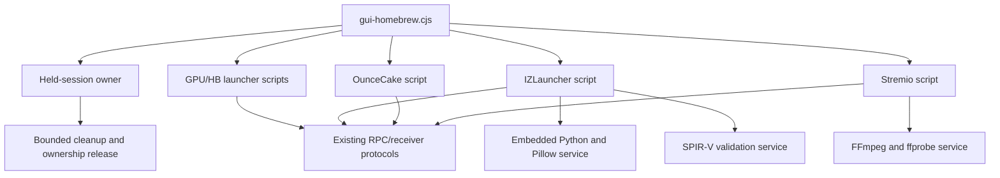
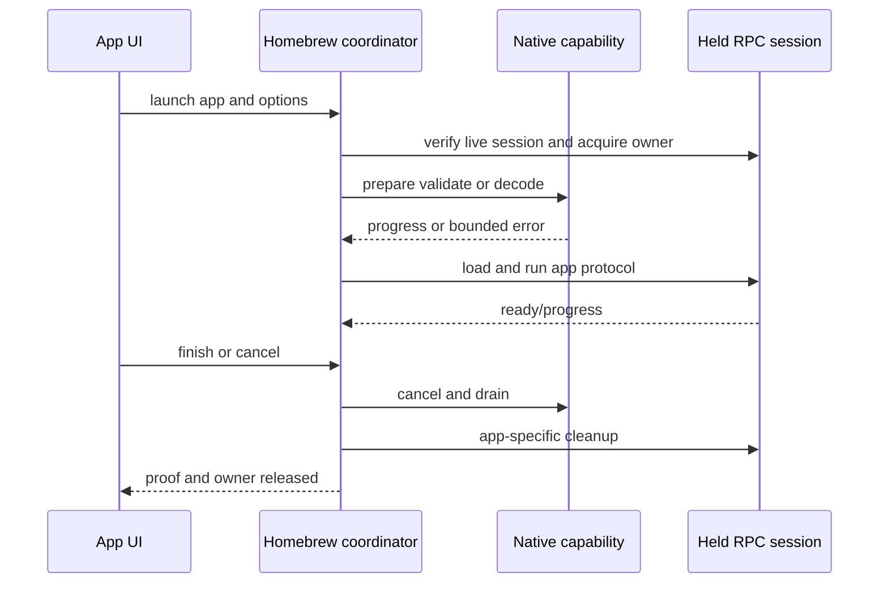

# iPad Homebrew and Media Parity - Plan

## Goal Capsule

- **Objective:** Every homebrew and media workflow bundled in the Mac release works from the target iPad with the same held-session ownership and cleanup guarantees.
- **Means:** Preserve launcher/session protocols, port Python/Pillow and SPIR-V as linked service capabilities, cross-build the media stack, and qualify each app independently before the aggregate release (KTD1–KTD7).
- **Authority:** Roadmap R13–R16 define parity; pinned vendor snapshots, provenance files, and current cleanup tests define integration contracts.
- **Stop conditions:** Do not publish an app as supported until its fixture suite and physical Switch launch/cleanup pass. Do not silently omit a desktop dependency from the runtime.

---

## Product Contract

### Summary

Port GPUBrewLauncher, HBLauncher, IZLauncher, OunceCake, and Stremio to the iPad service runtime. Replace macOS-specific Python, `spirv-val`, and `/Applications/Stremio.app` FFmpeg assumptions with pinned iOS-compatible capabilities while keeping existing JavaScript protocols and third-party provenance intact.

### Problem Frame

The launchers themselves are mostly JavaScript and RPC-driven, but their runtime dependencies are desktop-shaped. IZLauncher expects a standalone Python 3.13 executable with Pillow and a command-line SPIR-V validator. Stremio discovers Mac app-bundle FFmpeg/ffprobe executables and spawns a decode/probe pipeline. Upstream CPython expects embedded iOS use, and SPIR-V Tools intentionally skips iOS executables, so a faithful port needs native service adapters rather than only copying binaries.

### Requirements

**Shared homebrew lifecycle**

- R1. Every app launch must verify a live compatible held session, acquire one owner, emit progress, and run the current bounded cleanup path.
- R2. Per-session app overlays and user-imported apps must remain isolated from immutable bundled vendor snapshots.
- R3. App capability checks must report exact missing runtime, edition, host-profile, port, or account prerequisites.

**Launcher parity**

- R4. GPUBrewLauncher must launch hello-world, froggy-road, and ftpd-sb; HBLauncher must launch its pinned apps including ftpd-sb.
- R5. IZLauncher must launch its base shell and File Exchange, including the current BermTheSequel/demo path where supported.
- R6. IZLauncher shader validation must use the pinned SPIR-V Tools revision and reject malformed modules before launch.
- R7. IZLauncher and Stremio menu-render Python/Pillow work must run from a pinned iOS runtime and preserve current image/font outputs.
- R8. OunceCake must preserve its FTP port, allocation ownership, bounded graph traversal, stop/join proof, and uncertain-resource retention behavior.

**Stremio parity**

- R9. Stremio account, add-on discovery, manual add-on, stream selection, and current sample fixtures must remain supported.
- R10. Media probing, video decode/scale, frame delivery, audio delivery, cancellation, and receiver confirmation must run locally on iPad.
- R11. The iPad media pipeline must bound CPU, memory, temporary storage, queue depth, and thermal behavior and must terminate all work on session cleanup.

**Provenance and compatibility**

- R12. iOS runtime components must be version-pinned, checksummed, licensed, audited, and represented in the release provenance alongside current vendor sources.
- R13. Existing macOS launcher and media paths must remain functional.
- R14. The iPad app must import compatible extra launcher apps through a bounded folder/archive transaction into only the current service-owned workspace, rejecting traversal, links, invalid metadata, and duplicate targets.

### Acceptance Examples

- AE1. **Covers R1–R4.** Given a verified held session, when the user launches each GPU launcher app, then exactly one owner runs and cleanup releases it before another app can start.
- AE2. **Covers R5–R7.** Given IZLauncher assets, when validation/preparation runs, then the pinned iOS SPIR-V and Python/Pillow capabilities produce fixture-equivalent outputs and File Exchange launches.
- AE3. **Covers R8.** Given a malformed OunceCake mapping or uncertain native cleanup, when the app stops, then invalid traversal is rejected and uncertain resources are retained/reported rather than freed unsafely.
- AE4. **Covers R9–R11.** Given the pinned Stremio sample, when playback starts and is cancelled, then probe/decode/frame/audio paths run locally, queues remain bounded, and all workers exit.
- AE5. **Covers R12, R13.** Given a release audit, when both platforms are inspected, then Mac and iPad runtime dependencies have separate correct pins, licenses, and capability checks.

### Scope Boundaries

- The port preserves current app functionality; it does not add new homebrew apps, codecs, Stremio features, or IZ2S modules.
- App Store-compatible Python/framework packaging is not a goal, but the linked XCFramework pattern is preferred because it matches upstream iOS support and reduces executable sprawl.
- Hardware-accelerated VideoToolbox integration is permitted only if the existing FFmpeg protocol cannot meet thermal/performance gates; it is not required up front.
- Upstream vendor snapshot upgrades are deferred unless a port-blocking fix cannot be carried as a small documented patch.

---

## Planning Contract

### Key Technical Decisions

- KTD1. **Keep `gui-homebrew.cjs` as the lifecycle coordinator.** Add service capability calls for native work rather than rewriting launcher/session logic in Swift.
- KTD2. **Embed CPython as a service library.** Build a pinned arm64 iOS Python XCFramework with the required standard library and Pillow framework, and expose only named IZLauncher and Stremio menu-render jobs to Node.
- KTD3. **Link SPIR-V Tools and wrap validation.** Build the pinned static library and expose the exact `spirv-val --target-env vulkan1.0` behavior through a native helper/service command; upstream disables iOS executables.
- KTD4. **Build FFmpeg/ffprobe from pinned source for iOS.** Initially preserve the existing subprocess/pipe protocol through service-managed thin executables or adapters; move to direct library calls only where process behavior fails device gates.
- KTD5. **Give each runtime a capability manifest.** Scripts ask for `python`, `spirvValidate`, `ffprobe`, and `ffmpeg` capabilities rather than guessing desktop paths.
- KTD6. **Qualify apps independently.** Each app gets fixtures, service integration, physical launch, and cleanup evidence before aggregate UI enablement.
- KTD7. **Treat vendor and imported content as unprivileged input.** All launcher, Python, and media work uses the runtime plan's `mobile` child boundary and high-level service capabilities; imported content never receives a privileged helper handle.

### High-Level Technical Design

### Sources and Research

- Coordinator/apps: `scripts/gui-homebrew.cjs`, `scripts/gui-gpubrewlauncher.cjs`, `scripts/gui-hblauncher.cjs`, `scripts/gui-izlauncher.cjs`, `scripts/gui-ouncecake.cjs`, `scripts/gui-stremio.cjs`, and `stremio/`.
- Runtime pins/provenance: `packaging/homebrew-runtime.lock.json`, `packaging/*-provenance.json`, `upstream.lock`, and `scripts/prepare-homebrew-runtime.py`.
- CPython iOS embedding: <https://docs.python.org/3.13/using/ios.html>.
- SPIR-V Tools iOS library-only CMake behavior: <https://github.com/KhronosGroup/SPIRV-Tools/blob/main/CMakeLists.txt>.
- FFmpeg source: <https://github.com/FFmpeg/FFmpeg>.

---

## Implementation Units

### U1. Add the runtime capability contract

- **Goal:** Remove desktop path discovery from homebrew scripts.
- **Requirements:** R1–R3, R12, R13
- **Dependencies:** Runtime service protocol
- **Files:** `scripts/homebrew-capabilities.cjs`, `ios/app-protocol/HomebrewCapabilities.*`, `scripts/test-homebrew-capabilities.cjs`, `packaging/ios/homebrew-runtime.lock.json`
- **Approach:** Define version/digest/feature responses and commands for named IZLauncher jobs, `stremioMenuRender`, SPIR-V validation, media probe/decode, fonts, ports, storage, and cancellation; keep a Mac adapter for current paths.
- **Test scenarios:**
  - Resolve valid Mac and iOS manifests to equivalent logical capabilities.
  - Reject missing, version-mismatched, digest-mismatched, or unsupported-feature capabilities with stable reasons.
  - Cancel an in-flight native capability and propagate one terminal event to the owner.
- **Verification:** No homebrew script needs `/Applications`, Mac wheel tags, or direct platform executable guessing.

### U2. Port Python, Pillow, and fonts

- **Goal:** Supply IZLauncher and Stremio menu-render image/script functionality from a pinned embedded iOS runtime.
- **Requirements:** R5, R7, R12
- **Dependencies:** U1
- **Files:** `scripts/build-python-ios.sh`, `ios/homebrew/python/`, `packaging/ios/homebrew-runtime.lock.json`, `packaging/licenses/`, `ios/tests/PythonJobTests.*`
- **Approach:** Cross-build CPython 3.13 for arm64 iOS, package the standard library, convert Pillow native modules into signed frameworks as required, configure isolated `PYTHONHOME/PYTHONPATH`, disable bytecode writes, and expose bounded job requests.
- **Test scenarios:**
  - Import required standard modules and Pillow, render fixture text/images with DejaVu Sans, and compare semantic dimensions/pixels within defined tolerances.
  - Run `stremioMenuRender` in one-shot and persistent-worker modes, enforce fixed input/output size, timeout, cancellation, and deterministic cleanup.
  - Reject arbitrary module/path execution outside the packaged IZLauncher and Stremio job allowlist.
  - Cancel a CPU-bound and I/O-bound job and reclaim interpreter/job resources.
- **Verification:** The exact packaged runtime passes IZLauncher fixtures on target and has complete provenance/licenses.

### U3. Port SPIR-V validation

- **Goal:** Preserve pinned shader validation before IZLauncher launch.
- **Requirements:** R5, R6, R12
- **Dependencies:** U1
- **Files:** `scripts/build-spirv-ios.sh`, `ios/homebrew/spirv/`, `scripts/check-izlauncher-runtime.cjs`, `ios/tests/SPIRVValidationTests.*`
- **Approach:** Build the pinned SPIRV-Tools/Headers commits as iOS libraries, wrap validation with bounded input/output, and map diagnostics to the current script contract.
- **Test scenarios:**
  - Accept every pinned launcher shader for `vulkan1.0` and reject the existing malformed fixture.
  - Reject oversized, missing, traversal, and changed-after-validation inputs.
  - Compare iOS and Mac validator pass/fail outcomes across the fixture corpus.
- **Verification:** IZLauncher readiness no longer depends on a standalone `spirv-val` iOS executable.

### U4. Qualify GPUBrewLauncher and HBLauncher

- **Goal:** Restore both GPU launcher families and bundled apps.
- **Requirements:** R1–R4, R12, R13
- **Dependencies:** U1
- **Files:** `scripts/gui-gpubrewlauncher.cjs`, `scripts/gui-hblauncher.cjs`, `scripts/test-gui-homebrew.cjs`, `scripts/test-homebrew-apps.cjs`, `scripts/test-gui-session.cjs`, `docs/ipad/homebrew-matrix.md`
- **Approach:** Replace platform path assumptions with capability/session roots, retain immutable snapshots and fresh per-session app copies, add a bounded import transaction from UI staging into only the current workspace, and verify ftpd-sb bind/cleanup behavior on the selected network interface.
- **Test scenarios:**
  - Covers AE1. Launch and clean up hello-world, froggy-road, and ftpd-sb through each applicable launcher.
  - Refuse a second app owner, a stale held session, a port-5000 conflict, and a modified bundled snapshot.
  - Import a compatible extra app into session storage without modifying vendor source.
  - Cancel or reject corrupt, traversal, symlink, oversized/count-limited, metadata-invalid, and duplicate imports; verify the next fresh session has no imported copy.
- **Verification:** Fixture and physical launch matrix passes for both launchers and ftpd-sb is reachable from the documented client topology.

### U5. Qualify IZLauncher and File Exchange

- **Goal:** Run IZLauncher with native iOS preparation capabilities.
- **Requirements:** R1–R3, R5–R7, R12, R13
- **Dependencies:** U1–U3
- **Files:** `scripts/gui-izlauncher.cjs`, `scripts/prepare-izlauncher.cjs`, `scripts/test-gui-izlauncher.cjs`, `scripts/test-izlauncher-runtime.cjs`, `vendor/IZ2S-Platform/`, `docs/ipad/homebrew-matrix.md`
- **Approach:** Add a downstream overlay that validates and selects a service-supplied `ios-arm64` effective platform instead of raw `process.platform`, while retaining `darwin-arm64` for macOS and leaving upstream snapshots immutable. Call Python/SPIR-V capabilities, preserve host/demo selection and held-session validation, and update provenance for the patch.
- **Test scenarios:**
  - Covers AE2. Prepare, validate, launch, and clean up base shell/File Exchange on supported full and demo paths.
  - Reject wrong platform descriptor, missing font, invalid shader, failed Python job, stale session, and occupied service port.
  - Select and launch the correct descriptor from catalog fixtures under both `ios-arm64` and `darwin-arm64` effective platforms.
  - Verify a fresh session does not retain user exchange state unless explicitly exported.
- **Verification:** On-device File Exchange transfers a fixture in both directions and cleanup releases every owner/port.

### U6. Qualify OunceCake

- **Goal:** Preserve OunceCake's safety and FTP behavior on iPad.
- **Requirements:** R1–R3, R8, R12, R13
- **Dependencies:** U1
- **Files:** `scripts/gui-ouncecake.cjs`, `vendor/OunceCake/engine/`, `scripts/test-gui-ouncecake.cjs`, `scripts/test-ouncecake-session.sh`, `docs/ipad/homebrew-matrix.md`
- **Approach:** Keep the existing downstream safety patches, adapt interface/address discovery, and validate that service cancellation cannot bypass native stop/join proof.
- **Test scenarios:**
  - Covers AE3. Reject cycle/out-of-bound mappings and retain uncertain native resources.
  - Start FTP on port 2121, transfer a fixture, close clients, and prove complete cleanup.
  - Kill the UI, coordinator, and service at separate lifecycle points and reconcile owner state safely.
- **Verification:** Current self-tests and a physical FTP export pass without weakening cleanup proofs.

### U7. Build and integrate the iOS media stack

- **Goal:** Replace Stremio's Mac app-bundle FFmpeg dependency.
- **Requirements:** R9–R13
- **Dependencies:** U1
- **Files:** `scripts/build-ffmpeg-ios.sh`, `ios/homebrew/media/`, `packaging/ios/media-runtime.lock.json`, `stremio/`, `scripts/gui-stremio.cjs`, `ios/tests/MediaPipelineTests.*`
- **Approach:** First calibrate and commit numeric release ceilings for resident memory, temporary storage, queue depth, sustained CPU, supported playback duration, and thermal-state response on the target. Then pin FFmpeg source/configuration/codecs, cross-build arm64 iOS probe/decode capabilities, preserve current receiver/RPC framing, enforce those ceilings, route Stremio menu rendering through `stremioMenuRender`, and expose thermal/memory diagnostics.
- **Test scenarios:**
  - Covers AE4. Probe/decode the pinned Big Buck Bunny sample, deliver frame/audio fixtures, cancel mid-stream, and drain all workers.
  - Exercise unsupported codec, malformed stream, network stall, receiver timeout, disk-full, memory-pressure, and thermal-warning handling.
  - Fail qualification when any committed memory/storage/queue/CPU/duration/thermal ceiling is exceeded; include the exact calibrated values in the signed run record.
  - Compare Mac and iOS protocol output metadata for the same sample.
- **Verification:** Sample and one real supported Stremio stream run on target within the release resource thresholds.

### U8. Publish the complete parity matrix

- **Goal:** Gate UI enablement and release on per-app evidence.
- **Requirements:** R1–R13
- **Dependencies:** U2–U7
- **Files:** `docs/ipad/homebrew-matrix.md`, `scripts/audit-homebrew-parity.cjs`, `scripts/test-homebrew-apps.cjs`, `packaging/NOTICE.md`
- **Approach:** Generate a matrix from capability manifests, fixture results, physical run records, supported editions/profiles, licenses, and cleanup proof.
- **Test scenarios:**
  - Fail audit when any bundled app lacks a pin, license, fixture, physical result, or cleanup outcome.
  - Fail UI capability generation when the app/service runtime versions do not match the matrix.
- **Verification:** The audit enables all five named product options and no unqualified app.

---

## Verification Contract

| Area | Proof |
|---|---|
| Shared lifecycle | Existing homebrew/session ownership suites plus service cancellation/reconnect fixtures |
| Python/Pillow | Target import/render jobs, isolation/cancellation tests, provenance audit |
| SPIR-V | Mac/iOS pass-fail corpus parity with pinned shaders and malformed fixture |
| GPU launchers | Fixture and physical app launch/cleanup including FTP reachability |
| IZLauncher | Full/demo launch and bidirectional File Exchange on target |
| OunceCake | Existing safety fixtures plus physical FTP/cleanup/fault injection |
| Stremio | Existing account/add-on/sample tests plus target decode/stream/resource metrics |
| macOS | Current runtime preparation and every existing homebrew/media test remain green |

---

## Definition of Done

- Every bundled homebrew option has passing fixture, physical launch, and cleanup evidence.
- iOS Python/Pillow, SPIR-V, and media components are pinned, checksummed, licensed, and audited.
- No script relies on a Mac-only application path or runtime tag in iOS mode.
- Media work is bounded and terminates fully on cancel, failure, or session cleanup.
- Vendor source integrity/provenance remains explicit for every downstream patch.
- Current macOS paths and tests still pass.
- Experimental codecs, test account data, streams, generated media, and abandoned wrappers are absent from release artifacts.
