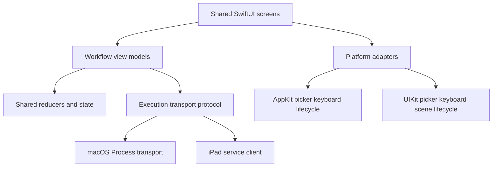
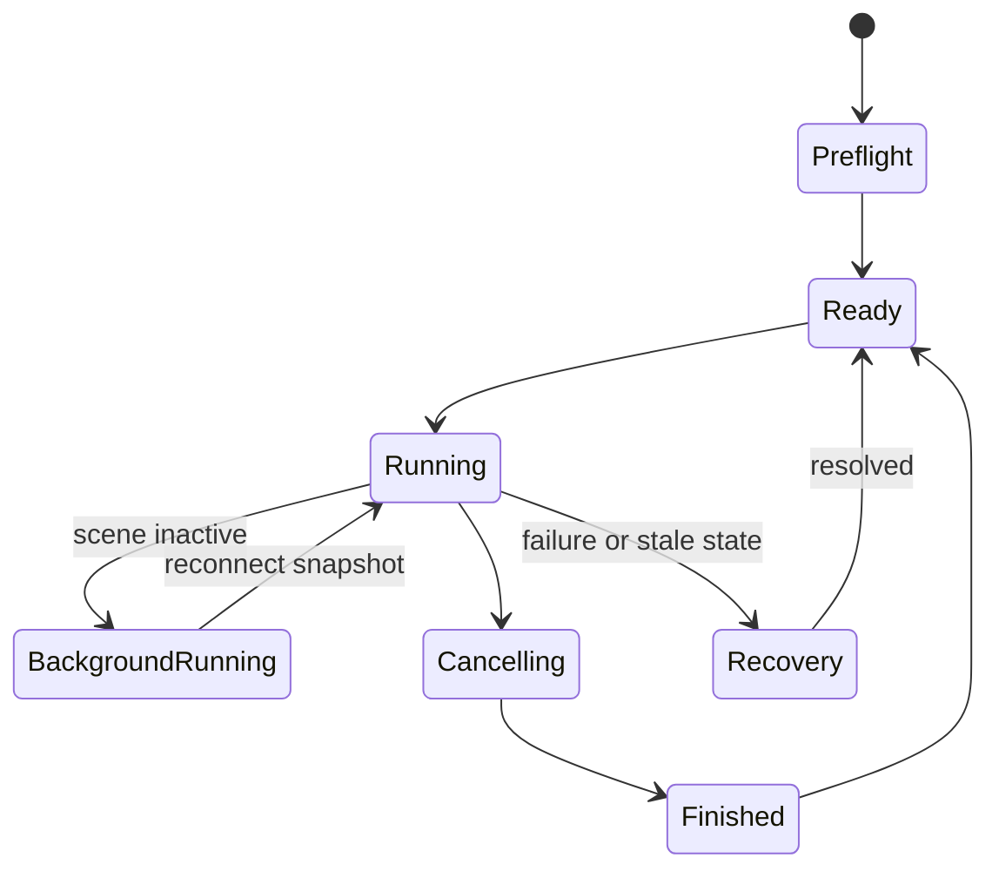

# Native iPad Interface - Plan

## Goal Capsule

- **Objective:** iPad users can complete every existing mac2jb setup, jailbreak, developer, keyboard, recovery, and diagnostic workflow through a native touch interface.
- **Means:** Share platform-neutral state and workflow models with macOS, replace AppKit and direct process ownership with UIKit/SwiftUI adapters and the service protocol, and design explicit background/reconnect states (KTD1–KTD5).
- **Authority:** Roadmap R11, R12, and R19 define parity; existing macOS workflow tests define current behavior unless the iPad platform requires a documented presentation change.
- **Stop conditions:** Do not mark a workflow complete from mocked UI alone; each must pass through the real service contract and at least one target-device acceptance path.

---

## Product Contract

### Summary

Turn the current macOS SwiftUI/AppKit app into a multiplatform interface with an iPad target. Preserve the first-time setup, standard jailbreak, homebrew selection, developer tools, progress, logs, and recovery model while adapting file selection, keyboard capture, lifecycle, settings, and update presentation to iPadOS.

### Problem Frame

The current SwiftUI surface imports AppKit throughout, uses `NSOpenPanel`, `NSApplication`, `NSTextView`, `NSEvent`, AppleScript, desktop updater controls, and `Process`. The large `SessionModel` also mixes domain state with Mac process ownership. A mechanical compile port would leave lifecycle and recovery behavior wrong; the UI must consume service snapshots as the authority and make background transitions visible.

### Requirements

**Workflow parity**

- R1. First-time setup must support full/demo edition selection, bootstrap typing, progress/ETA, cancellation, save command, confirmation, skip, and retry guidance.
- R2. Standard jailbreak must support host profile, local address, edition, readiness confirmation, 4/4 progress, held-RPC transition, and finish/retry.
- R3. Developer tools must include host-only, RPC-already-held, attach/dump, held RPC, live keyboard, controller choice, timing controls, and run-folder selection where applicable.
- R4. Homebrew selection must expose every app and its service-provided availability/reason without duplicating runtime rules in the view.

**iPad interaction and lifecycle**

- R5. Keyboard capture must use UIKit and release all keys when focus, scene activity, hardware keyboard, or service connection changes.
- R6. File/directory selection must use document-picker security scopes or service-provided session lists; the app may not assume arbitrary desktop path access.
- R7. Scene background, foreground, reconnect, daemon restart, and app relaunch must resolve from service snapshots without duplicating operations.
- R8. Long operations must show progress, cancellation state, last event, logs, and whether work continues in the background.

**Setup and diagnostics**

- R9. First launch must check iPadOS/device target, Dopamine state, rootless service, TrollStore installation context, runtime integrity, USB capability, and selected network path.
- R10. Every failed check must give one actionable remediation and preserve redacted diagnostics for export.
- R11. Accessibility, Dynamic Type, portrait/landscape, Split View, touch, and hardware keyboard input must remain usable at supported iPad sizes.
- R12. Compatible extra launcher apps must be importable through the document picker into the current service-owned session without shell access.

### Acceptance Examples

- AE1. **Covers R1, R7, R8.** Given bootstrap typing in progress, when the user backgrounds and relaunches the app, then the UI reconnects to the same operation and shows accurate progress or its terminal result.
- AE2. **Covers R2, R4.** Given a 4/4 held session, when the user reaches the homebrew section, then only service-qualified apps are enabled and every unavailable app shows its specific dependency reason.
- AE3. **Covers R3, R6.** Given an existing live run, when the user selects RPC-already-held, then the UI lists service-owned candidates and verifies the selected session before enabling tools.
- AE4. **Covers R5.** Given live keyboard focus, when the scene resigns active or the connection drops, then a stop/release command is sent and the UI no longer captures input.
- AE5. **Covers R9, R10.** Given a missing rootless package, when the app launches, then it explains how to install the matching package and disables mutating workflows while leaving diagnostics available.

### Scope Boundaries

- The iPad UI may reorganize navigation for touch and size classes, but it may not remove a roadmap workflow.
- Final visual branding changes are out of scope; reuse the existing identity and prioritize safe state communication.
- Shell/terminal UI and remote administration are not added.
- Platform-neutral extraction from `SessionModel` is in scope only where needed for parity and macOS preservation.

---

## Planning Contract

### Key Technical Decisions

- KTD1. **Split domain state from execution transport.** Extract workflow reducers/models from `SessionModel.swift`; macOS uses its existing transport adapter and iPad uses the service client.
- KTD2. **Treat service snapshots as authoritative.** The UI derives controls from operation/session capabilities and does not reconstruct liveness from local timers or cached booleans.
- KTD3. **Use scene-aware UIKit bridges.** Replace `NSTextView`/`NSEvent` with `UIViewRepresentable`, `UIKeyCommand`, text input, and explicit focus/scene release hooks.
- KTD4. **Use native document services sparingly.** Prefer service-returned safe run/session identifiers; use `UIDocumentPickerViewController` only for import/export artifacts the app genuinely owns.
- KTD5. **Keep platform-specific code at the edges.** Conditional targets own AppKit/UIKit views, lifecycle, and updater handoff; shared models and SwiftUI composition avoid platform imports.

### High-Level Technical Design

### Sources and Research

- Current UI/state: `gui/ContentView.swift`, `gui/SessionModel.swift`, `gui/SessionTypes.swift`, `gui/WorkflowProgress.swift`, `gui/FirstTimeSetupState.swift`, `gui/KeyboardCaptureView.swift`, `gui/StremioAccount.swift`, and `gui/main.swift`.
- Existing behavior fixtures: `scripts/test-first-time-setup.swift`, `scripts/test-workflow-progress.swift`, `scripts/test-session-recovery.sh`, `scripts/test-keyboard-state.swift`, and related shell wrappers.
- Service contract: `docs/plans/ipad-port/02-runtime-services.md`.

---

## Implementation Units

### U1. Integrate the completed shared transport seam

- **Goal:** Bind iPad view models to the shared reducer/transport seam delivered by runtime-services U1.
- **Requirements:** R1–R4, R7, R8
- **Dependencies:** Runtime-services U1 shared transport seam and U2 service protocol complete
- **Files:** `ios/app/ServiceTransport.swift`, `ios/app/WorkflowViewModels.swift`, `ios/tests/ServiceTransportTests.swift`
- **Approach:** Consume the already-characterized shared reducer, implement the iPad RPC transport, and map service snapshots/capabilities to view-model state without moving ownership back into the UI.
- **Test scenarios:**
  - Replay existing host/HID/session event fixtures through the iPad transport and produce the same shared state as the Mac transport.
  - Reconnect with a service snapshot during every active stage and avoid duplicate start/cancel commands.
  - Reject out-of-order, duplicate, or unknown-operation events without corrupting current state.
- **Verification:** iPad transport fixtures pass and the runtime plan's shared-state Mac regression suite remains green.

### U2. Create the iPad app target and adaptive shell

- **Goal:** Establish native app lifecycle, navigation, and platform adapters.
- **Requirements:** R7, R8, R11
- **Dependencies:** U1
- **Files:** `ios/app/`, `gui/SharedContentView.swift`, `gui/PlatformAdapters.swift`, `ios/app/Info.plist`, `ios/tests/AppLifecycleTests.swift`
- **Approach:** Add an iPadOS 17 target, scene-based entry point, NavigationSplitView/stack adaptation, connection banner, operation status surface, and conditional macOS entry point.
- **Test scenarios:**
  - Resize through supported size classes and preserve the selected workflow and active operation.
  - Background/foreground/relaunch with idle, running, cancelling, failed, and finished snapshots.
  - Exercise Dynamic Type and VoiceOver labels on all primary controls and progress states.
- **Verification:** Simulator state tests and target-device smoke navigation pass without importing AppKit in the iOS target.

### U3. Port first-time setup and standard jailbreak

- **Goal:** Deliver the primary Mac-free onboarding and jailbreak workflows.
- **Requirements:** R1, R2, R7–R10
- **Dependencies:** U1, U2
- **Files:** `gui/FirstTimeSetupState.swift`, `gui/SharedContentView.swift`, `ios/app/SetupViews.swift`, `ios/tests/SetupWorkflowTests.swift`
- **Approach:** Bind existing edition/timing rules to service capabilities, show device/network preflight, submit operation commands, render event-derived progress, and preserve recovery guidance.
- **Test scenarios:**
  - Covers AE1. Run full and demo bootstrap fixtures through background/relaunch and finish at the correct save step.
  - Cancel during typing, command wait, save command, host start, and verification; show stage-specific guidance.
  - Refuse to start with failed USB/network/runtime checks and deep-link to the relevant diagnostic.
- **Verification:** Full/demo fixtures and one physical first-time setup per edition pass.

### U4. Port developer tools and session attachment

- **Goal:** Expose all advanced workflows through service-owned session choices.
- **Requirements:** R3, R6–R8
- **Dependencies:** U1, U2
- **Files:** `ios/app/DeveloperToolsViews.swift`, `gui/SessionModel.swift`, `ios/tests/DeveloperWorkflowTests.swift`
- **Approach:** Replace desktop folder selection with service candidate enumeration and opaque IDs; keep explicit attach verification, host-profile constraints, dump destinations, controller selection, and timing settings.
- **Test scenarios:**
  - Covers AE3. List one live, one stale, and one incompatible run; enable only the verified live candidate.
  - Start and cancel host-only, held-RPC, attach, and dump operations with accurate ownership results.
  - Change host profile and require the matching bootstrap warning before the next run.
- **Verification:** Every developer option in `README.md` has a passing iPad state/service fixture.

### U5. Replace keyboard capture with UIKit

- **Goal:** Preserve safe live keyboard and text-send behavior across iPad input modes.
- **Requirements:** R5, R7, R8, R11
- **Dependencies:** U1, U2
- **Files:** `ios/app/KeyboardCaptureView.swift`, `gui/KeyboardTextModel.swift`, `ios/tests/KeyboardCaptureTests.swift`, `scripts/test-keyboard.cjs`
- **Approach:** Translate supported physical/software keyboard events into the existing US keyboard model, keep the 16 KiB/send-delay limits, and centralize stop/release on focus, scene, and connection transitions.
- **Test scenarios:**
  - Preserve printable ASCII, punctuation, tabs, line breaks, paste, and final-line behavior.
  - Covers AE4. Resign focus/scene and drop service connection during a held key/text transfer; send exactly one stop intent and show inactive capture.
  - Reject unsupported Unicode visibly without sending partial ambiguous input.
- **Verification:** Shared keyboard fixtures pass and physical Magic Keyboard/software keyboard tests send identical reports.

### U6. Build preflight, diagnostics, logs, and export

- **Goal:** Make every prerequisite and failure actionable from the app.
- **Requirements:** R9, R10
- **Dependencies:** U2 plus service diagnostics
- **Files:** `ios/app/DiagnosticsViews.swift`, `gui/DiagnosticModels.swift`, `ios/tests/DiagnosticsViewTests.swift`, `docs/ipad/troubleshooting.md`
- **Approach:** Render stable service diagnostic IDs, group blockers/warnings, expose redacted logs, provide retry/recheck actions, and export a privacy-reviewed support bundle through a document picker.
- **Test scenarios:**
  - Covers AE5. Detect missing service, stopped jailbreak, corrupt runtime, entitlement denial, USB failure, network mismatch, port conflict, and stale session.
  - Export a bundle and verify secrets, raw identifiers, account tokens, and user media are absent.
  - Recover a cleared blocker without restarting the app and enable the relevant workflow.
- **Verification:** Every roadmap R19 condition maps to a tested screen, remediation, and redacted evidence record.

### U7. Integrate homebrew and update surfaces

- **Goal:** Connect parity-plan capabilities and distribution-plan updates without hard-coding their internals.
- **Requirements:** R4, R7, R8, R12
- **Dependencies:** Native U2–U6, Homebrew U1, and Runtime-services U2 update/compatibility contract
- **Files:** `ios/app/HomebrewViews.swift`, `ios/app/UpdateViews.swift`, `gui/ContentView.swift`, `ios/tests/CapabilityPresentationTests.swift`
- **Approach:** Render service-provided app capabilities, progress, cleanup states, account prompts, and the abstract app/service update compatibility states from Runtime-services U2; keep concrete manifest verification and installer handoff behind adapters implemented by the later distribution plan.
- **Test scenarios:**
  - Covers AE2. Enable each homebrew item only when its declared capability set is present.
  - Show partial app/service update and prevent incompatible mutating operations.
  - Reconnect during homebrew cleanup and preserve the authoritative terminal state.
  - Import a launcher folder/archive through the document picker, cancel or reject traversal/links/oversize/duplicates, and show that a fresh session resets the imported copy.
- **Verification:** All homebrew/update fixture states have deterministic controls and guidance.

---

## Verification Contract

| Check | Proof |
|---|---|
| Shared state | Existing Swift fixtures plus transport replay and reconnect tests |
| iPad lifecycle | Simulator scene tests and physical background/relaunch runs |
| Workflow parity | Full/demo setup, jailbreak, developer, attach/dump, keyboard, recovery matrices |
| Accessibility | Dynamic Type, VoiceOver labels/order, keyboard navigation, rotation/Split View |
| Diagnostics | Stable-ID fixture coverage and redacted support-bundle audit |
| macOS regression | Existing AppKit target and GUI tests compile and pass |

---

## Definition of Done

- Every roadmap workflow has an iPad-native path and target-device proof.
- UI state is derived from the service and survives scene/app lifecycle changes without duplicate work.
- Keyboard capture always releases on focus/scene/connection loss.
- All R19 failures have tested remediation and safe diagnostic export.
- iPad layout and accessibility pass the supported size/input matrix.
- macOS behavior and tests remain green.
- No AppKit import, direct process handle, desktop path assumption, debug screen, or private log data remains in the iOS target.
