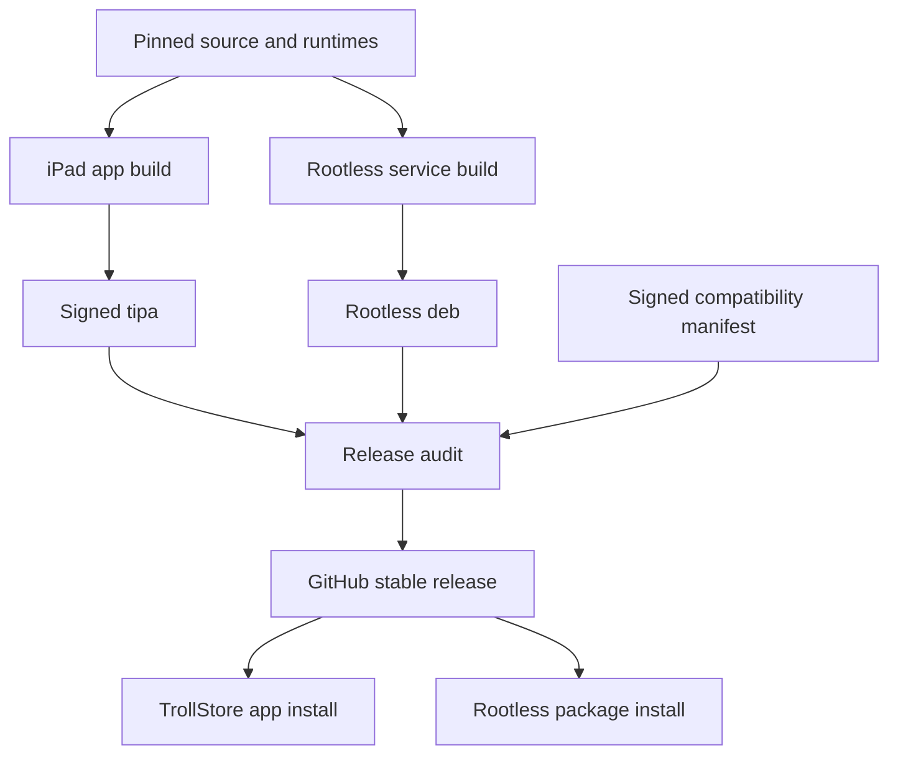
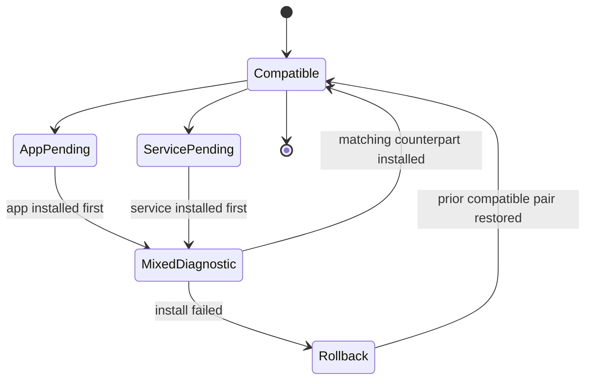

# iOS Distribution and Updates - Plan

## Goal Capsule

- **Objective:** Users can install, upgrade, diagnose, and remove the complete iPad port from reproducible, integrity-checked releases without a Mac.
- **Means:** Publish a TrollStore `.tipa` app and a Dopamine rootless `.deb` service from one signed compatibility manifest, with channel-specific update and rollback handling (KTD1–KTD8).
- **Authority:** Roadmap R17–R19 govern distribution; the app/service protocol defines compatibility and the release-validation plan owns final promotion.
- **Stop conditions:** Do not publish artifacts whose entitlements, runtime contents, protocol range, provenance, or checksums differ from the signed manifest. Do not self-replace the running app or daemon outside its channel's supported installer.

---

## Product Contract

### Summary

Add iOS build, signing, package, audit, update, rollback, and uninstall paths. TrollStore installs the UI app and preserves its private entitlements; a rootless package manager installs the durable service/watchdog because TrollStore cannot create a launch daemon. One release manifest ties compatible versions and runtime pins together.

### Problem Frame

The current updater validates a GitHub macOS `.app` ZIP, extracts it with `ditto`, verifies Mach-O/codesign, swaps the app bundle, and reopens it. None of that install path applies to iPadOS. A dual-artifact release also creates a dangerous mixed-version state unless compatibility is explicit and mutating actions fail closed.

### Requirements

**Build and signing**

- R1. The build must produce an arm64 iPadOS `.tipa` and rootless `iphoneos-arm64` `.deb` from pinned inputs on a clean runner.
- R2. Each executable must have only its declared entitlements, deployment target, install name/rpaths, and owner/mode; the audit must reject extras and omissions.
- R3. The `.tipa` must contain only the app, UI-only frameworks/resources, protocol models, and release verification material; the `.deb` must solely own the service, watchdog/controller broker, privileged helper, all executable runtimes/vendor trees, and rootless state.

**Compatibility and updates**

- R4. A signed release manifest must bind app version/build, service version, protocol compatibility range, hardware capability schema, runtime locks, artifact digests, sizes, and download URLs.
- R5. The app must verify GitHub release origin, manifest signature/digest, artifact digest/size, stable version policy, and compatibility before offering an update.
- R6. App updates must hand TrollStore the exact locally downloaded and verified `.tipa` when supported; if only remote URL installation works on target, post-install service attestation of the installed app CDHash/resource manifest is required before any mutating RPC.
- R7. Service updates must use the rootless package manager path and maintainer scripts, preserving or migrating durable state transactionally and restarting only after validation.
- R8. Mixed app/service versions must remain diagnostic-only unless their manifest ranges overlap.

**Recovery and lifecycle**

- R9. A failed or interrupted update must leave at least one launchable app and one valid service/runtime state.
- R10. Install, upgrade, downgrade refusal, re-jailbreak, TrollStore persistence repair, service restart, and uninstall must have documented and tested outcomes.
- R11. Uninstall must restore any active USB journal before removing the service and must offer an explicit choice to retain or remove user logs/settings.
- R12. Release artifacts must include checksums, source archive, build metadata, third-party notices, runtime/source provenance, and reproducibility instructions.
- R13. Release repository owner/name, documentation origin, bundle IDs, keychain services, update signing keys, and package IDs must come from generated build identity so the fork never trusts or publishes as `cpypwn/mac2jb` accidentally.

### Acceptance Examples

- AE1. **Covers R1–R4.** Given a clean build runner, when the release job completes, then both artifacts and their audited contents match one signed manifest.
- AE2. **Covers R5, R6.** Given a valid newer app release, when the user accepts it, then the exact verified local artifact is handed to TrollStore or the installed result is attested after remote fallback; no bundle is modified directly.
- AE3. **Covers R7–R9.** Given a service update interrupted before activation, when the package manager recovers, then the old service remains valid or the new service activates completely, never a mixed runtime.
- AE4. **Covers R8.** Given an incompatible app/service pair, when the app connects, then diagnostics and update guidance work but USB/session mutations are disabled.
- AE5. **Covers R10, R11.** Given an active or stale USB journal, when uninstall begins, then removal stops until restoration succeeds or the user follows the explicit recovery path.

### Scope Boundaries

- Hosting a new package repository is deferred; the first release may publish `.deb` and metadata in GitHub Releases for manual package-manager installation.
- Automatic privileged package installation from the app is excluded unless a supported package-manager URL/API is documented and safely verifiable.
- App Store, standard sideload expiry, rootful jailbreak, and iOS versions outside the target are not supported.
- Delta updates are excluded; whole-artifact updates keep validation and rollback simpler at this scale.

---

## Planning Contract

### Key Technical Decisions

- KTD1. **Build two independently installable artifacts.** Without the `.deb`, the `.tipa` provides diagnostics and installation guidance only; full parity requires the matching service package.
- KTD2. **Use Theos rootless conventions for the service.** Install under the resolved jailbreak root with rootless rpaths and `iphoneos-arm64`, avoiding literal `/var/jb` assumptions in runtime code.
- KTD3. **Make the release manifest the compatibility authority.** Both app and service embed it; update checks never infer compatibility from semantic versions alone.
- KTD4. **Keep updater download validation from the Mac path.** Share origin, size, checksum, stable-release, and minimum-build logic while replacing archive/install mechanics.
- KTD5. **Delegate installation to the channel owner.** TrollStore installs `.tipa`; dpkg/package manager installs `.deb`; mac2jb validates and hands off.
- KTD6. **Audit installed layout as well as archives.** Package fixtures verify maintainer scripts, ownership, service bootstrap, restoration-before-removal, and state migration.
- KTD7. **Preserve the scripted build pattern with explicit source sets.** `build-ios-app.sh` selects shared and UIKit files explicitly against the iPhoneOS SDK; the Mac script selects shared and AppKit files, and audits reject cross-platform imports.
- KTD8. **Centralize fork identity.** Generate Swift, plist, package, documentation, and updater identity from one reviewed release configuration while preserving current Mac identity only when intentionally configured.

### High-Level Technical Design





### Output Structure

```text
packaging/ios/
  app/
  rootless/
  entitlements/
  manifests/
  locks/
scripts/
  build-ios-app.sh
  build-ios-service.sh
  make-ios-release.sh
  audit-ios-release.py
```

### Sources and Research

- Existing updater/audit: `gui/AppUpdater.swift`, `gui/UpdatePackage.swift`, `gui/UpdateInstaller.swift`, `scripts/test-updater.swift`, `scripts/build-gui.sh`, `scripts/audit-release.py`, and `make-release-zip.command`.
- TrollStore URL scheme, arbitrary entitlements, root helpers, banned entitlements, and daemon limitation: <https://github.com/opa334/TrollStore>.
- Theos rootless and package conventions: <https://theos.dev/docs/rootless> and <https://theos.dev/docs/packaging>.

---

## Implementation Units

### U1. Define iOS release identity and compatibility manifest

- **Goal:** Create one verifiable contract for app, service, protocol, runtimes, and artifacts.
- **Requirements:** R4, R5, R8, R12
- **Dependencies:** Runtime-services U2 update/compatibility contract and stable runtime/homebrew lock formats
- **Files:** `packaging/release-identity.json`, `packaging/ios/manifests/release.schema.json`, `packaging/ios/manifests/signing-public-key`, `gui/UpdatePackage.swift`, `ios/service/ReleaseManifest.*`, `scripts/test-ios-release-manifest.*`
- **Approach:** Define generated fork identity, canonical manifest serialization, signature/key rotation fields, artifact records, compatibility ranges, target tuple, runtime lock digests, and required-update policy. Keep private signing material outside the repository.
- **Test scenarios:**
  - Accept a canonical valid manifest in Swift and service decoders.
  - Reject changed bytes, unknown key, duplicate field, wrong target, incompatible protocol, wrong digest/size, and rollback version.
  - Rotate from one trusted key to a predeclared successor without accepting an undeclared key.
  - Build Mac and iOS fixtures for this fork and prove each trusts only its configured repository, bundle/package IDs, keychain service, and signing key.
- **Verification:** App, service, and release audit reach identical compatibility decisions from golden fixtures.

### U2. Build and sign the TrollStore app artifact

- **Goal:** Produce a complete `.tipa` with audited entitlements and resources.
- **Requirements:** R1–R3, R12
- **Dependencies:** Native UI and runtime assets complete
- **Files:** `scripts/build-ios-app.sh`, `packaging/ios/app/`, `packaging/ios/entitlements/app.plist`, `packaging/ios/entitlements/*.plist`, `.github/workflows/ios-release.yml`
- **Approach:** Compile explicit shared/UIKit source lists with `xcrun swiftc` and the iPhoneOS SDK, embed only UI frameworks/resources plus the public manifest/key, sign each nested binary with its declared entitlements, assemble `Payload/mac2jb.app`, and zip as `.tipa`. Reject AppKit sources/imports in the iOS list.
- **Test scenarios:**
  - Fail build on unsigned nested code, unexpected architecture/platform, banned entitlement, or entitlement drift.
  - Install on TrollStore, launch, reconnect after respring/persistence repair, and run diagnostics.
  - Run app without the `.deb` and show the defined diagnostic-only state.
- **Verification:** Clean-runner artifact installs and its extracted audit matches the manifest exactly.

### U3. Build the Dopamine rootless service package

- **Goal:** Produce a safe installable `.deb` for service/watchdog/runtime.
- **Requirements:** R1–R3, R7, R9–R12
- **Dependencies:** Service and watchdog complete
- **Files:** `scripts/build-ios-service.sh`, `packaging/ios/rootless/control`, `packaging/ios/rootless/`, `packaging/ios/entitlements/service.plist`, `.github/workflows/ios-release.yml`
- **Approach:** Adopt/migrate the hardware plan's probe watchdog and journal schema, use rootless package scheme/rpaths, resolve the active jailbreak root at runtime, and install each service/runtime payload under an immutable version-and-digest-qualified directory. Keep only a stable launcher and atomically switched active pointer outside versioned payloads; install launch plists/state directories with strict modes, validate the complete staged payload, quiesce USB, activate, retain the previous payload through a health check, and make maintainer scripts idempotent.
- **Test scenarios:**
  - Install fresh, upgrade in place, reinstall same version, refuse downgrade, and remove with/without retained data.
  - Restart userspace/re-jailbreak and verify the service returns with valid state.
  - Interrupt package unpack and each maintainer-script phase; recover with the old or new immutable payload launchable and the active pointer naming only a fully validated version.
- **Verification:** Package audit and clean-device lifecycle matrix pass with no literal rootful paths.

### U4. Port app update discovery and TrollStore handoff

- **Goal:** Reuse secure release checks while delegating app installation to TrollStore.
- **Requirements:** R5, R6, R8–R10
- **Dependencies:** U1, U2
- **Files:** `gui/AppUpdater.swift`, `gui/UpdatePackage.swift`, `ios/app/TrollStoreUpdater.swift`, `ios/tests/AppUpdateTests.swift`
- **Approach:** Share configured-fork origin/metadata/checksum policy, validate and retain the exact local `.tipa`, prefer local-file TrollStore handoff, and provide the remote URL/manual fallback only with post-install service attestation before mutations.
- **Test scenarios:**
  - Covers AE2. Accept one valid stable release and produce the exact local-file handoff or encoded fallback URL required by the target's tested TrollStore behavior.
  - Reject redirect/origin mismatch, prerelease, missing asset, digest disagreement, incompatible service range, and required-update policy corruption.
  - Resume after TrollStore handoff and determine installed/not-installed from bundle identity rather than assuming success.
  - Replace or redirect the remote asset between validation and handoff; keep mutating RPC disabled when installed CDHash/resources do not match the signed manifest.
- **Verification:** iOS updater tests preserve the security properties of current Mac update fixtures without self-replacement code.

### U5. Add service update guidance and transactional migrations

- **Goal:** Safely move the rootless service/runtime between compatible releases.
- **Requirements:** R7–R10
- **Dependencies:** U1, U3
- **Files:** `ios/service/UpdateStatus.*`, `packaging/ios/rootless/`, `ios/tests/ServiceMigrationTests.*`, `docs/ipad/updating.md`
- **Approach:** Report installed/candidate versions, route the user to the published `.deb` and supported package-manager workflow, quiesce operations, restore USB, snapshot state, migrate durable data separately from the immutable version-and-digest-qualified payload, validate, atomically switch the active pointer, restart, health-check, then retire the previous payload only after the rollback window.
- **Test scenarios:**
  - Covers AE3. Interrupt before quiesce, after snapshot, after migration, and before restart; recover old or new complete state.
  - Refuse update during non-restorable USB state and provide recovery guidance.
  - Covers AE4. Keep diagnostics available but block mutations for incompatible versions.
- **Verification:** Mixed, interrupted, and rollback fixtures preserve one valid service state and no active USB mutation.

### U6. Extend release audit and provenance

- **Goal:** Make artifact contents, signing, sources, licenses, and manifest consistency machine-verifiable.
- **Requirements:** R1–R5, R12
- **Dependencies:** U1–U5
- **Files:** `scripts/audit-ios-release.py`, `scripts/make-ios-release.sh`, `scripts/build-gui.sh`, `scripts/audit-release.py`, `packaging/NOTICE.md`, `packaging/ios/locks/`, `.github/workflows/ios-release.yml`
- **Approach:** Inspect archive paths/types/modes, Mach-O platform/arch/load commands, entitlements, code signatures, launch plist, package metadata/scripts, manifest digests, runtime locks, source archive, and notices. Extend the existing source whitelist/audit so `ios/`, `docs/ipad/`, and the plan/build sources appear in corresponding release source archives.
- **Test scenarios:**
  - Reject malicious archive paths, extra executable, entitlement drift, absolute rootful path, unsigned code, missing notice, mismatched lock, and manifest disagreement.
  - Audit a reproducible second build and document any nondeterministic signed fields separately from payload identity.
- **Verification:** Release job cannot upload until Mac and iOS audits both pass.

### U7. Implement install, recovery, and uninstall runbooks

- **Goal:** Cover the complete user lifecycle without shell guesswork.
- **Requirements:** R8–R11
- **Dependencies:** U2–U6
- **Files:** `docs/ipad/installing.md`, `docs/ipad/updating.md`, `docs/ipad/uninstalling.md`, `scripts/test-ios-package-lifecycle.sh`
- **Approach:** Document ordered TrollStore/app and package/service installation, re-jailbreak behavior, persistence repair, partial-version recovery, log retention, USB restore, and complete removal; make the package scripts enforce dangerous preconditions.
- **Test scenarios:**
  - Covers AE5. Attempt removal with active and corrupted USB journals and require restoration/recovery.
  - Follow the runbook from clean target to full readiness without a development Mac.
  - Remove both artifacts with retain-data and purge-data choices, then verify no daemon/socket/USB mutation remains.
- **Verification:** A second tester can complete install, update, and uninstall solely from published artifacts/docs.

---

## Verification Contract

| Check | Proof |
|---|---|
| Manifest | Cross-language signature/compatibility fixtures and key-rotation tests |
| `.tipa` | Clean build, nested-code/entitlement/Mach-O audit, TrollStore install/launch |
| `.deb` | Rootless layout/rpath/package-script audit and clean-device lifecycle matrix |
| App update | Existing security-policy parity plus TrollStore URL/handoff/return tests |
| Service update | Quiesce/restore/migration interruption and mixed-version tests |
| Release | Checksums, provenance, licenses, source archive, reproducibility comparison |
| Lifecycle | Clean install, re-jailbreak, persistence repair, update, rollback, uninstall |

---

## Definition of Done

- Clean CI produces audited `.tipa`, `.deb`, manifest, checksums, notices, and source archive.
- Fresh install reaches full readiness with no Mac after artifact download.
- App and service updates use TrollStore/package-manager handoffs and never direct unsafe replacement.
- Incompatible mixed versions fail closed while retaining diagnostics/update guidance.
- Interrupted updates retain one complete valid state.
- Uninstall restores USB and removes daemon/socket state safely.
- Private signing keys, device identifiers, debug entitlements, staging payloads, and abandoned installers are absent from the repository/release.
