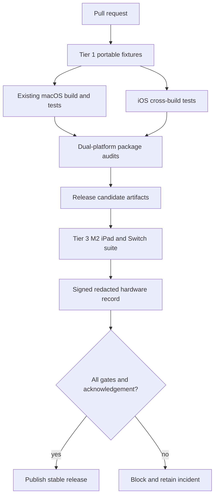
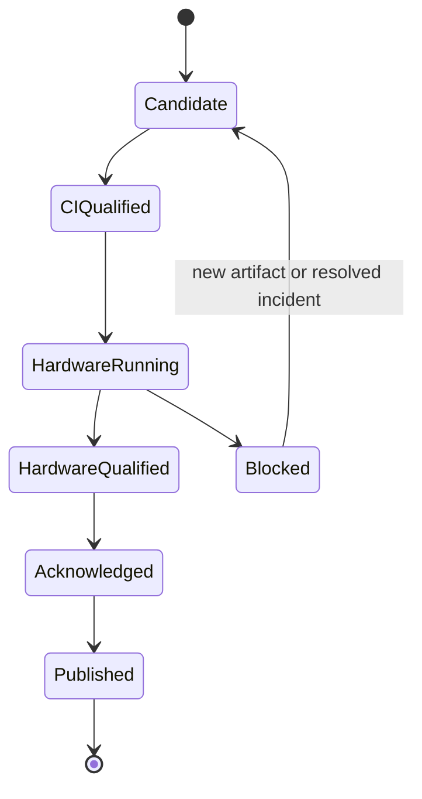

# iPad Release Validation - Plan

## Goal Capsule

- **Objective:** The iPad port ships only when repeatable CI and physical-device evidence prove end-to-end parity, recovery, safety, and macOS compatibility.
- **Means:** Add a layered test matrix, signed hardware-run records, destructive fault injection, release promotion gates, and operator/user documentation (KTD1–KTD5).
- **Authority:** Roadmap R1–R21 and each child plan's Verification Contract are cumulative release requirements.
- **Stop conditions:** No release promotion with a failed/missing hardware gate, unresolved USB restoration incident, unqualified homebrew app, incompatible artifact pair, or macOS regression.

---

## Product Contract

### Summary

Turn the completed implementation into a maintainable release process. Extend CI with iOS cross-build and package audits, run portable fixtures on every change, execute a controlled `iPad14,5` M2 iPad/Switch hardware suite for release candidates, and publish the results and recovery documentation needed to support the port.

### Problem Frame

Most repository tests are strong but Mac-bound: Swift fixtures compile for macOS, native helpers link IOKit/AppKit, and GitHub Actions has no attached jailbroken iPad or Switch. Private USB behavior, Dopamine process handling, and exploit timing cannot be proven in public CI. Release confidence therefore needs a clear split between deterministic CI gates and signed, reproducible hardware gates—not informal "tested on my device" claims.

### Requirements

**Continuous integration**

- R1. Every change must run existing macOS build, fixtures, GUI self-test, archive, and release audit unchanged or with justified platform-neutral refactors.
- R2. CI must cross-build every iOS target and runtime, run host-side unit/fixture tests, and audit `.tipa`/`.deb` contents without target hardware.
- R3. Shared protocol, state, script, manifest, runtime, and package fixtures must run on pull requests with deterministic inputs.

**Hardware qualification**

- R4. A release candidate must be tested on the identified `iPad14,5` / `J620AP` / `T8112` iPadOS 17.0/Dopamine/TrollStore tuple and supported Switch/SmileBASIC tuple.
- R5. Hardware records must include artifact digests, capability record digest, test-case IDs, timestamps, redacted logs, metrics, and pass/fail reasons.
- R6. USB qualification must cover 30 normal cycles and every planned crash/disconnect/restart restoration case with no unresolved failure.
- R7. Network qualification must retain the hardware plan's paired baseline and minimum 20-attempt success evidence.
- R8. End-to-end qualification must cover first-time setup, full/demo where supported, all host profiles/modes, live keyboard, attachment/dump, every homebrew option, updates, recovery, and uninstall.

**Operational quality**

- R9. Fault injection must cover cable/power, Wi-Fi, port conflict, app death, daemon death, worker death, userspace restart, stale state, storage pressure, corrupted runtime, and interrupted update.
- R10. Logs/support bundles must be bounded and redact device identifiers, secrets, Stremio credentials/tokens, user content, and private network details.
- R11. Release documentation must cover prerequisites, install, network, first-time setup, normal/developer workflows, each homebrew app, updates, recovery, diagnostics, re-jailbreak, uninstall, limitations, and provenance.
- R12. Release promotion must be automated from machine-readable results and require an explicit maintainer acknowledgement for the physical hardware record.
- R13. Security qualification must prove same-UID app impersonation fails, ordinary children remain unprivileged, high-level capability handles cannot be replayed/crossed between sessions, and durable records contain no transient secrets or user content.

### Acceptance Examples

- AE1. **Covers R1–R3.** Given a pull request changing shared orchestration, when CI runs, then Mac regression, iOS cross-build, service fixtures, and package audits all gate merge.
- AE2. **Covers R4–R8.** Given a release candidate, when the hardware suite runs, then its signed record binds the exact artifacts/device tuples and contains every required case.
- AE3. **Covers R6, R9.** Given an active USB session, when each process and connection fault is injected, then restoration is verified or the release is blocked with a retained incident.
- AE4. **Covers R8.** Given a clean install, when a tester follows the release checklist, then the complete Mac-free workflow and all homebrew apps finish and clean up.
- AE5. **Covers R10.** Given a hardware failure and exported support bundle, when the redaction audit runs, then it contains enough state to diagnose the case and no protected fields.

### Scope Boundaries

- Public CI is not expected to emulate private iPad USB behavior; it validates build/package/contracts, while physical qualification owns device claims.
- A permanent remote device farm is deferred; the first release uses a documented local hardware runner and signed result import.
- Broad compatibility claims beyond the `iPad14,5` / `J620AP` / `T8112` iPadOS 17.0 target are excluded until equivalent records exist.
- Exploit success is measured and reported, not promised as 100 percent when the upstream workflow is probabilistic.

---

## Planning Contract

### Key Technical Decisions

- KTD1. **Use a three-tier validation pyramid.** Tier 1 is fast portable fixtures, Tier 2 is clean cross-build/package audit, and Tier 3 is physical iPad/Switch acceptance.
- KTD2. **Make hardware results machine-readable and signed.** A schema and importer enforce artifact/test completeness; the repository stores redacted summaries and digests, not raw private logs.
- KTD3. **Gate release, not ordinary PRs, on hardware.** PRs cannot falsely pass device behavior, and contributors are not blocked on inaccessible equipment.
- KTD4. **Treat USB restoration incidents as release blockers.** No statistical waiver or manual-success note can override an unresolved restoration failure.
- KTD5. **Run macOS and iPad release audits together.** Shared changes cannot ship by passing only the new platform.

### High-Level Technical Design

### Sources and Research

- Existing CI/test baseline: `.github/workflows/build.yml`, `scripts/check.sh`, `scripts/test-*.cjs`, `scripts/test-*.swift`, `scripts/test-*.sh`, `scripts/audit-release.py`, and `README.md`.
- Child verification contracts: the numbered sibling plans `00-roadmap.md` through `06-release-validation.md` in `docs/plans/ipad-port/`.

---

## Implementation Units

### U1. Classify and preserve the existing Mac suite

- **Goal:** Establish regression ownership before adding iOS jobs.
- **Requirements:** R1, R3
- **Dependencies:** None
- **Files:** `.github/workflows/build.yml`, `scripts/check.sh`, `scripts/build-gui.sh`, `scripts/audit-release.py`, `docs/testing.md`, `scripts/test-suite-manifest.json`, `scripts/test-test-suite-manifest.cjs`
- **Approach:** Inventory every existing check by component, platform, duration, and artifact; preserve commands; split jobs only to improve diagnostics/parallelism without reducing coverage.
- **Test scenarios:**
  - Detect when a known test disappears from the workflow or suite manifest.
  - Prove a failure in native, Node, Swift, runtime, homebrew, Stremio, updater, or release audit maps to a visible CI job.
  - Verify Mac and iOS source archives include the corresponding shared/platform sources, plans, docs, locks, and notices from their explicit whitelists.
- **Verification:** The current clean commit passes the reorganized suite with the same or stronger coverage.

### U2. Add portable and iOS cross-build CI

- **Goal:** Gate every change on iOS compilation, shared behavior, and artifact structure.
- **Requirements:** R2, R3
- **Dependencies:** iOS targets and build scripts exist
- **Files:** `.github/workflows/ios-build.yml`, `.github/workflows/build.yml`, `scripts/test-ios-*.cjs`, `ios/tests/`, `scripts/audit-ios-release.py`
- **Approach:** Cache pinned source builds safely, cross-build all iOS binaries/runtimes, compile shared Swift tests for simulator/host where possible, run protocol/script fixtures, and audit unsigned test packages plus signed release fixtures.
- **Test scenarios:**
  - Covers AE1. Change a shared fixture and prove both platform jobs consume it.
  - Fail on wrong target triple, deployment version, architecture, load command, entitlement file, rootless path, or manifest digest.
  - Fail when an AppKit source enters the iOS source set, a UIKit source enters the Mac source set, or ordinary runtime children retain root/groups/privileged descriptors.
  - Rebuild from an empty cache and verify lock-based inputs.
- **Verification:** PR branch protection can require Mac, portable, iOS build, and package-audit checks.

### U3. Define hardware-run schema and runner

- **Goal:** Make physical evidence reproducible, complete, and privacy-safe.
- **Requirements:** R4, R5, R10, R12 and Roadmap R21
- **Dependencies:** Hardware capability and release manifest schemas
- **Files:** `scripts/ipad-hardware/release-run.schema.json`, `scripts/ipad-hardware/run-release-suite.cjs`, `scripts/ipad-hardware/import-release-run.cjs`, `scripts/test-ipad-release-run.cjs`, `docs/ipad/hardware-runner.md`
- **Approach:** Bind test definitions to artifact/capability digests and the hardware plan's enrolled report-signing public-key fingerprint, collect structured results/metrics/log references, redact, sign locally with the same canonical record contract, verify on import, and generate a markdown summary.
- **Test scenarios:**
  - Reject missing cases, changed artifact digest, unknown test ID, impossible timestamps, invalid signature, and unredacted protected fields.
  - Reject a validly shaped record signed by an unenrolled or substituted key and a capability record whose signature no longer matches canonical bytes.
  - Resume an interrupted run without reusing a result from a different artifact or device tuple.
  - Covers AE5. Produce a useful redacted failure bundle from synthetic sensitive logs.
- **Verification:** A dry-run fixture imports deterministically and cannot be edited without invalidating its signature.

### U4. Automate USB/network fault qualification

- **Goal:** Convert the hardware gates and destructive cases into a repeatable release suite.
- **Requirements:** R6, R7, R9
- **Dependencies:** U3 and hardware plan complete
- **Files:** `scripts/ipad-hardware/test-usb-release.cjs`, `scripts/ipad-hardware/test-network-release.cjs`, `docs/ipad/usb-recovery.md`, `scripts/test-ipad-fault-runner.cjs`
- **Approach:** Prompt/coordinate safe physical actions, capture state before/after, enforce cycle/attempt counts, stop immediately on restore mismatch, and emit incident bundles.
- **Test scenarios:**
  - Covers AE3. Inject app/worker/daemon death at each USB state, cable removal, userspace restart, and timeout.
  - Kill and restart the separately supervised watchdog/controller broker during mutation and verify its journal/lease recovery without a second writer.
  - Compare wired baseline and selected topology while preventing mixed conditions.
  - Abort the suite on first unresolved restoration failure and forbid promotion override.
- **Verification:** One complete release candidate passes the required cycle/attempt matrix and produces a valid record.

### U5. Automate end-to-end workflow and parity qualification

- **Goal:** Prove the whole product from clean install through cleanup.
- **Requirements:** R8, R9 and Roadmap R21
- **Dependencies:** U3, all feature plans complete
- **Files:** `scripts/ipad-hardware/test-e2e-release.cjs`, `docs/ipad/release-checklist.md`, `docs/ipad/homebrew-matrix.md`, `scripts/test-ipad-e2e-runner.cjs`
- **Approach:** Encode guided cases for install/preflight, full/demo setup, standard/developer modes, keyboard, attach/dump, each homebrew app, Stremio, update/rollback, re-jailbreak, and uninstall.
- **Test scenarios:**
  - Covers AE4. Complete the golden Mac-free full-version workflow and repeat the edition-specific setup path for demo.
  - Exercise every host profile and clearly skip unsupported app/edition combinations only when the parity manifest declares them.
  - Inject port conflict, storage pressure, runtime corruption, Wi-Fi loss, and interrupted update with expected recovery.
  - Crash the root service during each long-running family and verify fail-closed cleanup; allow reconnection only through the existing live attachment proof.
  - Run same-UID impostor, copied nonce, PID-reuse, capability replay/cross-session, and durable-secret canary cases from R13.
- **Verification:** The generated parity matrix has no missing required case and all cleanup states are proven.

### U6. Add release promotion gates

- **Goal:** Prevent publication unless CI, artifacts, hardware evidence, and acknowledgement agree.
- **Requirements:** R5, R12
- **Dependencies:** U1–U5
- **Files:** `.github/workflows/release.yml`, `scripts/verify-release-gates.py`, `scripts/test-release-gates.py`, `docs/ipad/releasing.md`
- **Approach:** Verify candidate digests across CI and imported hardware record, require all cases, reject stale results, capture maintainer acknowledgement, then publish artifacts/checksums/summary.
- **Test scenarios:**
  - Reject missing Mac gate, missing iOS audit, stale/different hardware artifact, failed test, unsigned record, and missing acknowledgement.
  - Publish a fixture candidate only when every gate is present and consistent.
- **Verification:** No manual upload path in the documented release flow bypasses the verifier.

### U7. Complete user and operator documentation

- **Goal:** Make the port operable without session knowledge or a shell.
- **Requirements:** R10, R11
- **Dependencies:** U1–U6
- **Files:** `README.md`, `docs/ipad/index.md`, `docs/ipad/installing.md`, `docs/ipad/networking.md`, `docs/ipad/first-time-setup.md`, `docs/ipad/homebrew.md`, `docs/ipad/troubleshooting.md`, `docs/ipad/releasing.md`
- **Approach:** Link one iPad entry point from README, document exact supported tuple and limitations, use diagnostic IDs, and align recovery steps with tested cases rather than ad hoc commands.
- **Test scenarios:**
  - Validate internal links, referenced files/artifacts, diagnostic IDs, versions, ports, and checksums.
  - Have a second tester follow install, first run, one failure recovery, update, and uninstall without private notes.
- **Verification:** Documentation review finds no missing roadmap workflow or unsupported compatibility claim.

---

## Verification Contract

| Tier | Required signal |
|---|---|
| Tier 1 portable | All shared Swift/Node/native fixtures, schemas, state reducers, protocol and security tests pass |
| Tier 2 build/package | Existing Mac build/release audit plus every iOS cross-build, runtime lock, entitlement, `.tipa`, and `.deb` audit pass |
| Tier 3 hardware | Exact target tuple passes USB cycles/faults, network attempts, complete E2E/parity/update/uninstall matrix |
| Privacy | Support bundles and imported records pass protected-field redaction tests |
| Promotion | Candidate artifact digests match all CI/hardware evidence and maintainer acknowledgement is recorded |

---

## Definition of Done

- PR gates preserve all current Mac checks and add deterministic iOS/shared coverage.
- A signed target-device record passes R4–R9 for the exact published artifacts.
- No unresolved USB restoration incident exists.
- Every bundled homebrew app and workflow has a required passing case or an explicitly supported-edition exclusion.
- Release promotion cannot proceed with missing, stale, mismatched, or failed evidence.
- Documentation covers the full lifecycle and has been followed by a second tester.
- Published summaries contain no secrets/private identifiers and make the exact support tuple clear.
- Temporary device logs, test accounts, user content, unsigned records, and failed experimental artifacts are removed from release inputs.
